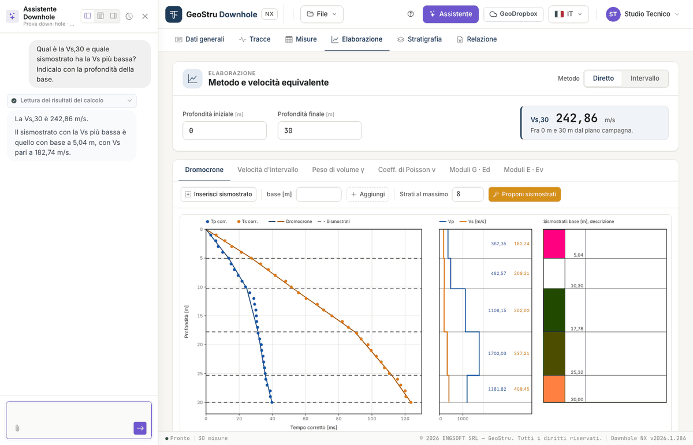
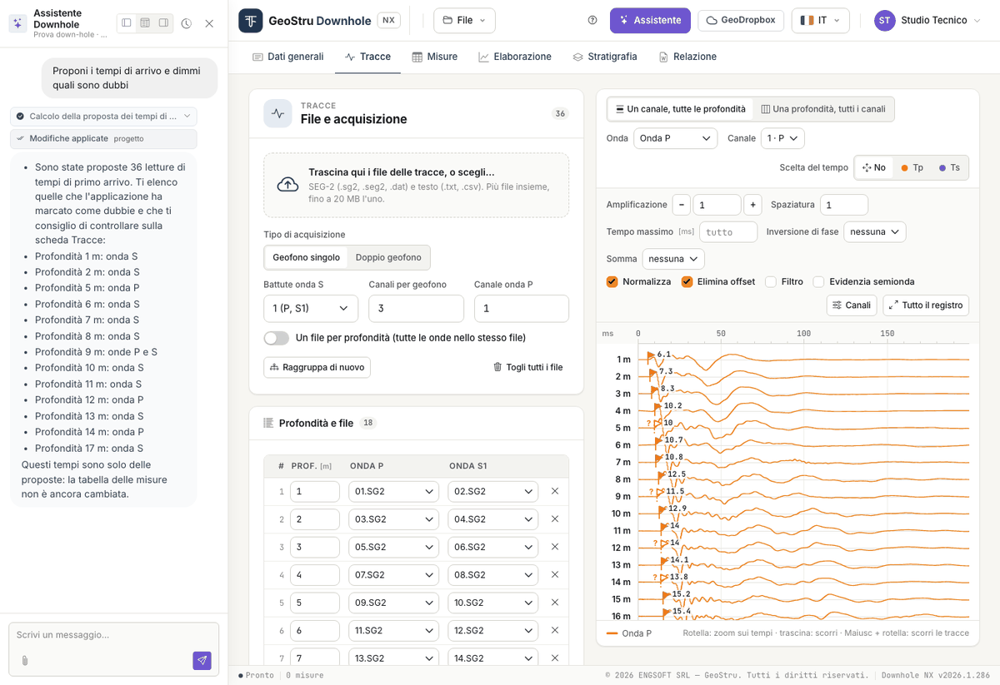

# AI assistant

The **Assistant** button, in the top bar, opens a chat next to the project. The assistant
reads the project and the results of the calculation and can write to the project for you:
you ask, it acts, the page updates.

Each message you send uses NX credits, charged only if the answer arrives. See
[Credits](relazione.md#credits).

Above each answer, a label says what the assistant did on the project: for instance
“Reading the calculation results” or “Calculating the arrival-time proposal”.

## What it can do

**Read and explain**

- it reads general data, geometry, measurements, seismic layers and stratigraphy;
- it reads the **results of the calculation** as they are on screen and explains them:
  velocities, moduli, V~s,eq~, the meaning of a warning or of a “--”;
- it checks the measurements: missing times, anomalous intervals, what is missing before
  generating the report;
- it explains the methods, the formulas and the limits of the test.

**Write to the project**

- it fills in the **general data**;
- it sets the **geometry** (source offset, first measurement, spacing);
- it enters the **measurement table** you give it, typed in the message or in an attached
  file;
- it sets the **options**: method, automatic or assigned unit weight, depths for V~s,eq~;
- it **adds, moves and describes the seismic layers** of both methods;
- it fills in the **stratigraphy**.

**Have times and seismic layers proposed**

- it has the app calculate the **arrival-time proposal** on the uploaded traces, and lists
  the doubtful ones for you;
- it **sends** the picked times **to the measurements**;
- it has the app calculate the **seismic-layer proposal**.

These are the same proposals as the [Propose the times](tracce.md#proposing-the-times) and
[Propose seismic layers](elaborazione.md#proposing-the-seismic-layers) buttons: see
[Automatic proposals](#automatic-proposals) below.

When it writes, the numbers it reports are read back from the calculation: it does not redo
them in its head.

## What it does not do

- **It deletes nothing**: measurements, seismic layers and layers are removed by you, in
  their tabs. If needed, it tells you what to remove and where.
- **It does not replace measurements or seismic layers you already have** unless you ask
  for it explicitly.
- **It does not upload traces and does not generate the report or the DXF**: those are your
  actions.
- **It does not make up measurements**: only the values you give it, or that it reads from
  a document of yours, go into the table. If they are missing, it asks.
- **It does not assign the subsoil category**: it can explain the categories of the Italian
  code and in which range a V~s,eq~ falls, but the classification is left to the designer.

## How to use it

Type your request in the box at the bottom and send it. When you first open the panel you
also find the **Quick actions**, ready-made requests you send with one click.

Requests that work well are concrete and say which method or tab you mean:

- “Explain the results: velocities, moduli and Vs,eq”
- “Set the source offset to 2 m and compute Vs,eq between 1.5 and 30 m”
- “Enter these measurements” followed by the depth, T~p~, T~s~ table copied from the
  spreadsheet
- “Add a seismic layer with its base at 8 m to the direct method and describe it as silty
  sand”
- “Check the measurements: any missing times or anomalous intervals?”
- “What is missing before generating the report?”

If the times are in seconds or the unit weight is in other units, say so: the assistant
converts and states the conversion. If the request is ambiguous, it asks before writing.

### Automatic proposals

With the traces uploaded, and a depth given to the rows, you can ask:

- “Propose the arrival times and tell me which ones are doubtful”
- “Send the times to the measurements”
- “Propose the direct-method seismic layers, four layers at most”
- “Process the survey: propose the times, send them to the measurements and propose the
  seismic layers”

How it behaves:

- it presents times and seismic layers **as proposals to be checked**, lists the doubtful
  times and reports the warnings of the calculation;
- it goes **one step at a time**: after the times it may ask you to confirm before sending
  them to the measurements. That is the moment to check them on the traces;
- if the measurements already contain times, it **does not replace them** without an
  explicit request (“replace the measurements with the proposed times”);
- if the method already has seismic layers, it **does not replace them** without an
  explicit request (“propose the seismic layers again”, “replace the layers”);
- if you ask, it can suggest an **indicative lithological description** from the
  velocities: it states it as a hypothesis, to be compared with the borehole log.

Give it the **source offset** as well: without it, the calculation uses the one written in
the Measurements tab.

### Attaching a document

With the **paperclip** you attach a file: text, CSV or TSV, spreadsheet (`.xlsx`, `.xls`)
or PDF. It is useful, for instance, to have the measurement table filled in from a test
report. Always check what was written against the original.

### While it works

While the assistant writes to the project the page is locked, and a strip says so: *“The
assistant is working on the project: the page becomes editable again as soon as it has
finished”*. Your own changes at that moment would be rejected, with no harm done.

Before sending the message the app saves the tab you have on screen; when the work is done
the page reloads by itself with the updated project.

In one answer the assistant can carry out a limited number of operations: if it reaches the
limit it says so, what it did is in the project, and you write to it to continue.

### The panel

At the top of the panel: three buttons to dock it left, bottom or right, the history button
to resume or reset the conversation, and the close button.

## It is an artificial intelligence system

!!! warning "Check what it writes"
    The assistant's answers are generated by an artificial intelligence system and may
    contain errors. What it writes to the project is a **proposal**: measurements, seismic
    layers and descriptions must be checked. The processing is yours, and you sign it.

In particular: proposed times must be looked at again on the traces, starting with the
doubtful ones; proposed seismic layers are the subdivision that best follows the times, not
an interpretation; a lithology suggested from velocities alone is a hypothesis; a table read
from a PDF must be compared with the document.

## Support ticket

The **Open a support ticket** quick action opens a support request from the same chat.
While the ticket is open, messages go to support, not to the project assistant, and use no
credits.

A strip at the top of the panel tells you who is answering: an **artificial intelligence
assistant** or, after the handover, a **human operator**. You can ask to talk to an operator
at any time.

---

*Found an error on this page? [Let us know](mailto:info@geostru.ai?subject=Help%20Downhole%20NX) or open a [Pull Request](https://github.com/EngSoft-Geostru/geostru-help-nx/edit/main/downhole/docs/en/assistente.md).*
