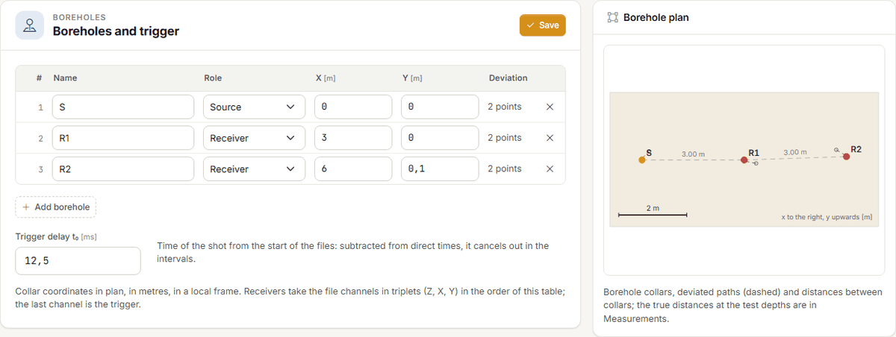
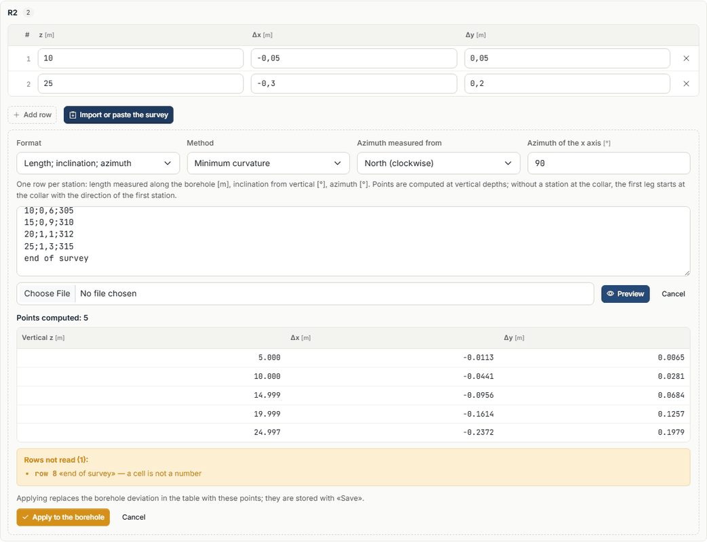
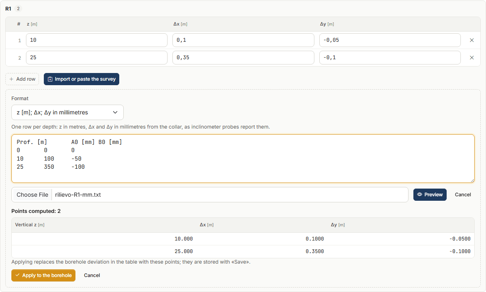
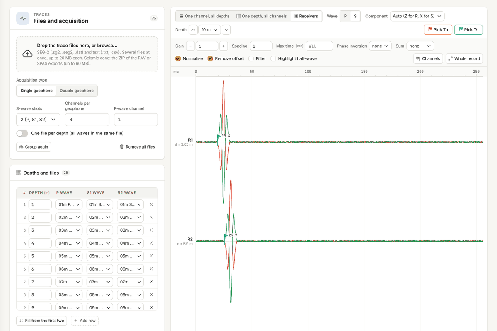
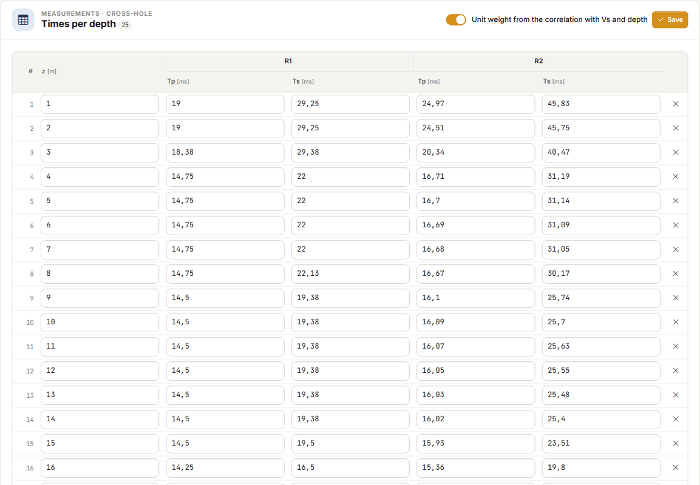
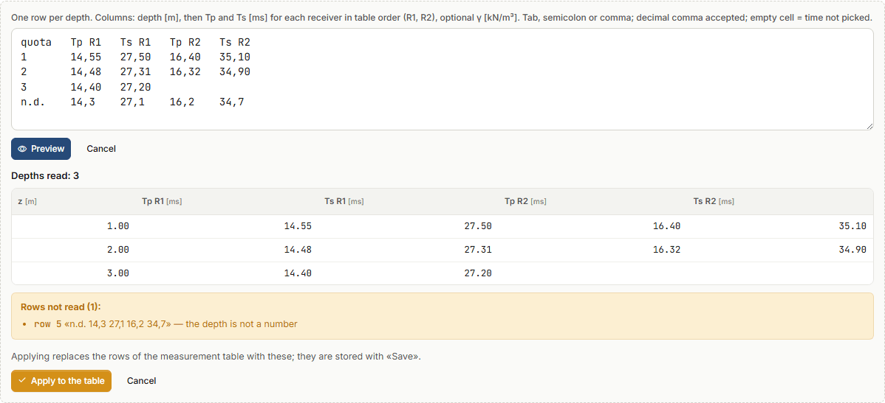
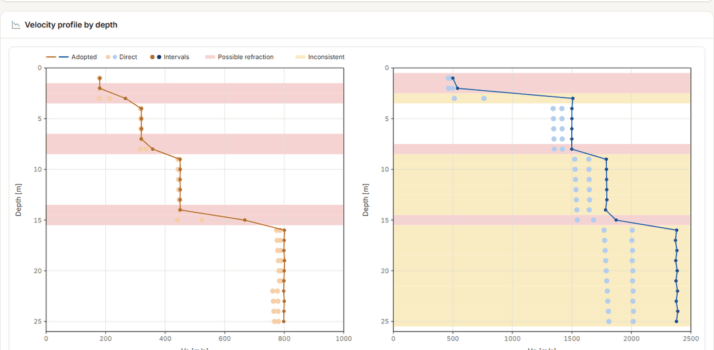
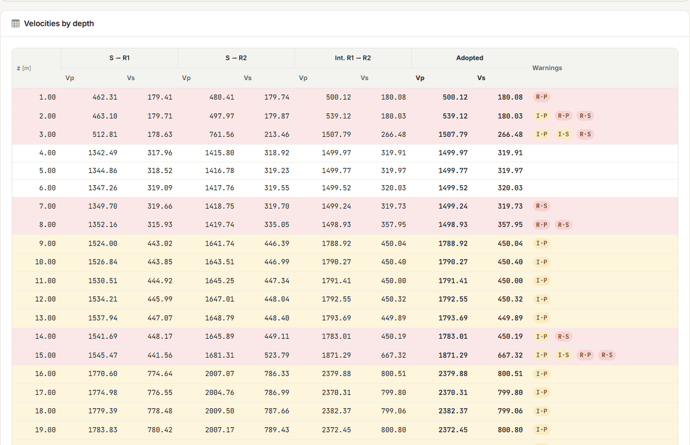

# Cross-hole test

The **cross-hole test** measures the time P and S waves take to travel from a **source**
borehole to one or more **receiver** boreholes, with source and receivers at the **same
depth**. Repeated at successive depths, it gives a velocity profile in which each value
belongs to a horizontal layer crossed by the waves. The technical reference is
**ASTM D4428/D4428M**.

In Downhole NX the cross-hole is a second **test type**: traces, time picking, elastic
parameters, V~s,eq~, stratigraphy, report, DXF, assistant and credits are the same as for the
down-hole test.

## When to use it

- When you need the **horizontal** velocity of the layers at given depths, without the
  oblique path of the down-hole test and without the shallow layers entering the deep
  travel times.
- When layers are thin compared with the depth but **not** thin compared with the borehole
  spacing: with boreholes 3 m apart, a 50 cm layer is skipped by the refracted wave (see
  [Flagged depths](#flagged-depths)).
- With **two receivers** or more: the interval velocity between two receivers removes the
  trigger delay, and it is the one the standard recommends.

## New cross-hole test

**File → New cross-hole test** creates a project with a source borehole S and two receivers
R1 and R2 in line, 3 m apart, vertical. You can also change the **Test type** in the
**General data**: the tabs adapt and the data of the other type stay in the project, ready
if you switch back.

In a cross-hole test the **Boreholes** tab replaces the down-hole geometry; Traces,
Measurements, Processing, Stratigraphy and Report are still there, adapted to the test.

## Boreholes and the deviation survey

In the **Boreholes** tab enter, for each borehole, its **name**, its **role** (one source,
one or more receivers) and the plan coordinates of the **collar**, X and Y in metres in a
local reference. Below the table is the **Trigger delay t~0~**: the instant of the shot
relative to the start of the files. It is subtracted from the times of the direct velocities
and cancels out in the interval velocities.

!!! note "The order of the receivers matters"
    In files with triaxial channels the receivers take channels 1–3, 4–6, … (Z, X, Y) in
    the order of the table; the trigger is the last channel. A receiver you add goes last.

The **Borehole plan**, on the right, is redrawn while you type: collars, deviated paths
(dashed) and distances between the collars.

### Why the survey matters

Boreholes are never perfectly vertical, and velocity is distance divided by time: if the
distance is wrong, the velocity is wrong in the same proportion. A receiver 3 m from the
source that has drifted 60 cm away at 20 m is actually 3.60 m away: with the same 18 ms,
ignoring the deviation gives 167 m/s instead of 200, **17 % less** (case 10 in
[Validation](validazione.md#the-cross-hole-test-cases-1014)). A borehole without a survey is
taken as vertical, and the report says so.

### Importing or pasting the survey

Below the plan, in the **Borehole deviations** card, each borehole has its own table: at
vertical depth z the borehole is offset by Δx, Δy from the collar. Between two points the
offset is interpolated, below the last it stays the last one. You can type the points, or
press **Import or paste the survey**:

1. choose the **Format**:
    - **z; Δx; Δy in metres** — offsets from the collar in metres;
    - **z [m]; Δx; Δy in millimetres** — as inclinometer probes report them;
    - **Length; inclination; azimuth** — one row per station: length measured along the
      borehole [m], inclination from vertical [°], azimuth [°];
2. paste the rows in the box, or choose a `.csv`, `.txt` or `.dat` file (it is read in the
   browser, not uploaded);
3. press **Preview**: you see the computed points and the rows that cannot be read, with
   the reason;
4. **Apply to the borehole** puts the points in the borehole table; they are stored with
   **Save**.

Accepted separators: semicolon, tab, comma or spaces; the decimal comma is fine. A first row
with the column names is skipped, and so is the collar row (0; 0; 0).

With **azimuth and inclination** also choose:

- the **Method**: **Minimum curvature** (between two stations the borehole is a circular
  arc; the usual method) or **Balanced tangential** (half the leg with the direction of the
  upper station, half with that of the lower one);
- what the azimuth is measured from: **North**, clockwise, or the **Site x axis** towards y;
- with north, the **Azimuth of the x axis** of the site: 90° if the x axis points east
  (then y points north).

Points are computed at **vertical depths**. If the survey has no station at the collar, the
first leg starts at the collar with the direction of the first station.

!!! warning "Millimetres read as metres"
    A row whose offset is larger than its depth is not read: it is almost always millimetres
    with the metre format. The same for an inclination over 60° (swapped columns or another
    unit). The preview lists them before they enter the project.

## Traces and times

The **Traces** tab works as in the down-hole test (see
[Traces and time picking](tracce.md)): load the SEG-2 files, one per depth and shot («10m P»,
«10m S1», «10m S2»), and the app groups them by depth. The cross-hole test adds the
**Receivers** view: one depth, one trace per receiver **in order of distance** from the
source, with the true distance written next to it (d = 3.05 m).

It is the only view where a trace belongs to a receiver, so that is where times are picked:
**Pick Tp** and **Pick Ts**, then a click on the trace. **Component** chooses the channel to
look at: automatically Z for P and X for S.

!!! tip "The visual check"
    In order of distance the first arrivals of a depth must lie on a straight line. A
    receiver off the line has a wrong time, or a refracted wave arrives there first.

**Propose the times** proposes the first arrivals for every depth and every receiver. Receivers
beyond the nearest one are proposed by **cross-correlation between receivers**: the time of
the nearest one plus the delay that makes the two waveforms match. That is how the time
difference, and so the interval velocity, is measured well even when the onset of the wave
is not sharp. Doubtful times are marked «?» and must be checked; a time you picked by hand
is not touched unless you ask to replace it.

!!! note "P waves between close boreholes"
    Between boreholes 3 m apart P waves travel in 1–2 ms. With traces sampled at 8 kHz the
    onset reading can be off by a few tenths of a millisecond, and the direct velocity to the
    first receiver is affected. The standard asks for 20–50 kHz. Cross-hole times are stored
    to 0.01 ms.

## Measurements

The **Measurements** tab has one row per **depth**, with T~p~ and T~s~ for each receiver in
milliseconds **from the start of the files** (the calculation removes the trigger delay)
and, with the unit weight entered by hand, γ. An empty cell is a time not picked. Below, read
only, the **true distances** at the depth and the **direct velocities**.

Times arrive in three ways:

- from the Traces tab with **Bring in the picked times** (the strip at the top offers it when
  there are times to bring, and warns if it would replace times already written);
- typed;
- with **Paste from spreadsheet**: columns **depth, T~p~ R1, T~s~ R1, T~p~ R2, T~s~ R2…** in
  the order of the receivers in the table, optional γ at the end. Tab (Excel, LibreOffice),
  semicolon or comma; decimal comma accepted; empty cell or «-» = not picked. **Preview**
  shows the depths read and the rows discarded with the reason; **Apply to the table**
  replaces the rows of the table. Pasting a block of cells straight into the table opens the
  same preview.

## Processing

For each depth the app computes:

- the **true distance** between source and receiver, from the deviated points of the
  boreholes at that depth;
- the **direct velocity** source → receiver, V = d / (t − t~0~);
- the **interval velocity** between two consecutive receivers in order of distance,
  V = (d~2~ − d~1~) / (t~2~ − t~1~): the trigger delay cancels out. It holds for roughly
  aligned boreholes, as the standard prescribes;
- the **adopted velocity**: the mean of the intervals if there are any, otherwise the
  direct velocity of the nearest receiver;
- the dynamic elastic parameters (γ, ν, G, E~d~, E, E~v~) with the same formulas as the
  down-hole test;
- the **V~s,eq~** between the two chosen depths: each depth represents the layer between the
  midpoints to the neighbouring depths, the first starts at ground level, the last is
  extended to H if the test is shorter, and this is stated.

The **Velocity profile by depth** shows the adopted V~s~ and V~p~ (line), direct and interval
values (dots), and the bands of the flagged depths.

### Flagged depths

The **Velocities by depth** table lists direct, interval and adopted values, and the
**Warnings** column has the codes:

| Code | Meaning | What to do |
|---|---|---|
| **R·P**, **R·S** | **possible refracted wave**: with the profile obtained, the wave refracted along a faster nearby layer would reach one of the receivers before the direct wave | the measured velocity may be that of the fast layer, not of the depth: look at the traces in the Receivers view (versus distance the refracted wave has the slope of the fast layer), and if so do not use that velocity without confirmation |
| **I·P**, **I·S** | **inconsistent**: the velocities of the pairs at the depth (S → R1, S → R2, R1 → R2) differ by more than 15 % | check the times of the depth and the trigger delay again; often it is the direct velocity to the first receiver, which depends on the onset reading and on t~0~ |

Near a velocity contrast the refraction check **flags one depth too many, never one too
few**: this is intended. Flagged depths stay in the calculation and in the V~s,eq~ (which uses
the adopted velocities of all depths): look at them before signing.

## Report and DXF

The **Report** tab works as in the down-hole test (see
[Report, DXF and credits](relazione.md)). For the cross-hole test the report contains the
theory of the test, the input data (boreholes, deviations, plan, measurements), the
processing by depth (distances, direct and interval velocities, adopted values, flagged
depths with their warnings, profile, parameters, V~s,eq~), the stratigraphy and the
**Calculation code** block. The DXF drawings are **plan**, **profile** and **column**.

Generating the Word file and exporting the DXF cost credits as in the down-hole test;
processing, charts and preview are free.

## Assistant

The [assistant](assistente.md) reads the cross-hole project and results (flagged depths with
the reason) and writes into the project, as in the down-hole test, only what you ask:

- the **boreholes** (name, role, collar coordinates) and the **trigger delay**: boreholes it
  does not mention stay as they are;
- the **deviation** of a borehole as a z, Δx, Δy table in metres; for a survey by azimuth and
  inclination it asks you to import it from the Boreholes tab, which computes it;
- the **times by depth and receiver**: it adds depths and times, deletes nothing, and a value
  already written and different stays until you tell it to replace it;
- the **proposal of the times** on the traces and their transfer to the measurements, with
  the same rules as the buttons.

It deletes nothing: you remove boreholes, depths and times yourself. Each message costs
credits.

## Limits

- **Thin layers** compared with the borehole spacing: the refracted wave skips them, and the
  depth is flagged.
- **Non-aligned boreholes** in the interval method: the difference of the distances is the
  path between the receivers only if they lie on the same ray from the source.
- **Boreholes without a survey**: taken as vertical (case 10 shows how much it matters).
  Below the last survey point the offset stays that of the last point.
- The minimum curvature method is exact on a circular arc; on a nearly vertical borehole
  with a turning azimuth it is off by fractions of a millimetre (case 14).
- **Anisotropy** (horizontal versus vertical V~s~) is not handled.
- Proposed times are proposals: S waves hold even between close boreholes, P waves depend on
  the sampling.
- As in the down-hole test: **dynamic** moduli, at small strains; the subsoil category is up
  to the designer.

---

*Found an error on this page? [Let us know](mailto:info@geostru.ai?subject=Help%20Downhole%20NX) or open a [Pull Request](https://github.com/EngSoft-Geostru/geostru-help-nx/edit/main/downhole/docs/en/crosshole.md).*
