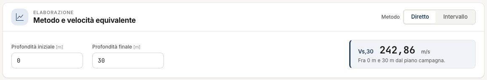
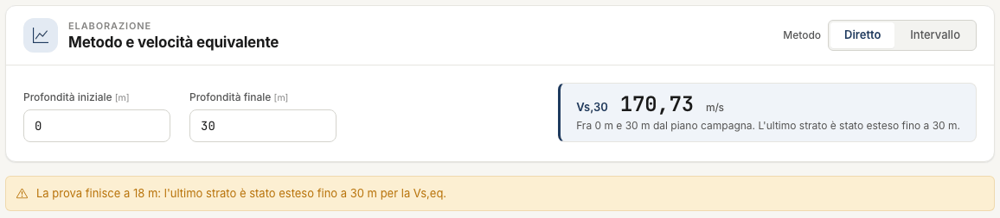
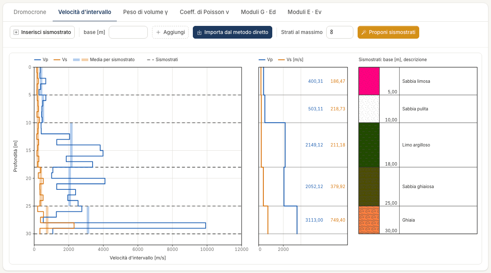
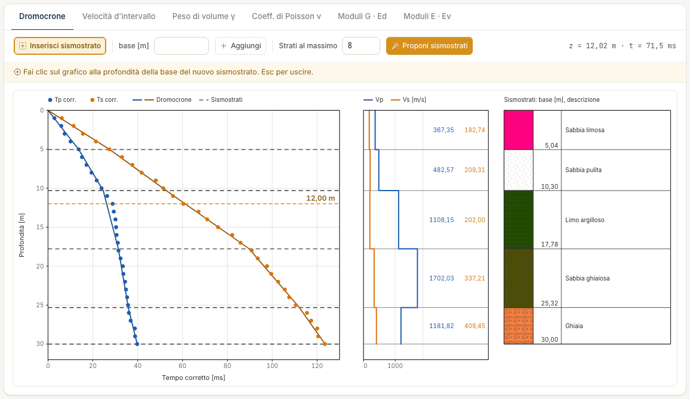
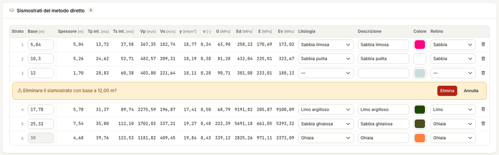
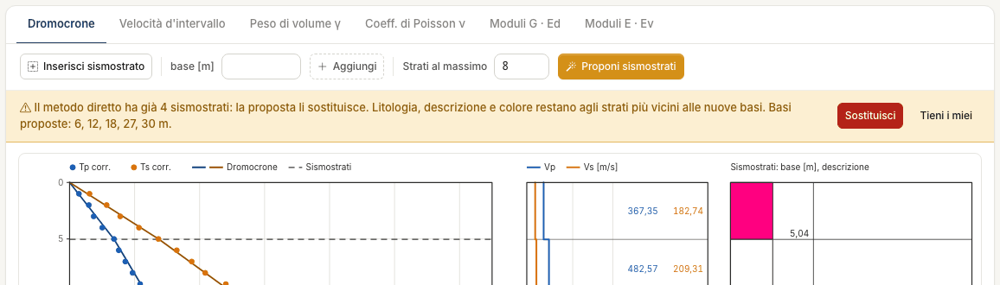
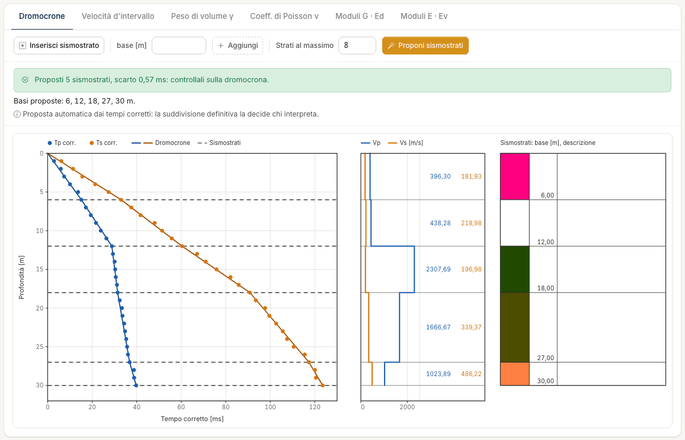
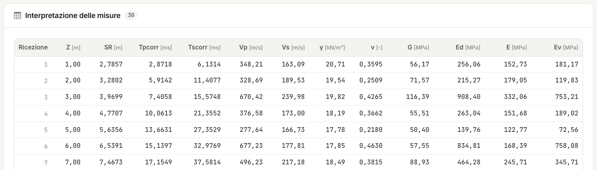

# Processing: direct method and interval method

The **Processing** tab shows the results and is where you define the **seismic layers**.
There is no calculation button: every change to the measurements or to the layers updates
charts and tables at once, at no credit cost.

The tab has four parts, top to bottom: method and equivalent velocity, the charts, the
seismic-layer table, the **Interpretation of the measurements** table.

If the measurements are missing or contain an error, **The measurements come first** takes
the place of the charts, with the error to fix and a link to the [Measurements](misure.md)
tab.

## Choosing the method

At the top right, **Method** has two positions:

- **Direct** — you define the seismic layers on the travel-time curve; each layer has one
  velocity, the slope of the segment between its two bases. It is the more stable method,
  because it averages over several receivers.
- **Interval** — one velocity for each pair of consecutive receivers. It gives metre-by-metre
  detail, but is sensitive even to small errors in the times.

Each method has **its own** seismic layers: those of the direct method and those of the
interval method are two separate lists. Switching method changes the chart on screen and the
seismic-layer table. The report can include both.

## Equivalent velocity V~s,eq~

The first card computes the equivalent shear-wave velocity between two depths:

- **Initial depth** — in the Italian code (NTC) it is the foundation level; 0 = ground
  level;
- **Final depth** — H: the depth of the bedrock, 30 m if it is deeper.

The value updates as soon as you change a field. Below the number, a note always says
between which depths it was computed.

Three things to know:

- **The label.** With a final depth of 30 m or more the label is **Vs,30**; below 30 m it is
  **Vs,eq (H = … m)**. The value is in any case the one between the two depths written in
  the note: for the code V~s,30~ leave 0 and 30.
- **A test shorter than H.** If the measurements stop before the final depth, the last layer
  is **extended** to H. The note and a yellow warning say so.
- **Seismic layers do not change it.** In the direct method the sum of the travel times
  through the layers is the corrected S-wave time at depth H, wherever the bases are. In the
  interval method it is computed on the measurement intervals. Both methods give the same
  number, apart from rounding. The exception is a test shorter than H: there the velocity of
  the last layer matters, and it depends on the base just above it.

!!! note "The subsoil category is up to you"
    Downhole NX does not assign the subsoil category. That takes the depth of the bedrock,
    which the test alone does not always reach.

## The six charts

The tabs above the chart open six drawings.

| Chart | What it shows | Method |
|---|---|---|
| **Travel-time curves** | Corrected P and S times against depth, with the lines of the seismic layers | direct |
| **Interval velocities** | V~p~ and V~s~ per interval, with the mean per seismic layer | interval |
| **Unit weight γ** | γ per interval | interval |
| **Poisson's ratio ν** | ν per interval | interval |
| **Moduli G · Ed** | G and E~d~ per interval | interval |
| **Moduli E · Ev** | E and E~v~ per interval | interval |

Next to each chart are the **V~p~ and V~s~ profile per seismic layer**, with the values
written out, and the **seismic-layer column** with base, colour, pattern and description.

As you move the pointer over the chart, the depth and the value at that point are shown at
the top right (for instance “z = 12.02 m · t = 71.5 ms”).

Seismic layers are edited on the charts **of the active method**. If you open a chart of the
other method you see it read-only, with the **Switch to the direct method** or **Switch to
the interval method** button.

## Inserting and editing seismic layers

A seismic layer is defined by its **base**, the depth at which it ends. On the travel-time
curve the base goes where **the slope changes**: the points above and below line up on two
different straight lines.

### Inserting with a click

1. Press **Insert seismic layer**: the button stays on and a yellow line reminds you what
   to do.
2. Move the pointer over the chart: a dashed orange line follows it, with its depth.
3. Click at the depth of the base. The layer is created: a line on the chart and a row in
   the table.
4. You can keep clicking for more layers. Leave with **Esc** or by pressing the button
   again: while the mode is on, lines cannot be dragged.

### Inserting by typing the base

Type the depth in the **base [m]** field next to the button and press **Add**. This is the
way to get an exact base.

### Moving

- **Drag** the dashed line of the layer on the chart. The calculation updates when you
  release it.
- Or type the new value in the **Base** field of the layer's row.

### Deleting

Press the **bin** at the end of the row. The confirmation appears below the row: **Delete**
or **Cancel**. The two neighbouring layers merge into one.

### Where a base can be

- Between ground level and the last measurement, **rounded to the decimetre**.
- In the **interval method** the base always snaps to the **nearest measurement depth**: the
  layer is an average of whole intervals.

### The bottom layer

The direct-method profile **always ends at the last measurement**. That is why there is
always at least one layer: with no other bases it is the mean velocity of the whole profile,
and inserting a seismic layer means splitting it.

The bottom layer follows the last measurement: its base is greyed out, it cannot be dragged
and it has no bin. If you lengthen or shorten the measurement table, it moves by itself.

In the interval method, instead, you may have no seismic layers at all: the values per
interval are there anyway. The bottom layer appears when you define the first base.

### Bringing the direct-method layers into the interval method

In the interval method, **Import from the direct method** copies the bases of the direct
method, with lithology, description, colour and pattern. The bases are snapped to the
measurement depths: 10.30 m becomes 10 m, 17.78 m becomes 18 m.

### Describing a layer

In the row of each layer you can choose **Lithology**, **Description**, **Colour** and
**Pattern**. Choosing the lithology pre-fills description and pattern. These are descriptive
data: they appear in the column next to the charts, in the report and, if you import them,
in the [Stratigraphy](stratigrafia.md). No calculation reads them.

## Proposing the seismic layers

**Propose seismic layers**, in the bar above the chart, calculates from the corrected times
where the slope of the travel-time curve changes, and proposes the layer bases. It is free.

### What it looks for

Among all possible subdivisions, the app picks the one whose **broken line** — the line
joining the corrected times at the layer bases — passes closest to the corrected times of P
waves and S waves. More layers always follow the points better: that is why the number of
layers is chosen with a criterion that charges for each extra layer, and a new layer comes
in only if it improves the fit by more than the reading uncertainty of the times is worth.

Two rules bound the search:

- bases lie **on measurement depths**: between two receivers the times do not tell where
  the slope changes;
- each layer contains **at least two** measurement **intervals**.

**Maximum layers**, next to the button, limits the number of layers (2 to 12; 8 to start
with). Lower it if you want a simpler subdivision: on the example, with 3 the proposal is
12 – 18 – 30 m.

### Applying the proposal

If the active method has no seismic layers, the proposal is applied at once.

If it already has some, a strip shows the **proposed bases** and asks before touching them:

- **Replace** — your layers are replaced. Lithology, description and colour stay with the
  layers nearest to the new bases;
- **Keep mine** — nothing changes.

Once applied, a green strip reports the outcome: *“5 seismic layers proposed, misfit 0.57 ms:
check them on the travel-time curve”*, followed by the bases. The **misfit** says how far the
broken line is from the corrected times: the smaller it is, the better it follows them.

If the travel-time curve shows no appreciable change of slope, the proposal is a single
layer for the whole profile, and the app says so.

### What it is, and what it is not

It is the subdivision that **best follows the times**, not a geological interpretation. It
knows nothing of the borehole log, of the water table, or of what you expect at the site.

On the example it proposes 6 – 12 – 18 – 27 – 30 m; the person who interpreted the test had
chosen 5.04 – 10.30 – 17.78 – 25.32 – 30 m. The differences are within two receivers, and
V~s,eq~ is the same.

Use it as a starting point: then **drag** the lines or **retype** the bases, as for layers
inserted by hand. In the direct method a base can also lie between two receivers.

The proposal is the same in the direct method and in the interval method; it is applied to
the active method. At least two receivers are needed, with the time of at least one wave at
every depth.

## The tables

### Seismic layers

One row per layer. In the **direct method**:

| Column | Meaning |
|---|---|
| **Base**, **Thickness** [m] | Depth of the base and thickness of the layer |
| **Tp int.**, **Ts int.** [ms] | Corrected times at the base of the layer, interpolated between the two nearest receivers |
| **Vp**, **Vs** [m/s] | Velocities of the layer |
| **γ** [kN/m³] | Unit weight, estimated or assigned |
| **ν** | Poisson's ratio |
| **G**, **Ed**, **E**, **Ev** [MPa] | Shear, constrained, Young's and bulk modulus |

In the **interval method** the same quantities are the **averages** of the values of the
intervals the layer contains.

### Interpretation of the measurements

One row per receiver: **Z**, the source–receiver distance **SR** and the corrected times
**Tpcorr** and **Tscorr**. In the interval method V~p~, V~s~, γ, ν, G, E~d~, E, E~v~ are
added, for the interval that ends at that receiver; the first row is the interval between
ground level and the first receiver.

**“--” means “cannot be computed”**, not zero. It happens when a time is missing, when the
corrected time does not increase, or when V~p~ and V~s~ do not give a Poisson's ratio
between 0 and 0.5.

## Errors and warnings

**Errors** (red strip) stop the calculation: fix them in the Measurements tab.

| Error | What to do |
|---|---|
| *No measurements: fill in the travel-time table* | Enter the measurements. |
| *Depths must be positive and strictly increasing: check row n* | Two equal depths, out of order or non-positive. |
| *Times must be greater than or equal to zero: check row n* | A negative time. Zero is allowed and means “not measured”. |
| *The source offset must be a number greater than or equal to zero* | Fix the geometry. |

**Warnings** (yellow strip) stop nothing: they tell you how to read a result.

| Warning | What it means |
|---|---|
| *Decreasing corrected time between two consecutive receivers: the interval-method row stays “--” at receivers …* | At that receiver the corrected time is lower than or equal to the previous one: the interval has no velocity. Nearly always a misread time: check it on the traces. |
| *Seismic layer n has a decreasing intercept: its values copy those of the previous layer (\*)* | Between the two bases the corrected time does not increase: the layer has no velocity of its own. It is marked with an asterisk. Move the base or check the times. |
| *The test ends at … m: the last layer was extended to … m for Vs,eq* | The final depth is beyond the last measurement. V~s,eq~ assumes the velocity of the last layer carries on down to H. |
| *Vs,eq cannot be computed: Vs is missing in at least one stretch between the chosen depths* | A stretch has no V~s~ (missing or non-increasing times). |
| *The base of a seismic layer (… m) was beyond the last measurement and was brought back to … m* | It happens when opening a desktop project, or after shortening the measurements. |
| *The final depth for Vs,eq must be greater than the initial one* | Fix the two fields of the first card. |

Two strips are about the project, not the calculation:

- *The project was modified in the meantime…* — the assistant or another browser tab
  changed the project: reload the page to see it as it is now.
- *The assistant is working on the project…* — wait until it has finished: nothing was
  modified.

---

*Found an error on this page? [Let us know](mailto:info@geostru.ai?subject=Help%20Downhole%20NX) or open a [Pull Request](https://github.com/EngSoft-Geostru/geostru-help-nx/edit/main/downhole/docs/en/elaborazione.md).*
