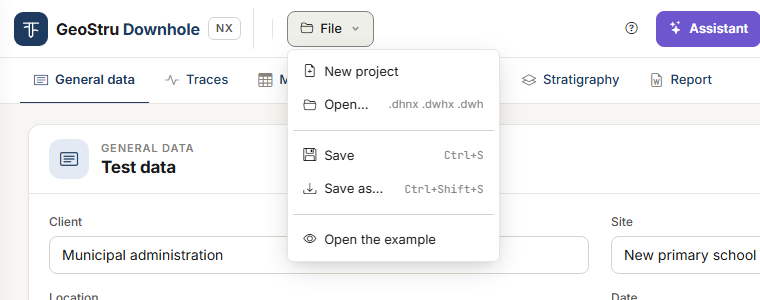
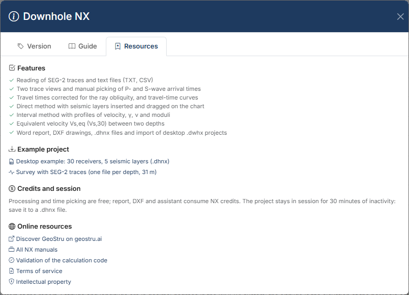

# Files, desktop projects and GeoDropbox

While you work, the project lives **on the server, in your session**. The copy that stays
with you is the **`.dhnx`** file: save it before you leave.

## The File menu

| Item | What it does |
|---|---|
| **New project** | Empties the project in the session. |
| **Open…** | Opens a `.dhnx` file, or a `.dwhx` / `.dwh` file of the desktop program. |
| **Save** (Ctrl+S) | Overwrites the file opened or saved last; if there is none, works like **Save as…**. |
| **Save as…** (Ctrl+Shift+S) | Saves the project to a new `.dhnx` file. |
| **Open the example** | Loads the desktop example project: 30 receivers, 5 seismic layers. |

New, Open and the example **replace** the project in the session. If there is anything to
lose, a strip below the bar asks for confirmation: what you have not saved to a file will be
lost.

### Save and Save as

In browsers that let a page write to a file chosen by the user (Chrome, Edge):

- **Save as…** opens the system dialog with the name proposed by the app (the site, or the
  client) and writes the file where you choose;
- from then on the file name shows in the top bar, next to the **File** menu: it is the file
  **Save** writes to;
- **Save** overwrites it without asking anything. The first time after a reload the browser
  may ask for permission to edit the file;
- **Open…** on a `.dhnx` does the same: the opened file becomes the one of **Save**.

After saving, a strip confirms *“Project saved to …”*.

In other browsers **Save** and **Save as…** download the file to the downloads folder.

The file stays tied to the **project** you opened: if you create a new project, open the
example or the session expires, the name disappears from the bar and **Save** asks again
where to save. That way an empty project never overwrites the good file.

A desktop `.dwhx` / `.dwh` opened here does not become the file of **Save**: the first save
asks for the name of the new `.dhnx`.

## The .dhnx file

The `.dhnx` file holds the whole project:

- general data, geometry and measurement table;
- options (method, unit weight, depths for V~s,eq~);
- seismic layers of both methods and stratigraphy;
- the rows of the Traces tab, the **picked times** and the view options;
- the sections chosen for the report;
- the **traces**, within the limit described below.

Results are not in the file: they are recomputed on opening, always with the current
version of the program.

Before saving, the app stores the tab you have on screen: the file includes your latest
change.

### Traces in the file

Traces travel inside the `.dhnx` as long as, all together, they do not exceed **30 MB**.

Beyond that limit the file carries only the **references** to the traces: rows, depths and
picked times are there, the recordings are not. The app tells you twice: in the Traces tab,
as soon as the survey goes over the limit, and when you save.

When you reopen such a file, the Traces tab lists the files to upload again. **Drop the
same files once more**: they are reattached to their rows, with no new rows, and the picked
times are still in place.

!!! tip "Keep the original files"
    Always keep the original acquisition files together with the `.dhnx`: for a large survey
    they are the only safe copy of the traces.

A `.dhnx` file can be opened up to 40 MB.

## The example projects

Two examples can be downloaded from the **?** button, **Resources** tab, **Example project**
heading:

| File | What it holds |
|---|---|
| `ExDefault.dhnx` | The example of the desktop program: 30 receivers at 1 m spacing, offset 2.6 m, five seismic layers. No traces. It is the same project as **File → Open the example**. |
| `ex-tracce-seg2.dhnx` | A real test with the **SEG-2 traces** inside: 31 three-channel files, one per depth from 1 to 31 m, offset 1.5 m, times already picked and seismic layers of both methods. Use it to try the Traces tab. |

Download the file and open it with **File → Open…**.

## Opening a desktop project

**File → Open…** also reads the projects of the Downhole desktop program: `.dwhx` and
`.dwh`, up to 2 MB. The project is converted; the original file is not modified, and the
app does not write desktop files.

**What is imported**

- test geometry and measurement table (depth, T~p~, T~s~);
- automatic or assigned unit weight, with the γ values per measurement;
- seismic layers of the direct method and of the interval method: base, lithology,
  description, colour;
- stratigraphy and water table depth;
- general data: client, site, location, date, operator, person in charge, description,
  notes, coordinates.

**What is not imported**

| Not imported | What happens |
|---|---|
| Patterns made from an image file | They were paths on the disk of whoever created the project. The pattern of the lithology is kept. |
| Logo | Add it in the Word document. |
| Chart colours, DXF settings, margins and text heights, legend positions | They are settings of the desktop program, not of the test. |
| Company details | They are not used. |
| Saved results (intercepts, unit weights) | They are recomputed. |
| Traces and desktop acquisition files (`.dsgx`) | Upload the SEG-2 or text files again in the [Traces](tracce.md) tab. |

After opening, blue strips at the top list what did not come in or was corrected. The most
common one: *“The base of seismic layer … (30.11 m) was beyond the last measurement and was
brought back to 30 m”*. The desktop program put the base of the last layer at the slant
distance of the last receiver; Downhole NX brings it back to its depth.

!!! note "Numbers may differ from the desktop version"
    On the same file some results change, because Downhole NX fixes some defects of the
    desktop program. Reason and effect of each difference are in
    [Validation and differences from the desktop version](validazione.md#differences-from-the-desktop-program).

## GeoDropbox

The **GeoDropbox** button, in the top bar, opens your projects in the GeoStru cloud:

- it **saves** the current project as a `.dhnx` in a GeoDropbox project;
- it **opens** a `.dhnx`, or a desktop `.dwhx` / `.dwh`, saved there.

That way you find your work from any workstation and share it with your office. As with
**Save**, the app stores the tab on screen first. GeoDropbox is a service separate from the
app credits.

## The session

The project stays in the session while you work. **After 30 minutes of inactivity the
session expires** and the project is no longer in memory; the same happens when the service
is updated.

Once the session has expired the app does not work on an empty project: it says *“The
session has expired and the project is no longer in memory: reopen the saved file. Nothing
was written or charged”*. Reopen your `.dhnx` and carry on.

Two habits keep you from losing work:

- **save** (Ctrl+S, or to GeoDropbox) every time you finish a step: the picked times, the
  seismic layers;
- work on the same project in **one browser tab only**. If the project changes elsewhere,
  the app flags it and does not save what you had on screen: reload the page.

---

*Found an error on this page? [Let us know](mailto:info@geostru.ai?subject=Help%20Downhole%20NX) or open a [Pull Request](https://github.com/EngSoft-Geostru/geostru-help-nx/edit/main/downhole/docs/en/file.md).*
