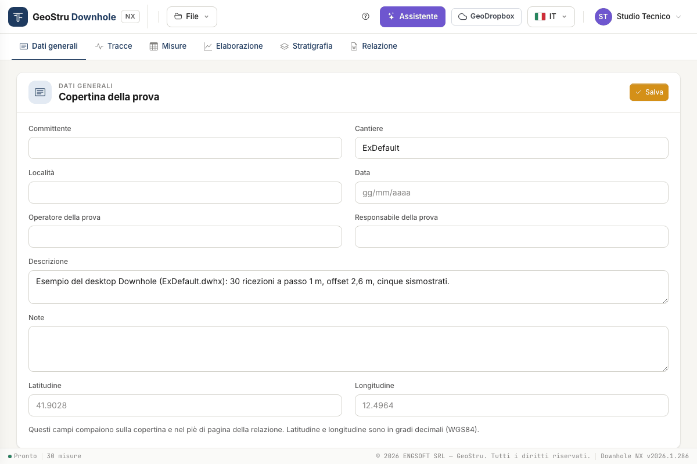
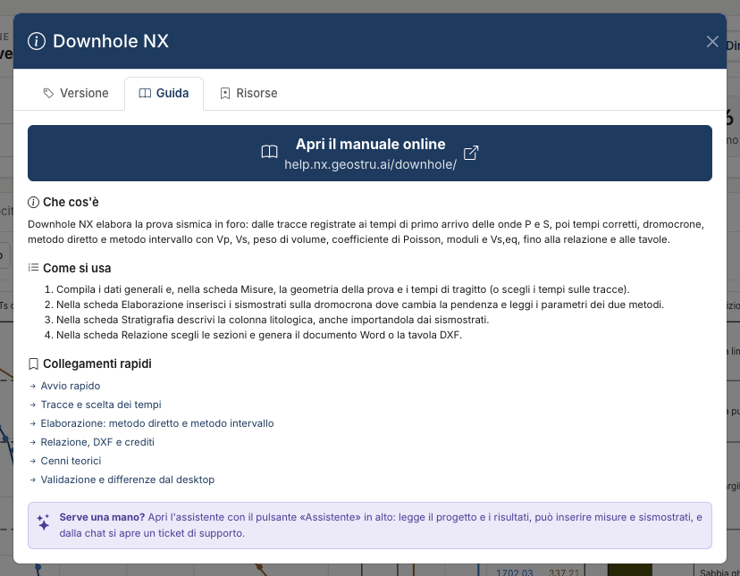

# Downhole NX — Down-hole seismic test

**Downhole NX** processes the **down-hole seismic test**: from the recorded traces to the
first-arrival times of P and S waves, then corrected times, travel-time curves, the **direct
method** and the **interval method**, up to the equivalent velocity V~s,eq~ (V~s,30~), the
Word report and the DXF drawings. It is the GeoStru Downhole desktop program brought to the
browser, with its calculation defects fixed and declared.

[**Open the app**](https://nx.geostru.ai/downhole/){ .md-button .md-button--primary }
[Quick start](quickstart.md){ .md-button }

!!! note "About the screenshots"
    The screenshots show the Italian interface. Labels in the text are those of the English
    interface, in the same position on screen.

## Who it is for

Geologists, geophysicists and geotechnical engineers, and site-investigation contractors who
run the test and have to deliver its processing: V~p~ and V~s~ profile, dynamic elastic
parameters, V~s,eq~ for the seismic characterisation of the site.

## How you work

Six tabs, left to right, follow the order of the job:

1. **General data** — client, site, date, operator: the cover-page fields.
2. **Traces** — you upload the recorded files (SEG-2 or text) and pick on the traces the
   first-arrival time of P and S waves at each depth: by hand, or starting from the times
   the app proposes and you check. If you already have the times, skip this tab.
3. **Measurements** — the test geometry and the depth / T~p~ / T~s~ table: typed, pasted
   from a spreadsheet, or sent from the Traces tab.
4. **Processing** — corrected times, travel-time curves, seismic layers inserted on the
   chart or proposed by the app, parameters per layer and per interval, V~s,eq~.
5. **Stratigraphy** — the descriptive lithological column.
6. **Report** — the Word document and the DXF drawings.

The top bar holds the **File** menu, the **?** help button, the **Assistant**,
**GeoDropbox**, the language and the user menu.

## What it computes

- **Corrected times** for the obliquity of the source–receiver path.
- **Direct method**: V~p~ and V~s~ of each seismic layer you define on the travel-time curve.
- **Interval method**: V~p~ and V~s~ between two consecutive receivers, and the averages per
  seismic layer.
- For each layer and interval: unit weight γ, Poisson's ratio ν, shear modulus G,
  constrained modulus E~d~, Young's modulus E, bulk modulus E~v~.
- **V~s,eq~** between two depths of your choice (V~s,30~ with 0 and 30 m).

Two aids are not part of the calculation but prepare it: **Propose the times**, which
proposes the first arrivals on the traces and marks the doubtful ones, and **Propose seismic
layers**, which proposes the layer bases on the travel-time curve. They are proposals: you
accept, correct or discard them.

The formulas are in [Theory](teoria.md); the test cases in [Validation](validazione.md).

## Limits to be aware of

- The result is only as good as the arrival times. The app can **propose** them, but a
  proposal is not a reading: they must always be looked at again on the traces, starting
  with those the app itself marks as doubtful.
- The proposed seismic layers are the subdivision that best follows the times, not a
  geological interpretation.
- It reads **SEG-2** and **text** traces (TXT, CSV). It does not read other acquisition
  formats.
- It assumes **straight ray paths** between source and receiver and applies no correction
  for borehole deviation or for the elevation of the source.
- The moduli are **dynamic**, small-strain moduli.
- It **does not assign the subsoil category**: V~s,eq~ is a number, the classification is
  left to the designer.

The full list of limits is in [Validation](validazione.md#fields-of-use-and-limits) and in
the [FAQ](faq.md).

## What uses credits

Downhole NX runs on **NX credits**. Only three actions use them:

| Action | Where |
|---|---|
| **Generate Word** | Report tab |
| **Export DXF** | Report tab |
| Each **message to the assistant** | Assistant panel |

Uploading traces, picking times, having times and seismic layers proposed, processing,
moving seismic layers, viewing the charts and saving the project **cost nothing**. If a credit operation fails, nothing is charged. This
manual does not quote prices: they are in the price list on
[geostru.ai](https://www.geostru.ai/), and your balance is in the user menu at the top
right. Details in [Report, DXF and credits](relazione.md#credits).

## What you need

- A GeoStru account and an internet connection: the calculation runs on the server.
- An up-to-date desktop browser. The app is tested with Chromium-based browsers (Chrome,
  Edge) and a window at least 900 px wide; touch dragging and Safari have not been tested.
- The interface comes in seven languages (Italian, English, French, Spanish, German,
  Romanian, Danish). The report is written in the interface language.

!!! warning "Save before you leave"
    The project lives on the server for the length of the session: after 30 minutes of
    inactivity it is gone. Download the file with **File → Save .dhnx** or use
    **GeoDropbox**. See [Files, desktop projects and GeoDropbox](file.md).

## Help inside the app

The **?** button in the top bar opens the help. The **Guide** tab sums up the steps and
links to the pages of this manual; the **Resources** tab lists the features and lets you
download the example project as a `.dhnx` file; the **Version** tab shows the version in
use.

## Where to start

1. [Quick start](quickstart.md) — the example, from opening it to the report.
2. [Traces and time picking](tracce.md) and [Measurements and test geometry](misure.md) — the data.
3. [Processing](elaborazione.md) and [Stratigraphy](stratigrafia.md) — the results.
4. [Report, DXF and credits](relazione.md), [AI assistant](assistente.md), [Files](file.md).
5. [Theory](teoria.md), [Validation and differences from the desktop version](validazione.md),
   [FAQ](faq.md).

---

*Found an error on this page? [Let us know](mailto:info@geostru.ai?subject=Help%20Downhole%20NX) or open a [Pull Request](https://github.com/EngSoft-Geostru/geostru-help-nx/edit/main/downhole/docs/en/index.md).*
