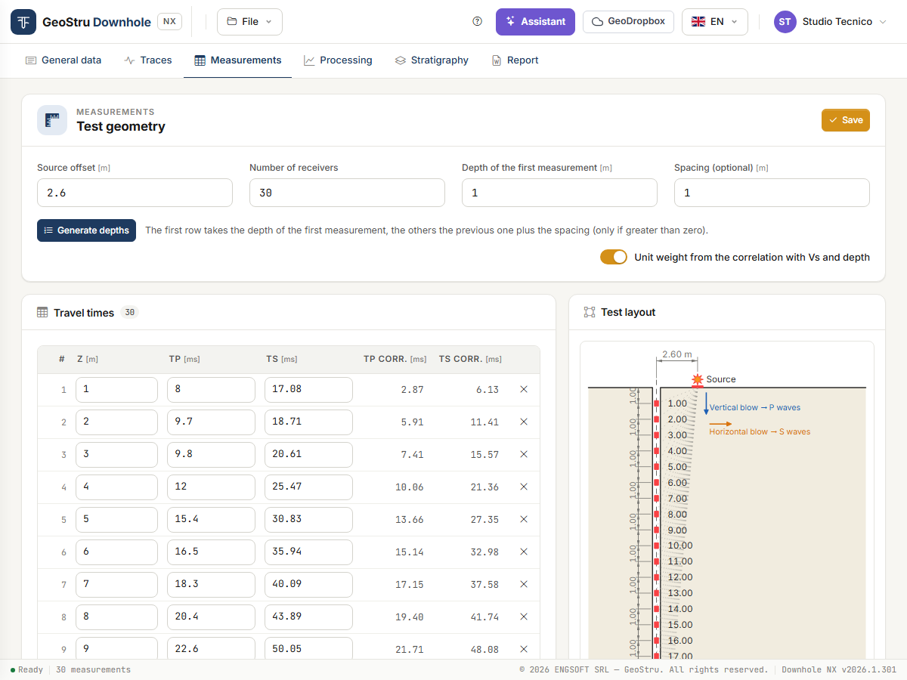
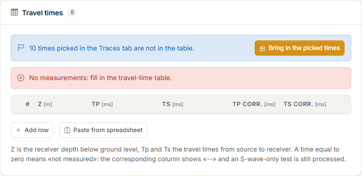
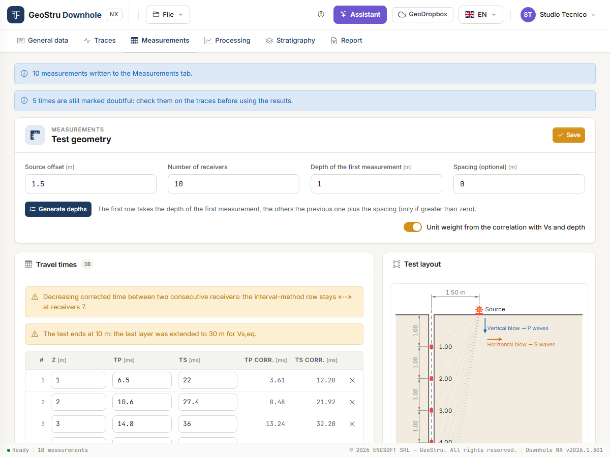
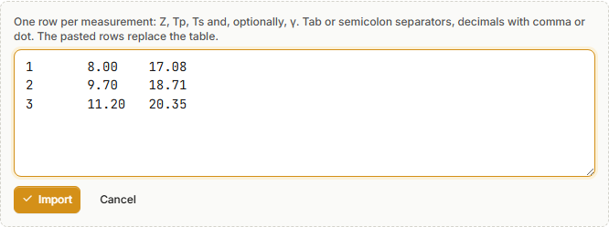
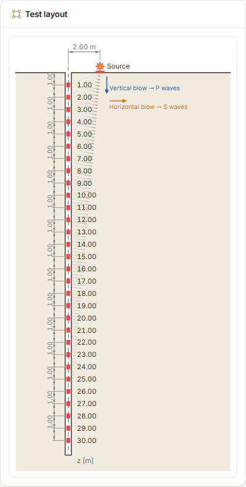

# Measurements and test geometry

The **Measurements** tab holds everything the calculation reads: the **test geometry** and
the **depth / T~p~ / T~s~** table. Times come from the [Traces](tracce.md) tab, or you type
or paste them here.

## Test geometry

| Field | Meaning |
|---|---|
| **Source offset** [m] | Horizontal distance d between the source and the borehole axis. It enters the correction of the times. |
| **Number of receivers** | How many rows the table should have. |
| **Depth of the first measurement** [m] | Depth of the first receiver position. |
| **Spacing (optional)** [m] | Step between one receiver position and the next. |

The last three fields are there to **generate the depth column**; the calculation reads the
depths written in the table, not these fields. The **source offset**, on the other hand,
goes straight into the calculation: always check it.

**Generate depths** brings the table to the number of receivers given. The first row takes
the depth of the first measurement, the others the previous one plus the spacing. With zero
spacing the depths already typed are kept. Times already in the table are not touched.

If the number of receivers is lower than the existing rows, the app asks for confirmation
before removing the rows at the bottom.

## Bringing in the picked times

The times picked in the [Traces](tracce.md) tab do not enter the table by themselves. When
the table does not hold them, a strip appears above it:

- blue, *“n times picked in the Traces tab are not in the table”*, if the table is empty or
  holds no times;
- yellow, *“n times picked in the Traces tab differ from the table: bringing them in
  replaces the table”*, if the table already has different times.

Press **Bring in the picked times**.

What happens:

- the table is **replaced** by the picked times, sorted by depth, in milliseconds;
- **one wave is enough**: the other column stays at zero, that is “not measured”;
- non-positive or duplicate depths cannot be measurements: they are left out and a strip
  lists them;
- if some of the times brought in are still **marked doubtful**, a strip reminds you:
  *“n times are still marked doubtful: check them on the traces before using the results”*.

!!! warning "Then check the geometry"
    The transfer writes depths and times, not the geometry. Set the **Source offset** to the
    real value: without it the corrected times are wrong.

## The travel-time table

One row per receiver position:

- **Z** [m] — depth of the receiver below ground level;
- **Tp** [ms] and **Ts** [ms] — travel times from source to receiver, as read on the traces
  (not corrected);
- **Tp corr.** and **Ts corr.** [ms] — the **corrected times** to the vertical, t · z / SR
  with SR = √(z² + d²). The program computes them, read-only: they update when times, depths
  or offset change. “--” means the time is not measured;
- **γ** [kN/m³] — only with an assigned unit weight (see below).

Depths must be **positive and strictly increasing**.

**A time equal to zero means “not measured”.** The corresponding column shows “--” in the
results and the rest is computed all the same: an S-only test is processed by leaving all
T~p~ at zero.

**Add row** appends a row, **×** removes one.

Above the table you also see the **calculation warnings** (for instance a decreasing
corrected time), the same as in the [Processing](elaborazione.md#errors-and-warnings) tab:
you see them while you fix the data.

### Pasting from a spreadsheet

**Paste from spreadsheet** opens a text box. Copy the cells from the sheet and paste them
there:

- one row per measurement: Z, T~p~, T~s~ and, optionally, γ;
- columns separated by tab or semicolon;
- decimals with comma or dot.

**Import** replaces the table with the pasted rows. Then press **Save**.

You can also paste a block of cells straight into a cell of the table: rows are filled from
that one down.

### Saving

**Save**, at the top right, stores geometry and table. Until you save, **Unsaved changes**
shows next to the button.

You do not need to press it at every digit: shortly after you stop typing the app saves by
itself, in the background, and redraws the layout and the corrected times. If you switch tab
with pending changes, it saves them first.

If a row has an error (a depth out of order, a negative time), a red strip above the table
points to the row to fix.

## Unit weight: automatic or assigned

The **Unit weight from the correlation with Vs and depth** switch decides where γ comes
from; γ is needed for the moduli G, E~d~, E, E~v~.

**On (default).** γ is estimated for each layer and interval from an empirical correlation
with V~s~ and depth. It is an estimate: the formula is in
[Theory](teoria.md#unit-weight-from-the-correlation).

**Off.** The table gets a **γ** column and you type the unit weight at each receiver
position, for instance from laboratory tests.

- In the interval method each interval uses the γ of its receiver position.
- In the direct method each seismic layer uses the **average** of the γ values of the
  receiver positions it contains.
- Where γ is missing, γ and the moduli show “--”. Velocities and Poisson's ratio do not
  depend on γ and are computed anyway.

## Test layout

On the right, the **Test layout** draws the borehole, the source with its offset, the
receiver positions at the depths of the table with their dimensions, the **rays** from the
source to each receiver and the two **blows**: vertical for P waves, horizontal for S waves.
It is redrawn as you type. It lets you check at a glance that geometry and depths are what
you meant; the same drawing goes into the report and can be exported to DXF.

---

*Found an error on this page? [Let us know](mailto:info@geostru.ai?subject=Help%20Downhole%20NX) or open a [Pull Request](https://github.com/EngSoft-Geostru/geostru-help-nx/edit/main/downhole/docs/en/misure.md).*
