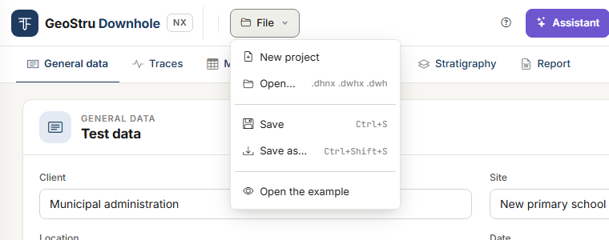
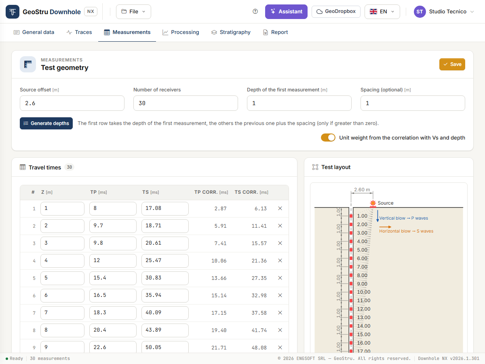
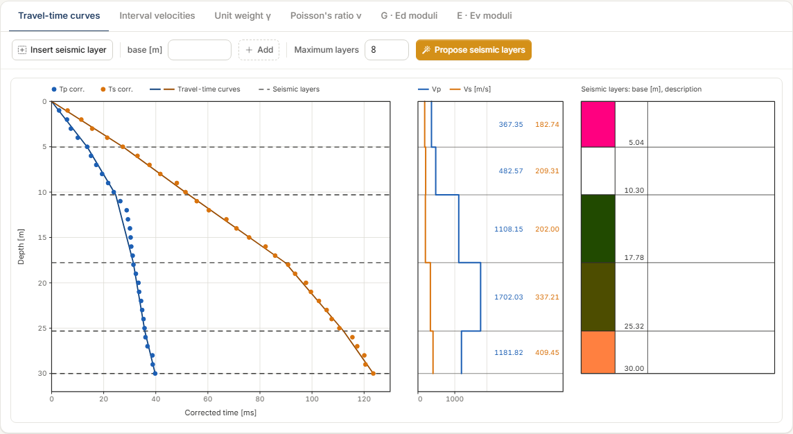
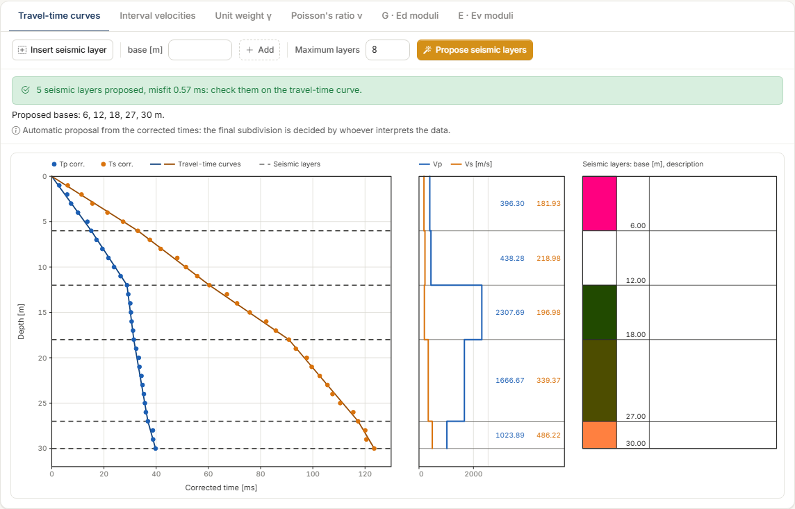

# Quick start (5 minutes)

Take the full tour with the example project: a test with **30 receivers at 1 m spacing**,
from 1 to 30 m, the source 2.6 m from the borehole and five seismic layers. There is nothing
to upload.

## 1. Open the example

Go to [nx.geostru.ai/downhole](https://nx.geostru.ai/downhole/) with your GeoStru account.
The app opens on the **General data** tab with an empty project.

Open the **File** menu and choose **Open the example**. If a project is already in the
session, a strip below the bar warns that it will be replaced: press **Confirm**.

## 2. Look at the measurements

Open the **Measurements** tab. At the top is the **Test geometry**: source offset 2.6 m, 30
receivers, first measurement at 1 m, spacing 1 m. Below it, the **Travel times** table with
depth Z and times T~p~ and T~s~ in milliseconds and, next to them, the corrected times
**Tp corr.** and **Ts corr.** computed by the program; on the right, the **Test layout**.

## 3. Read the processing

Open the **Processing** tab. There is no “Calculate” button: the results always follow the
data.

At the top right you read **V~s,30~ = 242.86 m/s**, computed between 0 and 30 m. Below it,
the **Travel-time curves** chart with the corrected times of P waves (blue) and S waves
(orange) and the five dashed lines of the seismic layers; next to it, the V~p~ and V~s~
profile per layer and the seismic-layer column.

## 4. Try moving a seismic layer

1. Press **Insert seismic layer** and click on the chart at about 12 m: a dashed line
   appears, and a row in the **Seismic layers of the direct method** table. Leave with Esc.
2. Drag the line up or down: velocities and moduli of the two neighbouring layers update
   when you release it.
3. To remove it, press the bin in its row and then **Delete**.

V~s,30~ stays at 242.86 m/s: H = 30 m is the base of the last layer, so it does not depend on
where you put the layers above. The reason is in [Processing](elaborazione.md#equivalent-velocity-vseq).

## 5. Have the seismic layers proposed

Above the chart press **Propose seismic layers**. The example already has its layers, so a
strip shows the proposed bases, **6, 12, 18, 27, 30 m**, and asks whether to replace them:
press **Replace**, or **Keep mine** to leave everything as it is.

The proposal is the subdivision that best follows the corrected times; the person who
interpreted the test had chosen 5.04 – 10.30 – 17.78 – 25.32 – 30 m. V~s,30~ is still
242.86 m/s. Details in [Processing](elaborazione.md#proposing-the-seismic-layers).

## 6. Switch to the interval method

At the top right press **Interval**. The chart becomes **Interval velocities** and the
**Interpretation of the measurements** table shows V~p~, V~s~, γ, ν and the moduli for each
receiver. **Import from the direct method** brings the five seismic layers here, snapped to
the measurement depths. Go back to **Direct** when you are done.

## 7. Generate the report

Open the **Report** tab and leave on the sections you need. On the right the **Report
preview** shows the laid-out document, free of charge: scroll through it. When it is right,
press **Generate Word** and the browser downloads the document.

!!! note "This action uses credits"
    **Generate Word** and **Export DXF** use NX credits; everything else in this guide is
    free. If generation fails, nothing is charged.

## 8. Save the project

**File → Save as…** (Ctrl+Shift+S) saves the project to a `.dhnx` file on your computer;
from then on **File → Save** (Ctrl+S) overwrites the same file. Do it before closing: the
project lives on the server only for the length of the session.

## With traces

To try the Traces tab download the second example: **?** button, **Resources** tab,
**Survey with SEG-2 traces (one file per depth, 31 m)**. Open it with **File → Open…** and
go to the [Traces](tracce.md) tab: you find the recordings, the times already picked and the
flags on the traces.

## With your own data

- **You have the recorded traces**: **File → New project**, then the [Traces](tracce.md)
  tab to upload them. With SEG-2 files the app often recognises by itself how the test was
  recorded; then pick the times, by hand or starting from **Propose the times**, and bring
  them into the Measurements tab with **Bring in the picked times**.
- **You already have the times** (from a spreadsheet or a test report): go to the
  [Measurements](misure.md) tab and use **Paste from spreadsheet**.
- **You have a desktop project** (`.dwhx` or `.dwh`): **File → Open…**. See
  [Files, desktop projects and GeoDropbox](file.md).

---

*Found an error on this page? [Let us know](mailto:info@geostru.ai?subject=Help%20Downhole%20NX) or open a [Pull Request](https://github.com/EngSoft-Geostru/geostru-help-nx/edit/main/downhole/docs/en/quickstart.md).*
