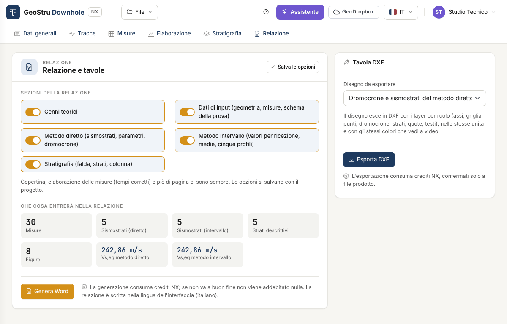

# Report, DXF and credits

The **Report** tab produces the two deliverables of the test: the **Word report** and the
**DXF drawings** of the charts. Together with messages to the assistant, these are the
actions of the app that use credits.

## Before you generate

Check three things, all free:

1. the fields of the **General data** tab (client, site, location, date, operator, person
   in charge, description, notes, coordinates): they appear on the cover page and in the
   footer;
2. the seismic layers and V~s,eq~ in the [Processing](elaborazione.md) tab;
3. the **What the report will contain** box: number of measurements, seismic layers of both
   methods, descriptive layers, figures and V~s,eq~ of both methods.

If the measurements are missing or contain errors, **Generate Word** is disabled and a note
says what to fix.

## Report sections

Five switches choose what to include.

| Section | Content |
|---|---|
| **Theoretical notes** | The test, the procedure, the two methods, the elastic parameters, V~s,eq~, the limits and the references. |
| **Input data** | Geometry, table of measured times, test layout. |
| **Direct method** | V~s,eq~, seismic layers, parameters per layer, travel-time curves. |
| **Interval method** | V~s,eq~, parameters per measurement interval, seismic layers and average values, the five profiles (velocity, γ, ν, G·E~d~, E·E~v~). |
| **Stratigraphy** | Water table, layers and column. Included only if the Stratigraphy tab has at least one layer. |

**Cover page**, **contents**, **processing of the measurements** (the table of corrected
times) and footer are always there.

The options are saved with the project: press **Save options**, or switch tab and the app
saves them for you.

## Generate Word

**Generate Word** produces a `.docx` file and the browser downloads it.

- The report is written **in the interface language**: to have it in English, switch
  language from the selector at the top before generating it.
- The figures are the same drawings you see on screen.
- On opening, Word may ask to update the fields: accept, and the table of contents gets its
  page numbers. Otherwise right-click the contents → **Update field**.
- Values that cannot be computed stay “--”, as on screen; the warnings of the calculation
  are reported in the document.

The document is an ordinary Word file: you can edit it, add your logo, convert it to PDF
from your word processor.

## DXF drawing

In the **DXF drawing** card choose the **Drawing to export** and press **Export DXF**:

- Test layout
- Travel-time curves and seismic layers of the direct method
- Interval velocity profile
- Interval unit weight profile
- Interval Poisson's ratio profile
- Interval G and E~d~ moduli profile
- Interval E and E~v~ moduli profile
- Stratigraphic column

Each export produces **one** drawing, with one layer per role (axes, grid, points,
travel-time curves, layers, dimensions, texts), in the same units and colours you see on
screen. Texts are in the interface language.

If the chosen drawing is empty (for instance the stratigraphic column with no layers), the
app says so and exports nothing.

## Credits

### What uses them

| Action | When it is charged |
|---|---|
| **Generate Word** | Once the document has been produced. |
| **Export DXF** | Once the file has been produced. |
| **Message to the assistant** | When the answer arrives. |

### What is free

Uploading traces, picking times, filling in the measurements, processing, inserting and
moving seismic layers, viewing all charts and tables on screen, filling in the stratigraphy,
saving and opening the project, opening the example.

### How much they cost

This manual does not quote prices: they change with the price list, published on
[geostru.ai](https://www.geostru.ai/). Your **balance** is in the user menu, at the top
right.

If the balance is not enough, the app generates nothing and shows a strip with the **credits
needed**, the **balance** and the **Buy credits** button. The project stays in the session:
top up and try again.

### If something goes wrong

**If an operation fails, nothing is charged.** That holds for every case the app can run
into:

- an error while generating the Word or the DXF file;
- invalid measurements or an empty drawing;
- expired session: the app says so and neither writes nor charges anything;
- credit service unreachable: try again in a few minutes;
- assistant not available, or answer not received.

The full conditions (validity of credits, refunds) are in the
[Terms of Service](https://geostru.ai/en/terms-of-service/).

---

*Found an error on this page? [Let us know](mailto:info@geostru.ai?subject=Help%20Downhole%20NX) or open a [Pull Request](https://github.com/EngSoft-Geostru/geostru-help-nx/edit/main/downhole/docs/en/relazione.md).*
