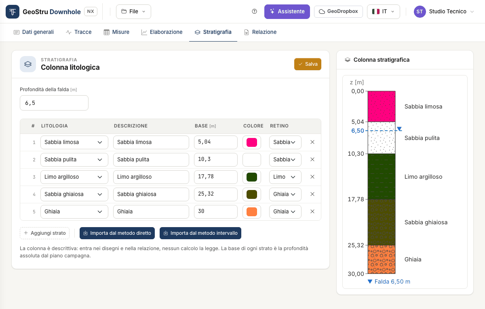

# Stratigraphy

The **Stratigraphy** tab holds the **lithological column** of the borehole: water table and
layers with lithology, description, colour and pattern.

It is a **descriptive** column: it goes into the drawings and the report, but **no
calculation reads it**. Velocities, moduli and V~s,eq~ depend only on the measurements and
on the seismic layers of the [Processing](elaborazione.md) tab. If you do not need it in the
report, you can leave it empty.

## Water table

**Water table depth** [m] is the depth below ground level. With a value greater than zero
the water table is drawn on the column and written in the report; with zero the report
states that no water table was found within the investigated depth.

## Layers

One row per layer:

| Field | Meaning |
|---|---|
| **Lithology** | One of the 14 entries of the list, from clean sand to rock. |
| **Description** | Free text shown next to the layer. |
| **Base** [m] | **Absolute** depth of the base below ground level, not the thickness. |
| **Colour** | Background colour of the layer. |
| **Pattern** | Hatch: sand, gravel, silt, clay, organic soil, rock, or none. |

Choosing the **lithology** pre-fills description, pattern and colour; a description you
typed yourself is not touched.

**Add layer** creates a row, **×** removes it. Press **Save** to store: the column on the
right is redrawn with the layers in depth order.

## Importing from the seismic layers

The column often coincides with the seismic layers. Instead of retyping it:

- **Import from the direct method** copies the seismic layers of the direct method;
- **Import from the interval method** copies those of the interval method.

You get the bases, lithologies, descriptions, colours and patterns you gave the layers in
the Processing tab. Layers written by hand are **replaced**: if there are any, the app asks
for confirmation. If the chosen method has no seismic layers, the column stays empty and the
app says so.

After importing you can correct the rows by hand. Column and seismic layers remain
independent: moving a seismic layer after the import does not move the layer of the column.

!!! note "Assigning the lithology"
    Velocities alone do not tell you what soil is there. Use the log of the borehole in
    which the test was run.

---

*Found an error on this page? [Let us know](mailto:info@geostru.ai?subject=Help%20Downhole%20NX) or open a [Pull Request](https://github.com/EngSoft-Geostru/geostru-help-nx/edit/main/downhole/docs/en/stratigrafia.md).*
