# Traces and time picking

In the **Traces** tab you upload the recordings of the test, look at them and pick the
**first-arrival time** of P waves (T~p~) and S waves (T~s~) at each depth: by hand, with a
click on the trace, or starting from the times the app proposes. The picked times then go
into the table of the [Measurements](misure.md) tab, with the **Bring in the picked times**
button.

If you already have the times you do not need this tab: go straight to Measurements.

The tab has two columns. On the left, three cards: **Files and acquisition**, **Depths and
files**, **Picked times**. On the right, the trace view.

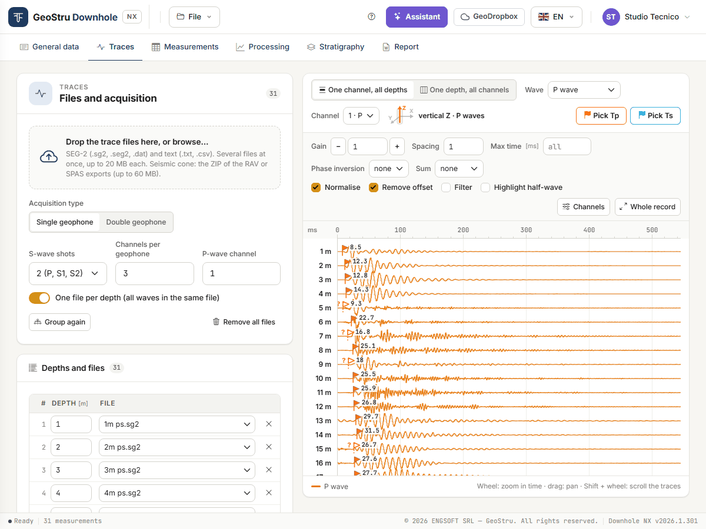

## Channels and shots: what they are

This is the distinction to have clear before uploading the files.

**Channels are the sensors of the geophone.** The geophone lowered into the borehole is
**three-component**: it has three sensors at right angles, one **vertical** (Z) and two
**horizontal** (X and Y). Each one writes to a channel of the seismograph, so a file with
three channels holds the three components of the same geophone. The vertical records P waves
well, the two horizontals S waves.

**P, S1 and S2 are shots, not channels.** A shot is a blow struck at the surface, on the
source:

| Shot | How it is struck | Where it is read |
|---|---|---|
| **P** | vertical blow on the plate | on the vertical channel |
| **S1** | horizontal blow in one direction | on the horizontal channels |
| **S2** | horizontal blow in the opposite direction | on the horizontal channels, with polarity reversed with respect to S1 |

Every shot produces a recording with **all** the channels. Usually each shot is a file; some
instruments instead put all the shots of one depth in the same file.

Some seismographs also record **extra channels**: the trigger signal, a reference sensor on
the source, or the second probe of a double geophone. They are not the borehole geophone, and
for S waves they must be left out (see [Channels](#channels-active-delay-descaling)).

Hence the fields of the **Files and acquisition** card:

- **P-wave channel** is the number of the channel of the **vertical** sensor;
- **Channels per geophone** is how many channels one probe has: 3 for a three-component
  geophone;
- **S-wave shots** is how many S shots you struck at each depth, not how many horizontal
  channels there are.

In the **One channel, all depths** view, next to the **Channel** drop-down, a geophone icon
shows which sensor you are looking at, with its axis highlighted and the label
*vertical Z · P waves*, *horizontal X · S waves* or *horizontal Y · S waves*. On a channel
beyond the three of the geophone the icon does not appear.

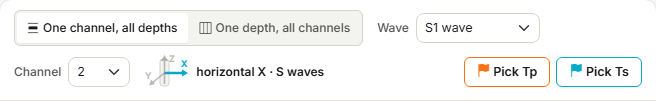

## Uploading the files

Drop the files on the dashed box, or click it to browse. You can upload many at once.

| Format | Extensions |
|---|---|
| SEG-2 | `.sg2`, `.seg2`, `.dat` |
| Text, with the traces in columns | `.txt`, `.csv` |
| Seismic cone: archive of the RAV or SPAS exports | `.zip` |

Each file can be up to **20 MB**, the ZIP archive up to **60 MB**; a project holds at most
**600 files**, **400 depth rows** and **64 channels**. During the upload a bar shows “n of m
files”; at the end a strip sums up the outcome: how many files went in and, for the rejected
ones, why.

Before uploading you can set in the **Files and acquisition** card how the test was run.
With SEG-2 files the app often recognises it by itself (see below).

| Field | What it means |
|---|---|
| **Acquisition type** | **Single geophone** or **Double geophone** (two probes in the same file). |
| **S-wave shots** | **1 (P, S1)**: one P shot and one S shot per depth. **2 (P, S1, S2)**: the two horizontal S shots in opposite directions. |
| **Channels per geophone** | How many channels one probe has. 0 = all the channels of the file. |
| **P-wave channel** | The channel on which the P wave is read: the one of the vertical sensor. |
| **One file per depth (all waves in the same file)** | Each file holds all the shots of one depth. |

### Recognising the acquisition

Many instruments save files with a **sequence number** (`001.DAT`, `002.DAT`…) and do not
say in the header which depth and which shot they belong to. In that case, as soon as the
files are uploaded, the app **looks at the signals** and tries to recognise how the test was
recorded.

It works on SEG-2 files, with a **Single geophone**, when there are at least six of them,
all with the same number of channels and the same sampling interval, and the rows are still
those of the automatic grouping (you have not corrected them by hand). It decides only what
the signals show clearly; the rest is left as it is.

| What it recognises | From what | What changes |
|---|---|---|
| **P, S1, S2 triplets** | S1 and S2 in phase opposition on the horizontal channels, P shot stronger on the vertical, regularly every three files | **S-wave shots** = 2; rows are grouped in threes |
| **P-wave channel** | the channel where the P shot is strongest | **P-wave channel** |
| **Trigger channels** | channels whose arrival always falls at the same instant in every file, beyond the three of the geophone | the channel is switched off in the **Channels** table; **Channels per geophone** goes to 0 |
| **Recording direction** | P arrivals decreasing or increasing row after row | proposes to assign the depths from the bottom or from the top |

The summary appears in the strip below the upload box, for instance:

> *Recognised from the signals: 30 files with 7 channels = 10 depths × (P, S1, S2). S1 and
> S2 in phase opposition in 5 of 10 triplets, P shot stronger on the vertical in 8 of 10.*

followed by the P channel, the channels switched off and the direction. At the end of the
strip, *Settings chosen by the program: check them on the traces* and **Undo**, which
restores the previous settings.

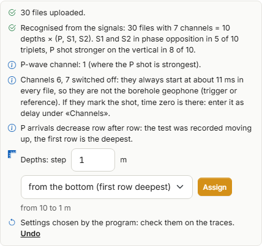

**Depths.** The step between one depth and the next is not in the files: you give it. The
**Depths: step** row is already filled in with 1 m and with the recognised direction
(**from the bottom (first row deepest)** or **from the top (first row shallowest)**); below
it, the preview says what will be written, for instance “from 10 to 1 m”. Change step or
direction if needed, then press **Assign**. No depth goes in without you having seen it.

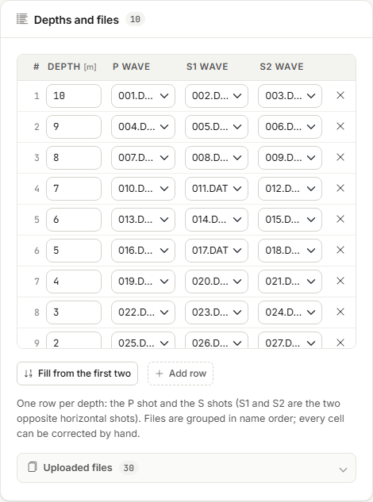

!!! warning "Recognition is a help, not a certainty"
    Always check the result on the traces: that each row has the right three shots, that
    the first row really is the deepest or the shallowest, that the channels switched off
    are not part of the geophone. If a trigger channel marks the instant of the shot, time
    zero is there: enter it as **Delay** in the **Channels** table.

### Seismic cone (ZIP archive)

Tests with the **seismic cone** (SCPTU) are uploaded by dropping the **ZIP archive** with the
RAV or SPAS exports. The archive is uploaded on its own, with no other files.

The app reads the recordings and prepares the acquisition:

- it **stacks the shots** repeated at the same depth, separately for the left shot, the
  right shot and the P shot;
- it assigns **S1 = left** and **S2 = right**; if the probe saved the right shot already
  inverted, it restores its physical sign, so S1 and S2 are opposite;
- it removes from the S waves the part that is **the same at every depth**, which is not a
  propagating wave;
- it writes one row per depth, already with its depth, and the three files P, S1 and S2.

The archive **replaces** the previous acquisition (files, rows, options); the times already
picked are kept. A strip sums up what was read.

!!! warning "Source offset and time zero"
    The seismic cone files hold neither the source offset from the hole nor the trigger
    delay. The strip tells you the current value of the **Source offset** in the
    Measurements tab, and time zero is the first sample. Check them before the calculation.

The next step is **Propose the times**, then the check on the traces.

## Rows: one depth and its files

The **Depths and files** card has one row per depth, with the file of the P shot and those
of the S shots.

Files are grouped automatically **in name order** (the number the name starts with is what
counts): in pairs with one S shot, in threes with two. With 36 files and **S-wave shots** = 1
you get 18 rows: `01` and `02` on the first, `03` and `04` on the second, and so on.

### The depth from the file name

The app reads the depth from the name only when the name states it **with the unit**: a
number followed by **m**, such as `12m`, `1m ps`, `12,5 m P` or `12m_S1`. With **One file
per depth** a plain number such as `12` also works.

A **bare number with leading zeros**, such as `001.DAT` or `06.sg2`, is the **sequence
number** of the instrument, not a depth: the row stays without a depth and you type it.

If the names give a different depth for each file, the survey has all waves in the same
file: on upload the app switches **One file per depth** on by itself, rebuilds the rows (one
per file, with the depth read from the name) and says so in the upload result, with **Undo**
to go back to the previous settings.

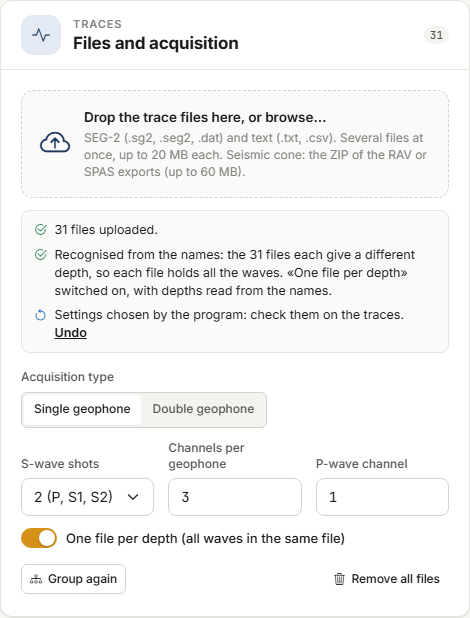

### Typing the depths

If the depths come neither from the names nor from the recognition:

1. type the depth of the **first two rows**;
2. the rows that are still empty take the step between the two;
3. **Fill from the first two** rewrites, with that step, every row from the third down.

Every cell can be corrected by hand: retype the depth, change the file from the drop-down,
remove the row with **×**, add an empty one with **Add row**. Until a row has a depth, its
traces are left out of the view.

- **Group again** rebuilds the rows from all the uploaded files with the current options.
  It asks for confirmation: manual corrections are lost.
- **Remove all files** clears files and rows, after a confirmation. The times already picked
  are kept: it lets you start over with another survey without losing the work done.
- **Uploaded files**, at the bottom of the card, lists the files with number of traces,
  samples, sampling interval and duration.

## The two views

At the top, above the plot, you choose how to look at the traces.

**One channel, all depths** — one trace per depth, top to bottom: the section along the
borehole, where first arrivals can be followed from one depth to the next. Choose the
**Wave** (P wave, S1 wave, S2 wave, S1 + S2 waves overlaid) and the **Channel**; the
geophone icon tells you which sensor it is.

**One depth, all channels** — all the channels of a single depth. Choose **P** or **S** and
the **Depth**, from the drop-down or with the up and down arrows. The S view shows the
active channels other than the P-wave channel; with two S shots in separate files, S1 and
S2 are overlaid on the same channel, and the polarity reversal helps you recognise the first
arrival of the shear wave.

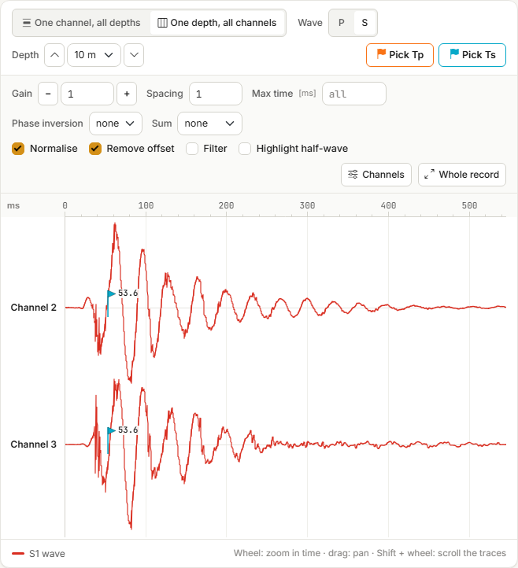

## Display controls

They change the drawing only, never the data.

| Control | Effect |
|---|---|
| **Gain** | Trace amplification: type the value, or use **−** and **+** to step it down and up. |
| **Spacing** | Distance between traces. At 1 they all fit in the window. |
| **Max time** | Cuts the record at that time, in ms. Empty = all. |
| **Phase inversion** | Reverses the polarity of S1 or S2. |
| **Sum** | Shows S1 − S2 or S2 − S1 instead of the two traces. |
| **Normalise** | Each trace is scaled to its own maximum. Without it the scale is common and amplitudes can be compared. |
| **Remove offset** | Subtracts its mean from each trace. |
| **Filter** | 5-point moving average. |
| **Highlight half-wave** | Fills the negative lobe of the traces. |
| **Channels** | Opens the channel table (below). |
| **Whole record** | Resets zoom and pan. |

The latest options are kept in the project: when you reopen the tab the view is as you left
it.

### Channels: active, delay, descaling

**Channels** opens a table with one row per channel of the file; the P-wave channel is marked
“· P”. You can switch a channel off, or type a **Delay** (pre-trigger, in ms) and a
**Descaling** different from those in the file header. Empty fields use the file values,
shown in grey. A channel that is not active does not appear among the S waves: this is how
you leave out a trigger or reference channel.

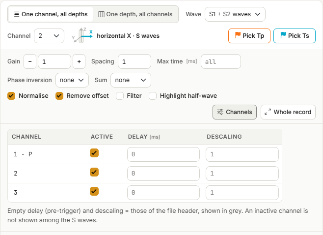

## Picking the times

Picking by hand is the reference procedure: the times proposed by the app are checked, and
corrected, in the same way.

1. Press **Pick Tp** or **Pick Ts**, at the top right of the view. The button stays on;
   **Pick Tp** brings the P wave on screen, **Pick Ts** the S waves.
2. Click on the trace at the first arrival.
3. The time goes to the depth of that trace (in the per-channel view) or to the depth on
   screen (in the per-depth view). A **flag** appears, orange for T~p~ and cyan for T~s~,
   and the row of the **Picked times** card is updated.

A new click at the same depth replaces the time. Times have a resolution of **0.1 ms** and
must fall after the shot instant (t > 0).

To stop picking, **press the lit button again** or press **Esc**: a click goes back to
picking nothing and only pans and zooms. At the bottom right the help line reminds you of
the mode you are in.

### Zoom and pan

On the whole record one pixel is worth a few tenths of a millisecond: zoom in to read the
first arrival properly.

- **Wheel**: zooms the time axis around the pointer.
- **Drag**: pans in time. A drag is never a pick.
- **Shift + wheel**: scrolls the traces, when they do not all fit in the window.
- **Whole record**: back to the full view.

At the bottom left you always read the time and depth under the pointer.

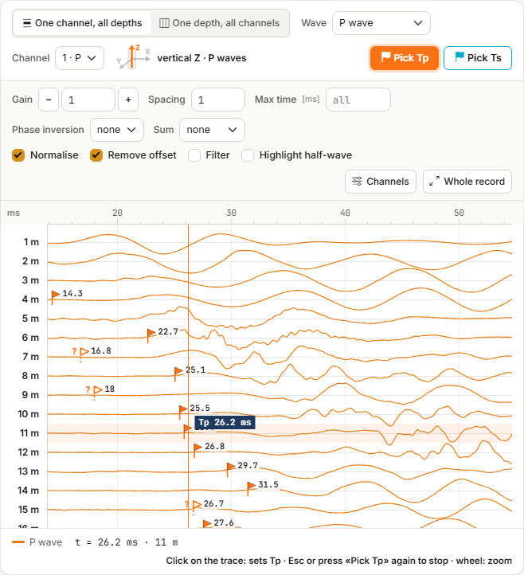

### The picked-times table

The **Picked times** card has one row per depth, with T~p~ and T~s~ in milliseconds. Values
can also be **typed or corrected by hand**; **×** removes the times of that depth. If a
depth no longer has a row in the **Depths and files** card, its time is kept but flagged: it
has no trace.

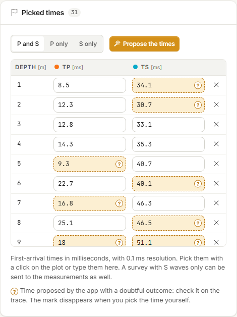

## Proposing the times

**Propose the times**, in the **Picked times** card, calculates a proposal of the
first-arrival times at every depth of the uploaded traces. It is free, and takes a few
seconds.

Next to the button you choose the waves: **P and S**, **P only** or **S only**.

At the end a strip sums up the outcome, for instance *“20 times proposed, 5 doubtful: check
them on the traces”*, and the flags appear on the traces just as for times picked by hand.

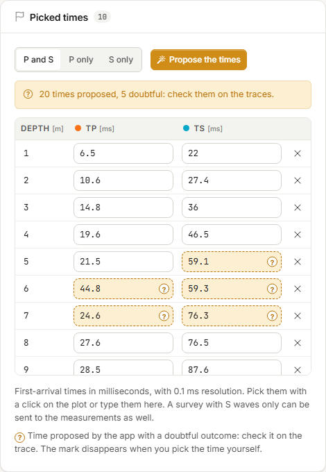

### If there are times already

If you have already picked times at some depths, the app does not touch them without
asking. A strip offers two ways:

- **Keep my times** — the proposal only fills the gaps;
- **Replace with the proposal** — your times are replaced by the proposed ones.

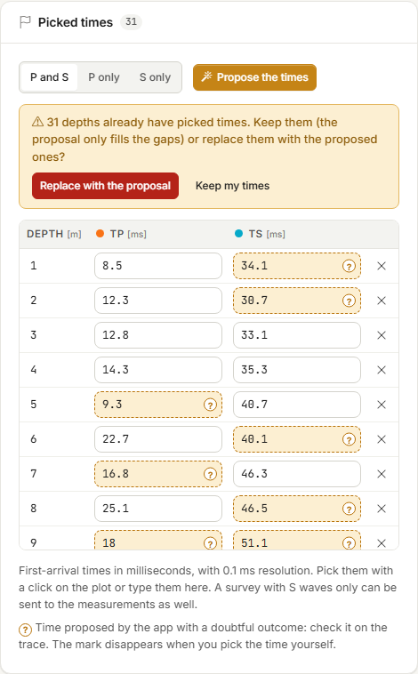

### Doubtful times

The app marks as **doubtful** a proposed time that:

- deviates by more than 3 ms from the trend of the times at the neighbouring depths;
- does not increase with respect to the previous depth;
- falls on a trace with little signal compared with the noise.

A doubtful time shows in two places: in the table the cell is highlighted and carries a
**“?”**; on the trace the flag is **hollow**, with a “?” next to it.

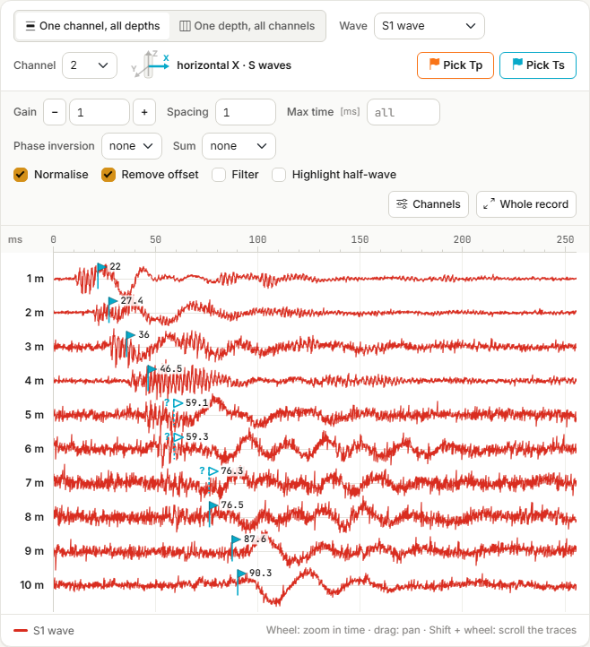

The mark disappears **when you pick the time yourself**: press **Pick Tp** or **Pick Ts**
and click on the trace, even at the same point if the proposal convinces you, or type the
corrected value in the table.

“Doubtful” does not mean wrong: it means **to be looked at**. And a time that is not marked
is not right for that reason.

### How far to trust it

On a real survey of 18 depths (case 8 of the
[Validation](validazione.md#case-8-the-automatic-proposals)), compared with the times the
operator picked by hand:

- **P waves** — median deviation 0.3 ms, maximum 1.4 ms: the proposal matches the reading
  within the uncertainty of the reading itself;
- **S waves** — median deviation 1.4 ms, maximum 5.3 ms, on times of 40–110 ms; ten times
  out of eighteen are marked doubtful.

S waves are the hard case, for two reasons you meet in nearly every test:

- at the **shallowest depths** the shear wave is buried under the P-wave train;
- where the **wavelet changes shape** from one depth to the next, the first arrival can no
  longer be followed continuously.

!!! warning "Check the S proposals one by one"
    Switch to the **One channel, all depths** view, S wave, and look at every flag, starting
    with the hollow ones. With two S shots use the per-depth view as well: there the
    polarity reversal between S1 and S2 shows where the shear wave arrives.

Doubtful times go into the measurements like the others, and in the measurements the mark
is gone: after the transfer the Measurements tab tells you how many were still doubtful.
Check them first. P times that do not increase with depth later give, in Processing, the
*“Decreasing corrected time”* warning and “--” rows.

### When the proposal does not start

| Message | What to do |
|---|---|
| *There are no traces to read…* | Upload the files and give each row a depth. |
| *n trace files are no longer on the server…* | Drop the files again, then ask for the proposal. |
| *The P-shot and S-shot files have a different number of channels…* | Check the rows and **Channels per geophone**. |
| *The time proposal did not work on these traces* | Pick the times by hand. |
| *No proposal at depths: … m* | Pick the time by hand at those depths. |

In all these cases nothing is written.

## Double geophone

With **Double geophone** each file holds the recordings of two probes. The first N channels
(N = **Channels per geophone**) belong to the upper probe, at the depth of the row; the next
N to the lower probe, one position further down (the step between the first and the second
row). In the view each trace is labelled “upper probe” or “lower probe”.

If a file has fewer channels than expected (channels per geophone × 2), the tab says so.
The automatic recognition of the acquisition does not work with the double geophone.

## Text files

For a `.txt` or `.csv` file the app has to know where the data start and which columns to
read. When the first text file is uploaded, the **Text reading options** panel opens by
itself, with the values the app has recognised and a preview of the file: check them.

| Field | Meaning |
|---|---|
| **First data row** | The first row with numbers, after the header. It is highlighted in the preview. |
| **Separator** | `;`, `,` or tab. |
| **Time column** | In seconds. |
| **P column**, **S1 column**, **S2 column** | Columns are counted from 1; 0 = the wave is not in the file. |

**Apply** reads the file again; with **Apply to all text files** the same options hold for
all of them. To reopen the panel of a file, use the button next to its name in the
**Uploaded files** list.

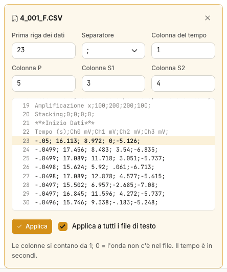

## Bringing the times into the measurements

The times picked here are not yet the measurements of the calculation. The transfer is done
from the [Measurements](misure.md#bringing-in-the-picked-times) tab: when the table does not
hold the times picked in Traces, a strip with the **Bring in the picked times** button
appears above the table.

**One wave is enough**: an S-only survey is brought in as well, and the other column stays
at zero, that is “not measured”.

## Warnings in the tab

| Warning | What to do |
|---|---|
| *n rows have no depth: they are left out of the views* | Type the depth of the rows, or assign them from the recognition strip. |
| *Several rows share the same depth: the per-depth view shows the first one* | Fix the duplicate depth. |
| *The file names give a different depth for each file…* | Turn on **One file per depth**. |
| *The P-shot and S-shot files have a different number of channels* | Channels are read by number: check **P-wave channel** and **Channels per geophone**. The app does not combine P and S files with a different number of channels. |
| *The file has n channels: the double geophone needs m* | Check **Channels per geophone** or the acquisition type. |
| *n files are no longer on the server: upload them again* | Drop the same files again: they are reattached to their rows, with no new rows. |
| *The traces take … MB, more than the … MB that fit in the .dhnx file* | **Save** will write only the references to the traces. See [Files](file.md#traces-in-the-file). |
| *Unsupported SEG-2 data format* | The file uses a sample encoding the app does not read. See the [FAQ](faq.md). |
| *a ZIP archive is uploaded on its own* | Drop the seismic cone ZIP with no other files. |
| *The ZIP holds no seismic cone recordings…* | The archive has no RAV or SPAS exports: check you picked the right one. |
| *The ZIP archive is too large…* | At most 60 MB, 256 MB once extracted, 20,000 entries. |

---

*Found an error on this page? [Let us know](mailto:info@geostru.ai?subject=Help%20Downhole%20NX) or open a [Pull Request](https://github.com/EngSoft-Geostru/geostru-help-nx/edit/main/downhole/docs/en/tracce.md).*
