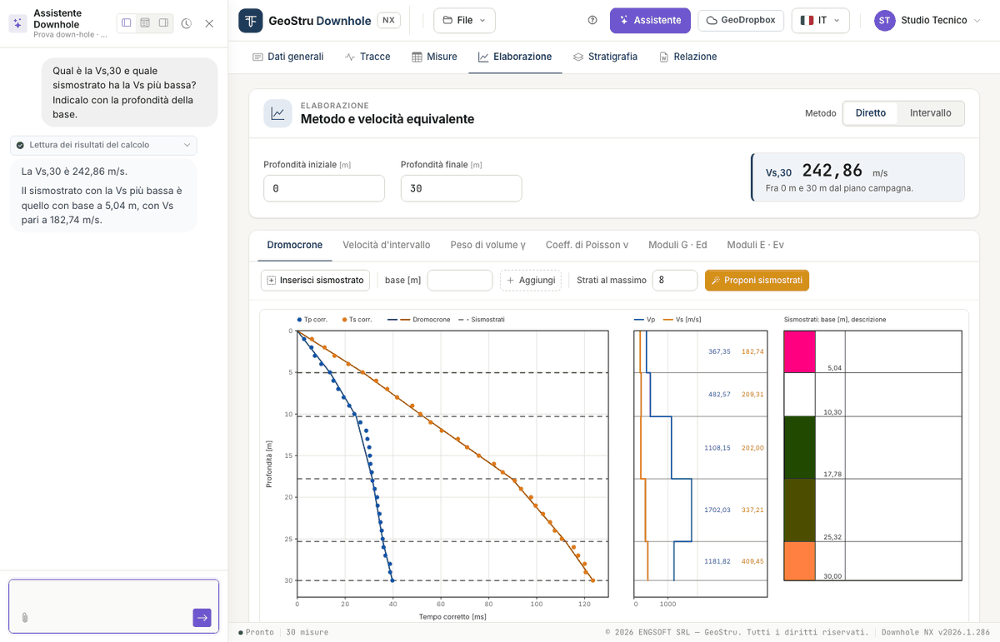
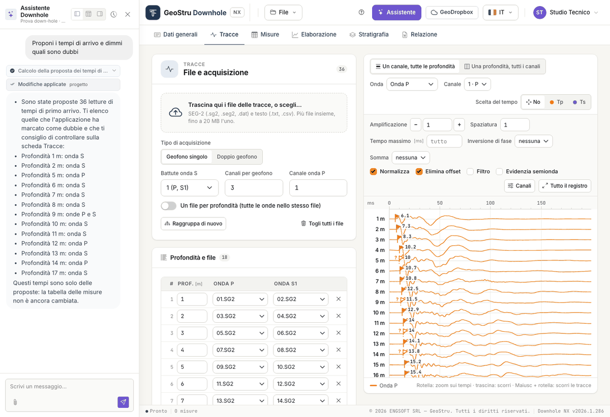

# Assistente AI

Il pulsante **Assistente**, nella barra in alto, apre una chat a fianco del progetto.
L'assistente legge il progetto e i risultati del calcolo e può scrivere nel progetto al
posto tuo: tu chiedi, lui esegue, la pagina si aggiorna.

Ogni messaggio che invii consuma crediti NX, addebitati solo se la risposta arriva. Vedi
[Crediti](relazione.md#crediti).

Sopra ogni risposta, un'etichetta dice che cosa l'assistente ha fatto sul progetto: per
esempio «Lettura dei risultati del calcolo» o «Calcolo della proposta dei tempi di arrivo».

## Che cosa può fare

**Leggere e spiegare**

- legge dati generali, geometria, misure, sismostrati e stratigrafia;
- legge i **risultati del calcolo** così come sono a video e li spiega: velocità, moduli,
  V~s,eq~, il significato di un avviso o di un «--»;
- controlla le misure: tempi mancanti, intervalli anomali, che cosa manca prima di generare
  la relazione;
- spiega i metodi, le formule e i limiti della prova.

**Scrivere nel progetto**

- compila i **dati generali**;
- imposta la **geometria** (offset della sorgente, prima misura, interdistanza);
- inserisce la **tabella delle misure** che gli dai, scritta nel messaggio o in un file
  allegato;
- imposta le **opzioni**: metodo, peso di volume automatico o assegnato, profondità della
  V~s,eq~;
- **aggiunge, sposta e descrive i sismostrati** dei due metodi;
- compila la **stratigrafia**.

**Far proporre tempi e sismostrati**

- fa calcolare all'app la **proposta dei tempi di arrivo** sulle tracce caricate, e ti
  elenca quelli dubbi;
- **porta nelle misure** i tempi scelti;
- fa calcolare la **proposta dei sismostrati**.

Sono le stesse proposte dei pulsanti [Proponi i tempi](tracce.md#proporre-i-tempi) e
[Proponi sismostrati](elaborazione.md#proporre-i-sismostrati): vedi più sotto
[Proposte automatiche](#proposte-automatiche).

Quando scrive, i numeri che ti riferisce li rilegge dal calcolo: non li rifà a mente.

## Che cosa non fa

- **Non elimina nulla**: misure, sismostrati e strati li togli tu, dalle rispettive schede.
  Se serve, ti dice che cosa togliere e dove.
- **Non sostituisce misure o sismostrati che hai già** se non glielo chiedi in modo
  esplicito.
- **Non carica le tracce e non genera la relazione o il DXF**: sono gesti tuoi.
- **Non inventa misure**: nella tabella entrano solo i valori che gli dai o che legge da un
  tuo documento. Se mancano, li chiede.
- **Non attribuisce la categoria di sottosuolo**: può spiegare le categorie delle NTC e in
  quale intervallo cade una V~s,eq~, ma la classificazione resta al progettista.

## Come si usa

Scrivi la richiesta nella casella in basso e invia. Alla prima apertura trovi anche le
**Azioni rapide**, richieste pronte da inviare con un clic.

Richieste che funzionano bene sono concrete e dicono a quale metodo o scheda ti riferisci:

- «Spiegami i risultati: velocità, moduli e Vs,eq»
- «Imposta l'offset della sorgente a 2 m e calcola la Vs,eq fra 1,5 e 30 m»
- «Inserisci queste misure» seguito dalla tabella profondità, T~p~, T~s~ copiata dal foglio
  di calcolo
- «Aggiungi al metodo diretto un sismostrato con base a 8 m e descrivilo come sabbia limosa»
- «Controlla le misure: ci sono tempi mancanti o intervalli anomali?»
- «Che cosa manca prima di generare la relazione?»

Se i tempi sono in secondi o il peso di volume in altre unità, dillo: l'assistente converte
e dichiara la conversione. Se la richiesta è ambigua, chiede prima di scrivere.

### Proposte automatiche

Con le tracce caricate, e la profondità assegnata alle righe, puoi chiedere:

- «Proponi i tempi di arrivo e dimmi quali sono dubbi»
- «Porta i tempi nelle misure»
- «Proponi i sismostrati del metodo diretto, al massimo quattro strati»
- «Elabora il rilievo: proponi i tempi, portali nelle misure e proponi i sismostrati»

Come si comporta:

- presenta tempi e sismostrati **come proposte da verificare**, elenca i tempi dubbi e
  riporta gli avvisi del calcolo;
- procede **un passo alla volta**: dopo i tempi può chiederti conferma prima di portarli
  nelle misure. È il momento di controllarli sulle tracce;
- se le misure contengono già dei tempi, **non le sostituisce** senza una richiesta
  esplicita («sostituisci le misure con i tempi proposti»);
- se il metodo ha già dei sismostrati, **non li sostituisce** senza una richiesta esplicita
  («proponi di nuovo i sismostrati», «sostituisci gli strati»);
- se glielo chiedi, può suggerire una **descrizione litologica indicativa** dalle velocità:
  la dichiara come ipotesi, da confrontare con la stratigrafia del sondaggio.

Dagli anche l'**offset della sorgente**: senza, il calcolo usa quello scritto nella scheda
Misure.

### Allegare un documento

Con la **graffetta** alleghi un file: testo, CSV o TSV, foglio di calcolo (`.xlsx`, `.xls`)
o PDF. Serve, per esempio, per far compilare la tabella delle misure da un rapporto di
prova. Controlla sempre ciò che è stato scritto confrontandolo con l'originale.

### Mentre lavora

Mentre l'assistente scrive nel progetto la pagina è ferma, e una striscia lo dice: *«L'assistente
sta lavorando sul progetto: la pagina torna modificabile appena ha finito»*. Le tue
modifiche in quel momento verrebbero respinte, senza danni.

Prima di inviare il messaggio l'app salva la scheda che hai a video; a lavoro finito la
pagina si ricarica da sola con il progetto aggiornato.

In una risposta l'assistente può eseguire un numero limitato di operazioni: se lo raggiunge
lo dice, ciò che ha fatto è nel progetto, e gli scrivi per proseguire.

### Il pannello

In alto nel pannello: tre pulsanti per agganciarlo a sinistra, in basso o a destra, il
pulsante della cronologia per riprendere o azzerare la conversazione, e la chiusura.

## È un sistema di intelligenza artificiale

!!! warning "Verifica ciò che scrive"
    Le risposte dell'assistente sono generate da un sistema di intelligenza artificiale e
    possono contenere errori. Ciò che scrive nel progetto è una **proposta**: misure,
    sismostrati e descrizioni vanno verificati. L'elaborazione è tua, e la firmi tu.

In particolare: i tempi proposti vanno riguardati sulle tracce, a partire da quelli dubbi;
i sismostrati proposti sono la suddivisione che meglio segue i tempi, non
un'interpretazione; una litologia suggerita dalle sole velocità è un'ipotesi; una tabella
letta da un PDF va confrontata con il documento.

## Ticket di supporto

L'azione rapida **Apri un ticket di supporto** apre una richiesta di assistenza dalla stessa
chat. Finché il ticket è aperto i messaggi vanno al supporto, non all'assistente del
progetto, e non consumano crediti.

Una striscia in alto nel pannello dice chi ti sta rispondendo: un **assistente di
intelligenza artificiale** oppure, dopo il passaggio, un **operatore umano**. Puoi chiedere
di parlare con un operatore in qualsiasi momento.

---

*Hai trovato un errore in questa pagina? [Segnalacelo](mailto:info@geostru.ai?subject=Help%20Downhole%20NX) o apri una [Pull Request](https://github.com/EngSoft-Geostru/geostru-help-nx/edit/main/downhole/docs/it/assistente.md).*
