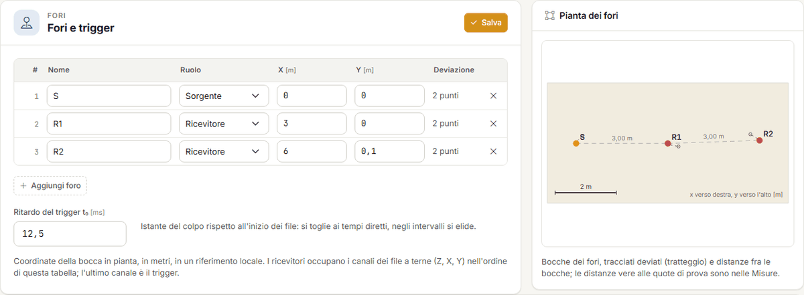
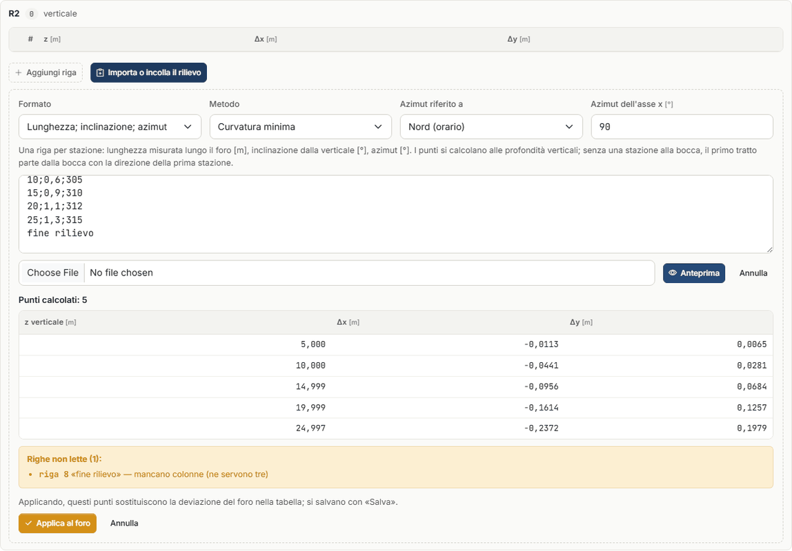
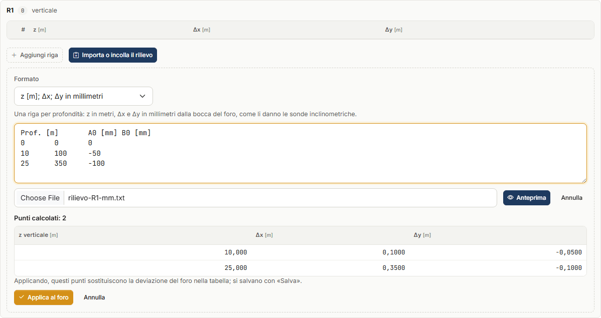
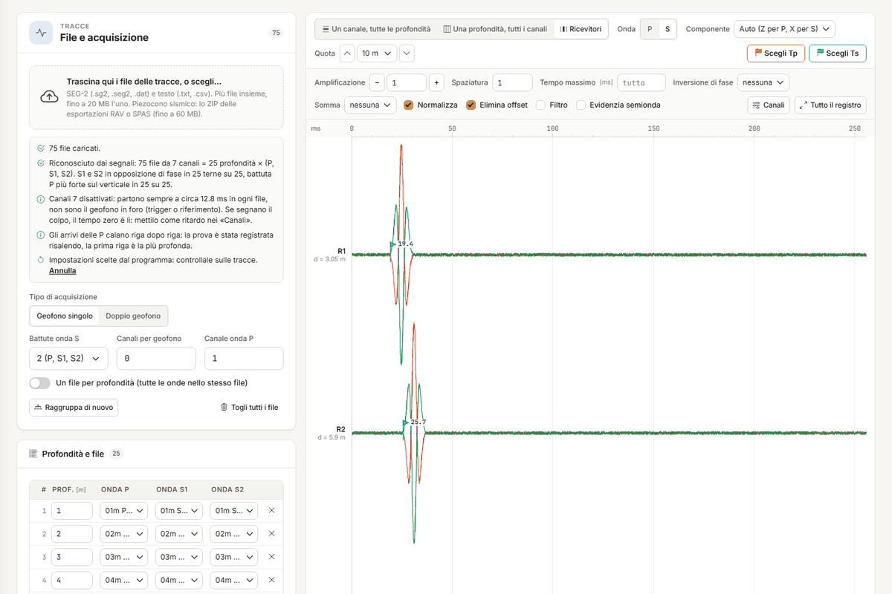
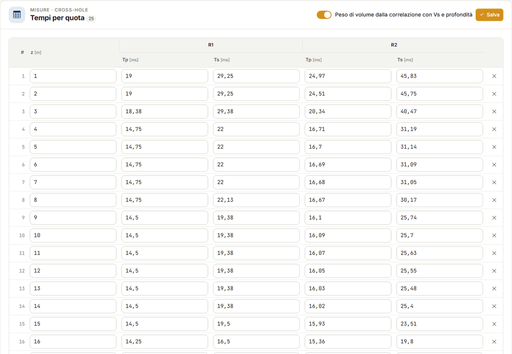
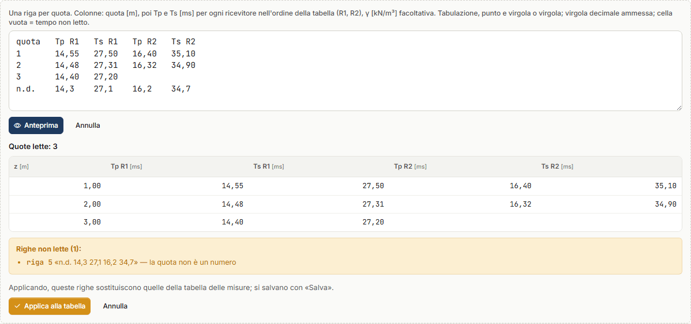
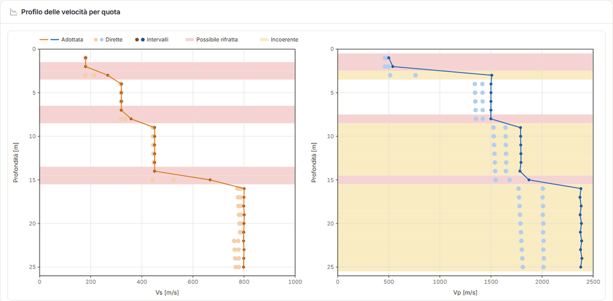
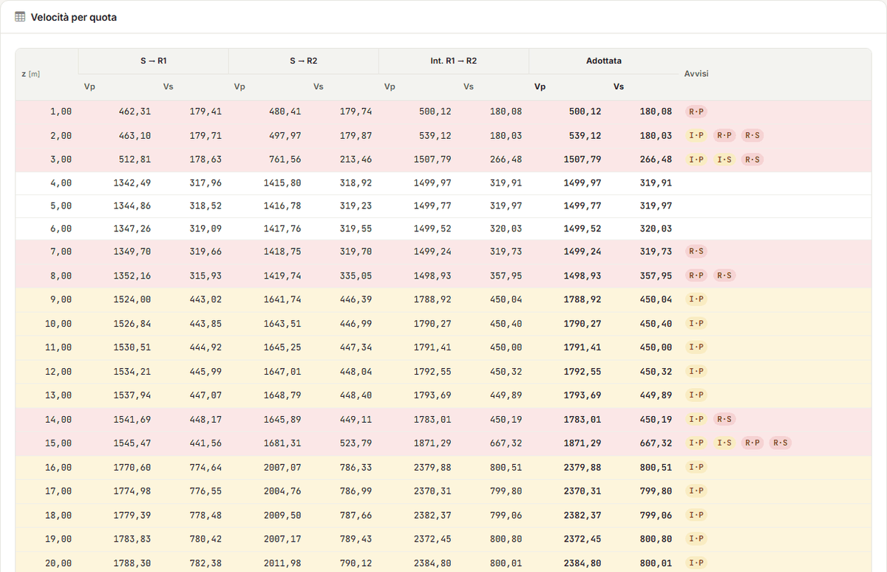

# Prova cross-hole

La **prova cross-hole** misura il tempo che le onde P e S impiegano ad andare da un foro
**sorgente** a uno o più fori **ricevitori**, con sorgente e ricevitori alla **stessa quota**.
Ripetuta a quote successive, dà un profilo delle velocità in cui ogni valore è quello di uno
strato orizzontale attraversato dalle onde. Il riferimento tecnico è la norma
**ASTM D4428/D4428M**.

In Downhole NX il cross-hole è un secondo **tipo di prova**: tracce, scelta dei tempi,
parametri elastici, V~s,eq~, stratigrafia, relazione, DXF, assistente e crediti sono gli
stessi del downhole.

## Quando si usa

- Quando serve la velocità **orizzontale** degli strati a quote precise, senza il percorso
  obliquo del downhole e senza che gli strati superficiali entrino nei tempi profondi.
- Quando gli strati sono sottili rispetto alla profondità ma **non** sottili rispetto alla
  distanza fra i fori: fra fori a 3 m uno strato di 50 cm viene scavalcato dall'onda
  rifratta (vedi [Le quote segnate](#le-quote-segnate)).
- Con **due ricevitori** o più: la velocità d'intervallo fra due ricevitori elimina il
  ritardo del trigger ed è quella che la norma consiglia.

## Nuova prova cross-hole

**File → Nuova prova cross-hole** crea un progetto con un foro sorgente S e due ricevitori
R1 e R2 allineati a 3 m, verticali. Puoi anche cambiare il **Tipo di prova** nei **Dati
generali**: le schede si adattano e i dati dell'altro tipo restano nel progetto, pronti se
torni indietro.

Nel cross-hole la scheda **Fori** prende il posto della geometria del downhole; Tracce,
Misure, Elaborazione, Stratigrafia e Relazione ci sono ancora, adattate alla prova.

## I fori e il rilievo di deviazione

Nella scheda **Fori** scrivi per ogni foro il **nome**, il **ruolo** (una sola sorgente,
uno o più ricevitori) e le coordinate della **bocca** in pianta, X e Y in metri in un
riferimento locale. Sotto la tabella c'è il **Ritardo del trigger t~0~**: l'istante del colpo
rispetto all'inizio dei file. Si toglie ai tempi delle velocità dirette e si elide in quelle
d'intervallo.

!!! note "L'ordine dei ricevitori conta"
    Nei file a terne i ricevitori occupano i canali 1–3, 4–6, … (Z, X, Y) nell'ordine della
    tabella; il trigger è l'ultimo canale. Se aggiungi un ricevitore va in coda.

La **Pianta dei fori**, a destra, si ridisegna mentre scrivi: bocche, tracciati deviati
(tratteggio) e distanze fra le bocche.

### Perché serve il rilievo

I fori non sono mai perfettamente verticali, e la velocità è la distanza divisa per il tempo:
se la distanza è sbagliata, la velocità è sbagliata nella stessa proporzione. Un ricevitore a
3 m dalla sorgente che a 20 m si è allontanato di 60 cm è in realtà a 3,60 m: con lo stesso
tempo di 18 ms, ignorando la deviazione si legge 167 m/s invece di 200, il **17 % in meno**
(caso 10 della [Validazione](validazione.md#la-prova-cross-hole-casi-1014)). Un foro senza
rilievo si considera verticale, e la relazione lo dichiara.

### Importare o incollare il rilievo

Sotto la pianta, nella card **Deviazioni dei fori**, ogni foro ha la sua tabella: alla
profondità verticale z il foro è spostato di Δx, Δy dalla bocca. Fra due punti lo spostamento
si interpola, sotto l'ultimo resta quello dell'ultimo. Puoi scrivere i punti a mano, oppure
premere **Importa o incolla il rilievo**:

1. scegli il **Formato**:
    - **z; Δx; Δy in metri** — spostamenti dalla bocca in metri;
    - **z [m]; Δx; Δy in millimetri** — come li danno le sonde inclinometriche;
    - **Lunghezza; inclinazione; azimut** — una riga per stazione: lunghezza misurata lungo il
      foro [m], inclinazione dalla verticale [°], azimut [°];
2. incolla le righe nel riquadro, oppure scegli un file `.csv`, `.txt` o `.dat` (si legge nel
   browser, senza caricarlo);
3. premi **Anteprima**: vedi i punti calcolati e le righe che non si leggono, con il motivo;
4. **Applica al foro** mette i punti nella tabella del foro; si salvano con **Salva**.

Separatori ammessi: punto e virgola, tabulazione, virgola o spazi; la virgola decimale va
bene. Una prima riga con i nomi delle colonne si salta, e anche la riga della bocca
(0; 0; 0).

Con **azimut e inclinazione** scegli anche:

- il **Metodo**: **Curvatura minima** (fra due stazioni il foro è un arco di circonferenza; è
  il metodo usuale) o **Tangente bilanciata** (metà tratto con la direzione della stazione
  sopra, metà con quella sotto);
- da che cosa si misura l'azimut: dal **Nord**, in senso orario, oppure dall'**Asse x del
  sito** verso y;
- con il nord, l'**Azimut dell'asse x** del sito: 90° se l'asse x guarda a est (allora y
  guarda a nord).

I punti si calcolano alle **profondità verticali**. Se il rilievo non ha una stazione alla
bocca, il primo tratto parte dalla bocca con la direzione della prima stazione.

!!! warning "Millimetri letti come metri"
    Una riga in cui lo spostamento è più grande della profondità non viene letta: quasi
    sempre sono millimetri con il formato in metri. Lo stesso per un'inclinazione oltre 60°
    (colonne scambiate o un'unità diversa). L'anteprima le elenca prima che entrino nel
    progetto.

## Tracce e tempi

La scheda **Tracce** si usa come nel downhole (vedi [Tracce e scelta dei tempi](tracce.md)):
carichi i file SEG-2, uno per quota e battuta («10m P», «10m S1», «10m S2»), e l'app li
raggruppa per quota. Nel cross-hole c'è in più la vista **Ricevitori**: una quota, una traccia
per ricevitore **in ordine di distanza** dalla sorgente, con la distanza vera scritta accanto
(d = 3,05 m).

È l'unica vista in cui una traccia appartiene a un ricevitore, e quindi è lì che si scelgono
i tempi: **Scegli Tp** e **Scegli Ts**, poi un clic sulla traccia. **Componente** sceglie il
canale da guardare: in automatico Z per le P e X per le S.

!!! tip "Il controllo a vista"
    In ordine di distanza i primi arrivi di una quota devono stare su una retta. Un
    ricevitore fuori retta ha un tempo sbagliato, oppure lì arriva prima un'onda rifratta.

**Proponi i tempi** propone i primi arrivi per ogni quota e ogni ricevitore. I ricevitori
oltre il più vicino si propongono per **correlazione fra ricevitori**: il tempo del più
vicino più il ritardo che fa coincidere le due forme d'onda. È il modo di misurare bene la
differenza di tempo, cioè la velocità d'intervallo, anche quando l'inizio dell'onda è poco
netto. I tempi dubbi sono marcati «?» e vanno guardati; un tempo scelto a mano non viene
toccato, salvo che tu chieda di sostituirlo.

!!! note "Le onde P fra fori vicini"
    Fra fori a 3 m le onde P viaggiano in 1–2 ms. Con tracce campionate a 8 kHz la lettura
    dell'inizio può sbagliare di qualche decimo di millisecondo, e la velocità diretta al
    primo ricevitore ne risente. La norma chiede 20–50 kHz. I tempi cross-hole si scrivono a
    0,01 ms.

## Misure

La scheda **Misure** ha una riga per **quota**, con T~p~ e T~s~ per ogni ricevitore in
millisecondi **dall'inizio dei file** (il ritardo del trigger lo toglie il calcolo) e, con il
peso di volume assegnato a mano, γ. Una cella vuota è un tempo non letto. Sotto, in sola
lettura, le **distanze vere** alla quota e le **velocità dirette**.

I tempi arrivano in tre modi:

- dalla scheda Tracce con **Porta i tempi scelti** (la striscia in alto lo propone quando ci
  sono tempi da portare, e avvisa se sostituirebbe tempi già scritti);
- digitati;
- con **Incolla da foglio di calcolo**: colonne **quota, T~p~ R1, T~s~ R1, T~p~ R2, T~s~ R2…**
  nell'ordine dei ricevitori della tabella, γ facoltativa in fondo. Tabulazione (Excel,
  LibreOffice), punto e virgola o virgola; virgola decimale ammessa; cella vuota o «-» = non
  letto. **Anteprima** mostra le quote lette e le righe scartate con il motivo; **Applica
  alla tabella** sostituisce le righe della tabella. Se incolli un blocco di celle
  direttamente nella tabella si apre la stessa anteprima.

## Elaborazione

Per ogni quota l'app calcola:

- la **distanza vera** fra sorgente e ricevitore, dai punti deviati dei fori alla quota;
- la **velocità diretta** sorgente → ricevitore, V = d / (t − t~0~);
- la **velocità d'intervallo** fra due ricevitori consecutivi in ordine di distanza,
  V = (d~2~ − d~1~) / (t~2~ − t~1~): il ritardo del trigger si elide. Vale per fori circa
  allineati, come prescrive la norma;
- la **velocità adottata**: la media degli intervalli se ce ne sono, altrimenti la diretta
  del ricevitore più vicino;
- i parametri elastici dinamici (γ, ν, G, E~d~, E, E~v~) con le stesse formule del downhole;
- la **V~s,eq~** fra le due profondità scelte: ogni quota rappresenta lo strato compreso fra
  le metà delle distanze dalle quote vicine, il primo parte dal piano campagna, l'ultimo si
  prolunga fino a H se la prova è più corta, e lo si dichiara.

Il **Profilo delle velocità per quota** mostra V~s~ e V~p~ adottate (linea), dirette e
d'intervallo (punti), e le fasce delle quote segnate.

### Le quote segnate

La tabella **Velocità per quota** riporta dirette, intervalli e adottate, e nella colonna
**Avvisi** le sigle:

| Sigla | Significato | Che cosa fare |
|---|---|---|
| **R·P**, **R·S** | **possibile rifratta**: con il profilo ottenuto, l'onda rifratta lungo uno strato più veloce vicino arriverebbe prima della diretta a uno dei ricevitori | la velocità misurata può essere quella dello strato veloce, non della quota: guarda le tracce in vista Ricevitori (in distanza la rifratta ha la pendenza dello strato veloce), e se è così non usare quella velocità senza conferma |
| **I·P**, **I·S** | **incoerente**: le velocità delle coppie della quota (S → R1, S → R2, R1 → R2) differiscono oltre il 15 % | ricontrolla i tempi della quota e il ritardo del trigger; spesso è la diretta al primo ricevitore, che dipende dalla lettura dell'inizio e da t~0~ |

Vicino a un contrasto di velocità il controllo della rifratta **segna una quota in più, mai
una in meno**: è voluto. Le quote segnate restano nel calcolo e nella V~s,eq~ (che usa le
velocità adottate di tutte le quote): guardale prima di firmare.

## Relazione e DXF

La scheda **Relazione** funziona come nel downhole (vedi
[Relazione, DXF e crediti](relazione.md)). Per il cross-hole la relazione contiene i cenni
teorici della prova, i dati di input (fori, deviazioni, pianta, misure), l'elaborazione per
quota (distanze, velocità dirette e d'intervallo, adottate, quote segnate con le avvertenze,
profilo, parametri, V~s,eq~), la stratigrafia e il blocco **Codice di calcolo**. Le tavole
DXF sono **pianta**, **profilo** e **colonna**.

Generare il Word ed esportare il DXF costano crediti come nel downhole; elaborazione, grafici
e anteprima sono gratuiti.

## Assistente

L'[assistente](assistente.md) legge progetto e risultati del cross-hole (le quote segnate
con il motivo) e scrive nel progetto, come nel downhole, solo ciò che gli chiedi:

- i **fori** (nome, ruolo, coordinate della bocca) e il **ritardo del trigger**: i fori che
  non nomina restano come sono;
- la **deviazione** di un foro come tabella z, Δx, Δy in metri; per un rilievo in azimut e
  inclinazione ti chiede di importarlo dalla scheda Fori, che lo calcola;
- i **tempi per quota e ricevitore**: aggiunge quote e tempi, non cancella, e un valore già
  scritto e diverso resta finché non gli dici di sostituirlo;
- la **proposta dei tempi** sulle tracce e il loro passaggio nelle misure, con le stesse
  regole dei pulsanti.

Non elimina nulla: fori, quote e tempi li togli tu. Ogni messaggio costa crediti.

## Limiti

- **Strati sottili** rispetto alla distanza fra i fori: l'onda rifratta li scavalca, e la
  quota risulta segnata.
- **Fori non allineati** nel metodo intervallo: la differenza delle distanze è il tratto fra
  i ricevitori solo se stanno sullo stesso raggio dalla sorgente.
- **Fori senza rilievo**: si assumono verticali (il caso 10 mostra quanto pesa). Sotto
  l'ultimo punto del rilievo lo spostamento resta quello dell'ultimo punto.
- Il metodo della curvatura minima è esatto su un arco di circonferenza; su un foro quasi
  verticale con l'azimut che gira sbaglia di frazioni di millimetro (caso 14).
- L'**anisotropia** (V~s~ orizzontale contro verticale) non è trattata.
- Le proposte dei tempi sono proposte: le onde S reggono anche fra fori vicini, le P
  dipendono dal campionamento.
- Come nel downhole: moduli **dinamici**, a piccole deformazioni; la categoria di
  sottosuolo resta al progettista.

---

*Hai trovato un errore in questa pagina? [Segnalacelo](mailto:info@geostru.ai?subject=Help%20Downhole%20NX) o apri una [Pull Request](https://github.com/EngSoft-Geostru/geostru-help-nx/edit/main/downhole/docs/it/crosshole.md).*
