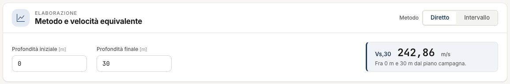
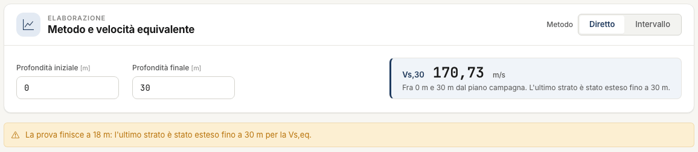
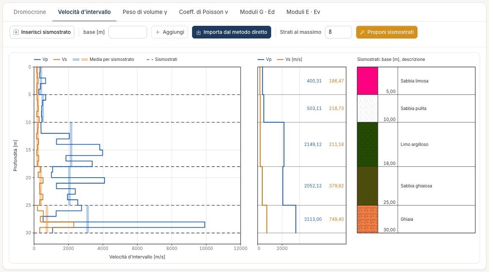
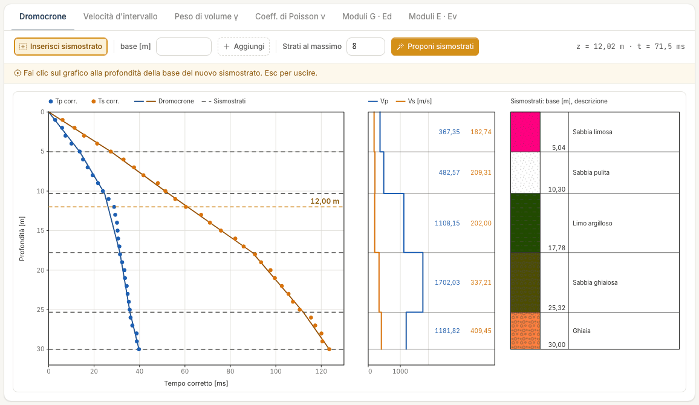
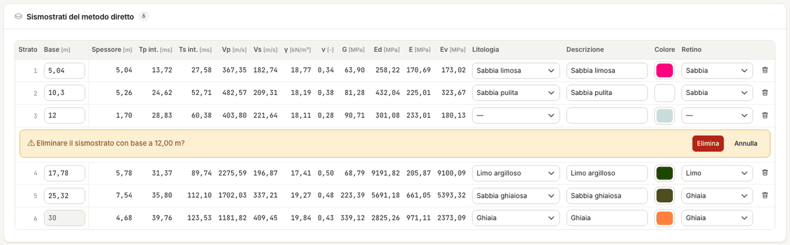
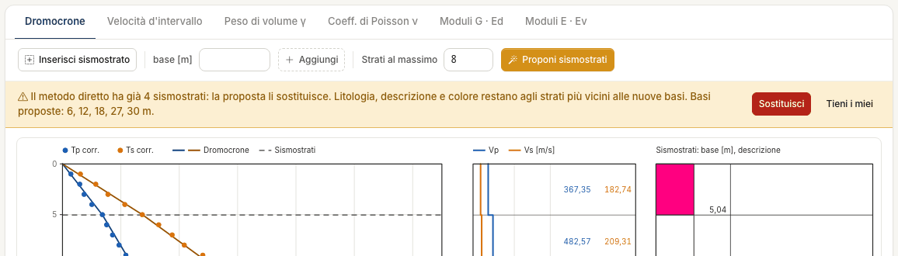
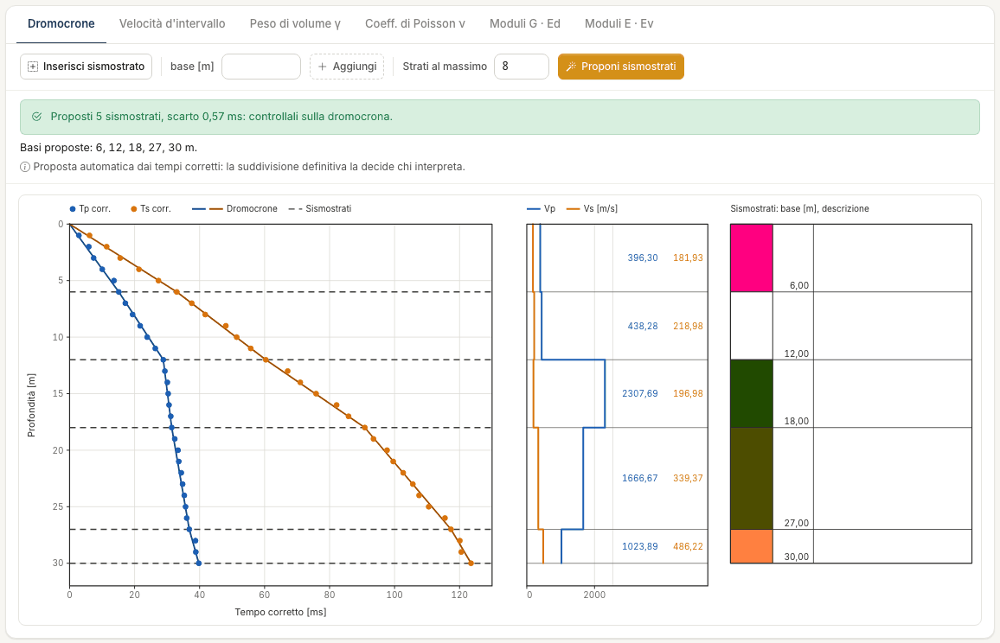
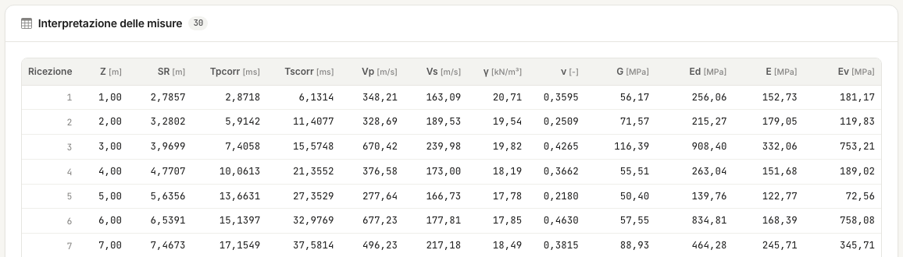

# Elaborazione: metodo diretto e metodo intervallo

La scheda **Elaborazione** mostra i risultati e ti fa definire i **sismostrati**. Non c'è un
pulsante di calcolo: ogni modifica alle misure o agli strati aggiorna subito grafici e
tabelle, senza consumare crediti.

La scheda ha quattro parti, dall'alto in basso: metodo e velocità equivalente, i grafici, la
tabella dei sismostrati, la tabella **Interpretazione delle misure**.

Se le misure mancano o contengono un errore, al posto dei grafici compare **Prima servono le
misure** con l'errore da correggere e il rimando alla scheda [Misure](misure.md).

## Scegliere il metodo

In alto a destra, **Metodo** ha due posizioni:

- **Diretto** — definisci i sismostrati sulla dromocrona; ogni strato ha una velocità, la
  pendenza del tratto fra le sue due basi. È il metodo più stabile, perché media su più
  ricezioni.
- **Intervallo** — una velocità per ogni coppia di ricezioni consecutive. Dà il dettaglio
  metro per metro, ma è sensibile anche a piccoli errori sui tempi.

Ogni metodo ha i **suoi** sismostrati: quelli del metodo diretto e quelli del metodo
intervallo sono due elenchi separati. Cambiando metodo cambiano il grafico aperto e la
tabella dei sismostrati. Nella relazione puoi includere entrambi.

## Velocità equivalente V~s,eq~

La prima card calcola la velocità equivalente delle onde di taglio fra due profondità:

- **Profondità iniziale** — per le NTC è il piano di posa della fondazione; 0 = piano
  campagna;
- **Profondità finale** — H: la profondità del substrato, 30 m se è più profondo.

Il valore si aggiorna appena cambi un campo. Sotto il numero, una nota dice sempre fra quali
profondità è stato calcolato.

Tre cose da sapere:

- **L'etichetta.** Con profondità finale di 30 m o più l'etichetta è **Vs,30**; sotto i
  30 m è **Vs,eq (H = … m)**. Il valore è comunque quello fra le due profondità scritte
  nella nota: per la V~s,30~ di norma lascia 0 e 30.
- **La prova più corta di H.** Se le misure finiscono prima della profondità finale,
  l'ultimo strato viene **prolungato** fino a H. La nota e un avviso giallo lo dichiarano.
- **I sismostrati non la cambiano.** Nel metodo diretto la somma dei tempi di attraversamento
  degli strati è il tempo corretto delle onde S alla profondità H, dovunque siano le basi.
  Nel metodo intervallo è calcolata sugli intervalli di misura. I due metodi danno lo stesso
  numero, a meno degli arrotondamenti. Fa eccezione la prova più corta di H: lì conta la velocità dell'ultimo strato, che
  dipende dalla base che gli sta sopra.

!!! note "La categoria di sottosuolo resta a te"
    Downhole NX non attribuisce la categoria di sottosuolo. Per farlo serve la profondità
    del substrato, che la prova da sola non sempre raggiunge.

## I sei grafici

Le linguette sopra il grafico aprono sei disegni.

| Grafico | Che cosa mostra | Metodo |
|---|---|---|
| **Dromocrone** | Tempi corretti di P e S in funzione della profondità, con le rette dei sismostrati | diretto |
| **Velocità d'intervallo** | V~p~ e V~s~ per intervallo, con la media per sismostrato | intervallo |
| **Peso di volume γ** | γ per intervallo | intervallo |
| **Coeff. di Poisson ν** | ν per intervallo | intervallo |
| **Moduli G · Ed** | G ed E~d~ per intervallo | intervallo |
| **Moduli E · Ev** | E ed E~v~ per intervallo | intervallo |

Accanto a ogni grafico ci sono il **profilo di V~p~ e V~s~ per sismostrato**, con i valori
scritti, e la **colonna dei sismostrati** con base, colore, retino e descrizione.

Muovendo il puntatore sul grafico, in alto a destra leggi profondità e valore in quel punto
(per esempio «z = 12,02 m · t = 71,5 ms»).

I sismostrati si modificano sui grafici **del metodo attivo**. Se apri un grafico dell'altro
metodo, lo vedi in sola lettura, con il pulsante **Passa al metodo diretto** o **Passa al
metodo intervallo**.

## Inserire e modificare i sismostrati

Un sismostrato è definito dalla sua **base**, la profondità a cui finisce. Sulla dromocrona
la base va dove **cambia la pendenza**: i punti sopra e sotto si allineano su due rette
diverse.

### Inserire con un clic

1. Premi **Inserisci sismostrato**: il pulsante resta acceso e una riga gialla ricorda che
   cosa fare.
2. Muovi il puntatore sul grafico: una linea tratteggiata arancio ti segue, con la sua
   profondità.
3. Fai clic alla profondità della base. Nasce lo strato: una linea sul grafico e una riga
   nella tabella.
4. Puoi continuare a fare clic per altri strati. Esci con **Esc** o ripremendo il pulsante:
   finché il modo è attivo le linee non si trascinano.

### Inserire scrivendo la base

Scrivi la profondità nel campo **base [m]** accanto al pulsante e premi **Aggiungi**. È il
modo per avere una base esatta.

### Spostare

- **Trascina** la linea tratteggiata dello strato sul grafico. Il calcolo si aggiorna al
  rilascio.
- Oppure scrivi il nuovo valore nel campo **Base** della riga dello strato.

### Eliminare

Premi il **cestino** in fondo alla riga. Sotto la riga compare la conferma: **Elimina** o
**Annulla**. I due strati vicini si fondono in uno.

### Dove può stare una base

- Fra il piano campagna e l'ultima misura, **arrotondata al decimetro**.
- Nel **metodo intervallo** la base si aggancia sempre alla **profondità di misura più
  vicina**: lo strato è una media di intervalli interi.

### Lo strato di fondo

Il profilo del metodo diretto **finisce sempre all'ultima misura**. Per questo c'è sempre
almeno uno strato: senza altre basi è la velocità media dell'intero profilo, e inserire un
sismostrato significa dividerlo.

Lo strato di fondo segue l'ultima misura: la sua base è in grigio, non si trascina e non ha
il cestino. Se allunghi o accorci la tabella delle misure, si sposta da solo.

Nel metodo intervallo, invece, puoi non avere sismostrati: i valori per intervallo ci sono
comunque. Lo strato di fondo compare quando definisci la prima base.

### Portare gli strati del diretto nell'intervallo

Nel metodo intervallo, **Importa dal metodo diretto** copia le basi del metodo diretto, con
litologia, descrizione, colore e retino. Le basi vengono agganciate alle profondità di
misura: 10,30 m diventa 10 m, 17,78 m diventa 18 m.

### Descrivere uno strato

Nella riga di ogni strato puoi scegliere **Litologia**, **Descrizione**, **Colore** e
**Retino**. Scegliendo la litologia, descrizione e retino si precompilano. Sono dati
descrittivi: compaiono nella colonna accanto ai grafici, nella relazione e, se li importi,
nella [Stratigrafia](stratigrafia.md). Nessun calcolo li legge.

## Proporre i sismostrati

**Proponi sismostrati**, nella barra sopra il grafico, calcola dai tempi corretti dove la
pendenza della dromocrona cambia e propone le basi degli strati. È gratuito.

### Che cosa cerca

Fra tutte le suddivisioni possibili, l'app sceglie quella la cui **spezzata** — la linea che
unisce i tempi corretti alle basi degli strati — passa più vicino ai tempi corretti delle
onde P e delle onde S. Più strati seguono sempre meglio i punti: per questo il numero di
strati è scelto con un criterio che fa pagare ogni strato in più, e uno strato nuovo entra
solo se migliora l'accordo più di quanto valga l'incertezza di lettura dei tempi.

Due regole fissano il campo della ricerca:

- le basi stanno **sulle profondità di misura**: fra due ricezioni i tempi non dicono dove
  cambia la pendenza;
- ogni strato contiene **almeno due intervalli** di misura.

**Strati al massimo**, accanto al pulsante, limita il numero di strati (da 2 a 12; 8 di
partenza). Abbassalo se vuoi una suddivisione più semplice: sull'esempio, con 3 la proposta
è 12 – 18 – 30 m.

### Applicare la proposta

Se il metodo attivo non ha sismostrati, la proposta viene applicata subito.

Se ne ha già, una striscia mostra le **basi proposte** e chiede prima di toccarli:

- **Sostituisci** — i tuoi strati sono sostituiti. Litologia, descrizione e colore restano
  agli strati più vicini alle nuove basi;
- **Tieni i miei** — non cambia nulla.

Dopo l'applicazione una striscia verde riporta l'esito: *«Proposti 5 sismostrati, scarto
0,57 ms: controllali sulla dromocrona»*, seguita dalle basi. Lo **scarto** dice di quanto la
spezzata si discosta dai tempi corretti: più è piccolo, meglio li segue.

Se la dromocrona non mostra un cambio di pendenza apprezzabile, la proposta è un solo strato
per tutto il profilo, e l'app lo dice.

### Che cosa è, e che cosa non è

È la suddivisione che **meglio segue i tempi**, non un'interpretazione geologica. Non conosce
la stratigrafia del sondaggio, né la falda, né che cosa ti aspetti dal sito.

Sull'esempio propone 6 – 12 – 18 – 27 – 30 m; chi aveva interpretato la prova aveva scelto
5,04 – 10,30 – 17,78 – 25,32 – 30 m. Le differenze sono entro due ricezioni, e la V~s,eq~ è
la stessa.

Usala come punto di partenza: poi **trascina** le linee o **riscrivi** le basi, come per
gli strati inseriti a mano. Nel metodo diretto una base può stare anche fra due ricezioni.

La proposta è la stessa nel metodo diretto e nel metodo intervallo; viene applicata al
metodo attivo. Servono almeno due ricezioni, con il tempo di almeno un'onda a tutte le
profondità.

## Le tabelle

### Sismostrati

Una riga per strato. Nel **metodo diretto**:

| Colonna | Significato |
|---|---|
| **Base**, **Spessore** [m] | Profondità della base e spessore dello strato |
| **Tp int.**, **Ts int.** [ms] | Tempi corretti alla base dello strato, interpolati fra le due ricezioni vicine |
| **Vp**, **Vs** [m/s] | Velocità dello strato |
| **γ** [kN/m³] | Peso di volume, stimato o assegnato |
| **ν** | Coefficiente di Poisson |
| **G**, **Ed**, **E**, **Ev** [MPa] | Modulo di taglio, edometrico, di Young, di compressibilità volumetrica |

Nel **metodo intervallo** le stesse grandezze sono le **medie** dei valori degli intervalli
che lo strato contiene.

### Interpretazione delle misure

Una riga per ricezione: **Z**, la distanza sorgente–ricevitore **SR** e i tempi corretti
**Tpcorr** e **Tscorr**. Nel metodo intervallo si aggiungono V~p~, V~s~, γ, ν, G, E~d~, E,
E~v~ dell'intervallo che finisce a quella ricezione; la prima riga è l'intervallo fra il
piano campagna e la prima ricezione.

**«--» significa «non calcolabile»**, non zero. Succede quando manca un tempo, quando il
tempo corretto non cresce, o quando V~p~ e V~s~ non danno un coefficiente di Poisson fra 0 e
0,5.

## Errori e avvisi

Gli **errori** (striscia rossa) fermano il calcolo: vanno corretti nella scheda Misure.

| Errore | Che cosa fare |
|---|---|
| *Nessuna misura: compila la tabella dei tempi di tragitto* | Inserisci le misure. |
| *Le profondità devono essere positive e strettamente crescenti: controlla la riga n* | Due profondità uguali, fuori ordine o non positive. |
| *I tempi devono essere maggiori o uguali a zero: controlla la riga n* | Un tempo negativo. Zero è ammesso e vale «non misurato». |
| *L'offset della sorgente deve essere un numero maggiore o uguale a zero* | Correggi la geometria. |

Gli **avvisi** (striscia gialla) non fermano nulla: dicono come leggere un risultato.

| Avviso | Che cosa significa |
|---|---|
| *Tempo corretto decrescente fra due ricezioni consecutive: la riga del metodo intervallo resta «--» alle ricezioni …* | A quella ricezione il tempo corretto è minore o uguale al precedente: l'intervallo non ha una velocità. Quasi sempre è un tempo letto male: ricontrollalo sulle tracce. |
| *Il sismostrato n ha un'intercetta decrescente: i suoi valori copiano quelli dello strato precedente (\*)* | Fra le due basi il tempo corretto non cresce: lo strato non ha una velocità propria. È marcato con un asterisco. Sposta la base o ricontrolla i tempi. |
| *La prova finisce a … m: l'ultimo strato è stato esteso fino a … m per la Vs,eq* | La profondità finale supera l'ultima misura. La V~s,eq~ assume che la velocità dell'ultimo strato continui fino a H. |
| *Vs,eq non calcolabile: manca la Vs di almeno un tratto fra le profondità scelte* | Un tratto non ha V~s~ (tempi mancanti o non crescenti). |
| *La base di un sismostrato (… m) era oltre l'ultima misura ed è stata riportata a … m* | Succede aprendo un progetto del desktop, o dopo aver accorciato le misure. |
| *La profondità finale della Vs,eq deve essere maggiore di quella iniziale* | Correggi i due campi della prima card. |

Due strisce riguardano il progetto, non il calcolo:

- *Il progetto è stato modificato nel frattempo…* — l'assistente o un'altra scheda del
  browser hanno cambiato il progetto: ricarica la pagina per vederlo com'è ora.
- *L'assistente sta lavorando sul progetto…* — attendi che abbia finito: nulla è stato
  modificato.

---

*Hai trovato un errore in questa pagina? [Segnalacelo](mailto:info@geostru.ai?subject=Help%20Downhole%20NX) o apri una [Pull Request](https://github.com/EngSoft-Geostru/geostru-help-nx/edit/main/downhole/docs/it/elaborazione.md).*
