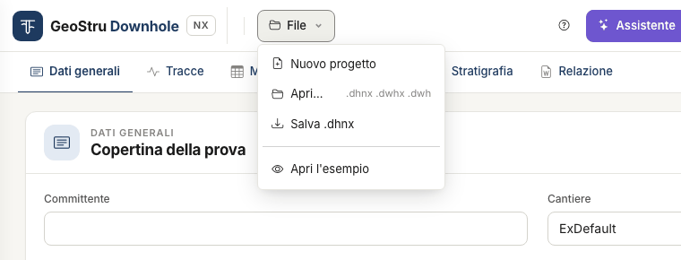

# File, progetti del desktop e GeoDropbox

Mentre lavori il progetto vive **sul server, nella tua sessione**. La copia che resta a te
è il file **`.dhnx`**: salvalo prima di uscire.

## Il menu File

| Voce | Che cosa fa |
|---|---|
| **Nuovo progetto** | Svuota il progetto in sessione. |
| **Apri…** | Apre un file `.dhnx`, oppure un `.dwhx` / `.dwh` del programma desktop. |
| **Salva .dhnx** | Scarica il progetto sul tuo computer. |
| **Apri l'esempio** | Carica il progetto di esempio: 30 ricezioni, 5 sismostrati. |

Nuovo, Apri ed esempio **sostituiscono** il progetto in sessione. Se c'è qualcosa da
perdere, una striscia sotto la barra chiede conferma: ciò che non hai salvato in un file
andrà perso.

## Il file .dhnx

**Salva .dhnx** scarica un unico file con tutto il progetto:

- dati generali, geometria e tabella delle misure;
- opzioni (metodo, peso di volume, profondità della V~s,eq~);
- sismostrati dei due metodi e stratigrafia;
- le righe della scheda Tracce, i **tempi scelti** e le opzioni della vista;
- le sezioni scelte per la relazione;
- le **tracce**, entro il limite descritto sotto.

I risultati non sono nel file: si ricalcolano all'apertura, sempre con la versione corrente
del programma.

Prima di scaricare, l'app salva la scheda che hai a video: nel file c'è anche l'ultima
modifica.

### Le tracce nel file

Le tracce viaggiano dentro il `.dhnx` finché non superano, tutte insieme, i **30 MB**.

Oltre quel limite il file porta solo i **riferimenti** alle tracce: righe, profondità e
tempi scelti ci sono, le registrazioni no. L'app te lo dice due volte: nella scheda Tracce,
appena il rilievo supera il limite, e al momento del salvataggio.

Riaprendo un file così, la scheda Tracce elenca i file da ricaricare. **Trascina di nuovo
gli stessi file**: si ricollegano alle loro righe, senza crearne di nuove, e i tempi scelti
sono ancora al loro posto.

!!! tip "Tieni i file originali"
    Conserva sempre i file di acquisizione originali insieme al `.dhnx`: sono la sola copia
    sicura delle tracce quando il rilievo è grande.

Un file `.dhnx` si apre fino a 40 MB.

## Aprire un progetto del desktop

**File → Apri…** legge anche i progetti del programma desktop Downhole: `.dwhx` e `.dwh`,
fino a 2 MB. Il progetto viene convertito; il file originale non viene modificato, e l'app
non scrive file del desktop.

**Che cosa viene importato**

- geometria della prova e tabella delle misure (profondità, T~p~, T~s~);
- peso di volume automatico o assegnato, con i valori di γ per misura;
- sismostrati del metodo diretto e del metodo intervallo: base, litologia, descrizione,
  colore;
- stratigrafia e profondità della falda;
- dati generali: committente, cantiere, località, data, operatore, responsabile,
  descrizione, note, coordinate.

**Che cosa non viene importato**

| Non importato | Che cosa succede |
|---|---|
| Retini fatti con un file immagine | Erano percorsi sul disco di chi ha creato il progetto. Resta il retino della litologia. |
| Logo | Aggiungilo nel documento Word. |
| Colori dei grafici, impostazioni del DXF, margini e altezze dei testi, posizioni delle legende | Sono impostazioni del programma desktop, non della prova. |
| Dati anagrafici dello studio | Non sono usati. |
| Risultati salvati (intercette, pesi di volume) | Si ricalcolano. |
| Tracce e file di acquisizione del desktop (`.dsgx`) | Ricarica i file SEG-2 o di testo nella scheda [Tracce](tracce.md). |

Dopo l'apertura, strisce azzurre in alto elencano ciò che non è entrato o è stato corretto.
La più frequente: *«La base del sismostrato … (30,11 m) era oltre l'ultima misura ed è stata
riportata a 30 m»*. Il desktop poneva la base dell'ultimo strato alla distanza inclinata
dell'ultima ricezione; Downhole NX la riporta alla sua profondità.

!!! note "I numeri possono differire da quelli del desktop"
    Sullo stesso file alcuni risultati cambiano, perché Downhole NX corregge alcuni difetti
    del programma desktop. Ragione ed effetto di ogni differenza sono in
    [Validazione e differenze dal desktop](validazione.md#differenze-dal-programma-desktop).

## GeoDropbox

Il pulsante **GeoDropbox**, nella barra in alto, apre i tuoi progetti nel cloud GeoStru:

- **salva** il progetto corrente come `.dhnx` in un progetto GeoDropbox;
- **apre** un `.dhnx`, o un `.dwhx` / `.dwh` del desktop, salvato lì.

Così ritrovi il lavoro da qualunque postazione e lo condividi con lo studio. Come per
**Salva .dhnx**, l'app registra prima la scheda a video. GeoDropbox è un servizio separato
dai crediti delle app.

## La sessione

Il progetto resta in sessione finché lavori. **Dopo 30 minuti di inattività la sessione
scade** e il progetto non è più in memoria; lo stesso succede quando il servizio viene
aggiornato.

A sessione scaduta l'app non lavora su un progetto vuoto: dice *«La sessione è scaduta e il
progetto non è più in memoria: riapri il file salvato. Non è stato scritto né addebitato
nulla»*. Riapri il tuo `.dhnx` e prosegui.

Due abitudini evitano di perdere lavoro:

- **salva il `.dhnx`** (o su GeoDropbox) ogni volta che hai finito un passaggio: i tempi
  scelti, i sismostrati;
- lavora sullo stesso progetto in **una sola scheda del browser**. Se il progetto cambia
  altrove, l'app lo segnala e non salva ciò che avevi a video: ricarica la pagina.

---

*Hai trovato un errore in questa pagina? [Segnalacelo](mailto:info@geostru.ai?subject=Help%20Downhole%20NX) o apri una [Pull Request](https://github.com/EngSoft-Geostru/geostru-help-nx/edit/main/downhole/docs/it/file.md).*
