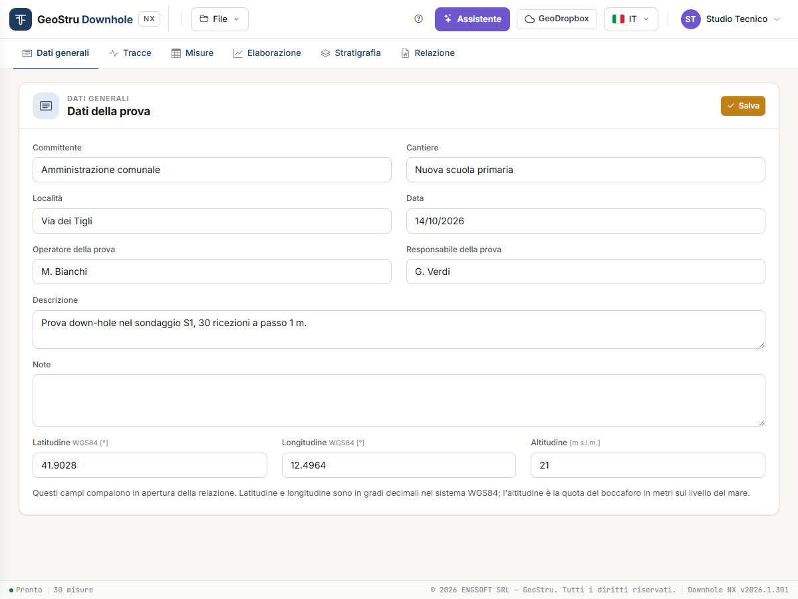
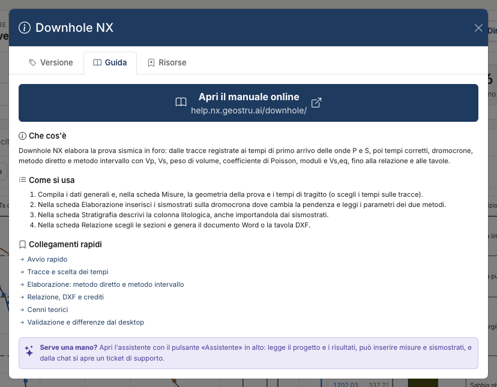

# Downhole NX — Prova sismica in foro

**Downhole NX** elabora la **prova sismica in foro (down-hole)**: dalle tracce registrate ai
tempi di primo arrivo delle onde P e S, poi tempi corretti, dromocrone, **metodo diretto** e
**metodo intervallo**, fino alla velocità equivalente V~s,eq~ (V~s,30~), alla relazione Word e
alle tavole DXF. È il programma desktop Downhole di GeoStru portato nel browser, con i
difetti di calcolo corretti e dichiarati.

Elabora anche la **prova cross-hole** (ASTM D4428/D4428M): sorgente e ricevitori in fori
diversi, alla stessa quota, con i fori deviati dal rilievo inclinometrico. Vedi
[Prova cross-hole](crosshole.md).

[**Apri l'app**](https://nx.geostru.ai/downhole/){ .md-button .md-button--primary }
[Guida rapida](quickstart.md){ .md-button }

## A chi serve

A geologi, geofisici e ingegneri geotecnici, e alle imprese di indagini che eseguono la
prova e devono consegnarne l'elaborazione: profilo di V~p~ e V~s~, parametri elastici
dinamici, V~s,eq~ per la caratterizzazione sismica del sito.

## Come si lavora

Sei schede, da sinistra a destra, seguono l'ordine del lavoro:

1. **Dati generali** — i **Dati della prova**: committente, cantiere, data, operatore,
   coordinate WGS84 e altitudine. Aprono la relazione.
2. **Tracce** — carichi i file registrati (SEG-2, testo o lo ZIP del piezocono sismico),
   l'app riconosce come è stata registrata la prova, e scegli sulle tracce il tempo di
   primo arrivo delle onde P e S a ogni profondità: a mano, oppure partendo dai tempi che
   l'app propone e che tu controlli. Se hai già i tempi, salti questa scheda.
3. **Misure** — la geometria della prova e la tabella profondità / T~p~ / T~s~: digitata,
   incollata da un foglio di calcolo o portata dalla scheda Tracce, con i tempi corretti
   accanto.
4. **Elaborazione** — tempi corretti, dromocrone, sismostrati inseriti sul grafico o proposti
   dall'app, parametri per strato e per intervallo, V~s,eq~.
5. **Stratigrafia** — la colonna litologica descrittiva.
6. **Relazione** — l'anteprima del documento, il Word e le tavole DXF.

In alto ci sono il menu **File**, il pulsante **?** dell'aiuto, l'**Assistente**,
**GeoDropbox**, la lingua e il menu utente.

Nella scheda **Dati generali** latitudine e longitudine si scrivono in **gradi decimali**
nel sistema WGS84 (per esempio 41.9028 e 12.4964) e l'**altitudine** è la quota del
boccaforo in m s.l.m. Sono tutti campi descrittivi: nessun calcolo li legge.

## Che cosa calcola

- **Tempi corretti** per l'obliquità del percorso sorgente–ricevitore.
- **Metodo diretto**: V~p~ e V~s~ di ogni sismostrato che definisci sulla dromocrona.
- **Metodo intervallo**: V~p~ e V~s~ fra due ricezioni consecutive, e le medie per sismostrato.
- Per ogni strato e intervallo: peso di volume γ, coefficiente di Poisson ν, modulo di
  taglio G, modulo edometrico E~d~, modulo di Young E, modulo di compressibilità volumetrica
  E~v~.
- **V~s,eq~** fra due profondità a tua scelta (V~s,30~ con 0 e 30 m).
- Nella **prova cross-hole**: distanze vere fra i fori deviati, velocità dirette e
  d'intervallo per quota, velocità adottata, quote segnate «possibile rifratta» o
  «incoerente», parametri e V~s,eq~. Vedi [Prova cross-hole](crosshole.md).

Tre aiuti non fanno parte del calcolo ma lo preparano: il **riconoscimento
dell'acquisizione**, che al caricamento capisce dai segnali come sono organizzati i file;
**Proponi i tempi**, che propone i primi arrivi sulle tracce e marca quelli dubbi; e
**Proponi sismostrati**, che propone le basi degli strati sulla dromocrona. Sono proposte: le
accetti, le correggi o le scarti.

Le formule sono in [Cenni teorici](teoria.md); i casi di prova in
[Validazione](validazione.md).

## Limiti da conoscere

- La qualità del risultato è quella dei tempi di arrivo. L'app può **proporli**, ma una
  proposta non è una lettura: vanno sempre riguardati sulle tracce, a partire da quelli che
  l'app stessa marca come dubbi.
- I sismostrati proposti sono la suddivisione che meglio segue i tempi, non
  un'interpretazione geologica.
- Legge tracce **SEG-2**, **di testo** (TXT, CSV) e gli **archivi ZIP del piezocono
  sismico** (esportazioni RAV o SPAS). Non legge altri formati di acquisizione.
- Assume **percorsi rettilinei** fra sorgente e ricevitore. Nel downhole non corregge per
  l'inclinazione del foro né per la quota della sorgente; nel cross-hole le distanze sono
  quelle vere fra i fori deviati, se gli dai il rilievo.
- I moduli sono **dinamici**, a piccole deformazioni.
- **Non attribuisce la categoria di sottosuolo**: la V~s,eq~ è un numero, la classificazione
  resta al progettista.

L'elenco completo dei limiti è in [Validazione](validazione.md#campi-dimpiego-e-limiti) e
nelle [Domande frequenti](faq.md).

## Che cosa consuma crediti

Downhole NX funziona a **crediti NX**. Li consumano solo tre azioni:

| Azione | Dove |
|---|---|
| **Genera Word** | scheda Relazione |
| **Esporta DXF** | scheda Relazione |
| Ogni **messaggio all'assistente** | pannello Assistente |

Caricare le tracce, scegliere i tempi, far proporre tempi e sismostrati, elaborare, spostare
i sismostrati, guardare i grafici e l'anteprima della relazione, salvare il progetto **non
costano nulla**. Se un'operazione a crediti non va a buon fine non viene addebitato nulla. Il manuale non riporta i prezzi: sono nel listino su
[geostru.ai](https://www.geostru.ai/), e il tuo saldo è nel menu utente in alto a destra.
Dettagli in [Relazione, DXF e crediti](relazione.md#crediti).

## Che cosa serve

- Un account GeoStru e una connessione a internet: il calcolo gira sul server.
- Un browser desktop aggiornato. L'app è collaudata con i browser basati su Chromium
  (Chrome, Edge) e con una finestra larga almeno 900 px; il trascinamento a tocco e Safari
  non sono stati collaudati.
- L'interfaccia è in sette lingue (italiano, inglese, francese, spagnolo, tedesco, rumeno,
  danese). La relazione è scritta nella lingua dell'interfaccia.

!!! warning "Salva prima di uscire"
    Il progetto vive sul server per la durata della sessione: dopo 30 minuti di inattività
    non c'è più. Salva il file con **File → Salva** (Ctrl+S) o usa **GeoDropbox**. Vedi
    [File, progetti del desktop e GeoDropbox](file.md).

## L'aiuto dentro l'app

Il pulsante **?** nella barra in alto apre l'aiuto. La scheda **Guida** riassume i passi e
porta alle pagine di questo manuale; la scheda **Risorse** elenca le funzioni e fa scaricare
i due progetti di esempio, `ExDefault.dhnx` e `ex-tracce-seg2.dhnx` (con le tracce SEG-2);
la scheda **Versione** mostra la versione in uso.

## Da dove iniziare

1. [Guida rapida](quickstart.md) — l'esempio, dall'apertura alla relazione.
2. [Tracce e scelta dei tempi](tracce.md) e [Misure e geometria della prova](misure.md) — i dati.
3. [Elaborazione](elaborazione.md) e [Stratigrafia](stratigrafia.md) — i risultati.
   Per la prova fra fori: [Prova cross-hole](crosshole.md).
4. [Relazione, DXF e crediti](relazione.md), [Assistente AI](assistente.md), [File](file.md).
5. [Cenni teorici](teoria.md), [Validazione e differenze dal desktop](validazione.md),
   [Domande frequenti](faq.md).

---

*Hai trovato un errore in questa pagina? [Segnalacelo](mailto:info@geostru.ai?subject=Help%20Downhole%20NX) o apri una [Pull Request](https://github.com/EngSoft-Geostru/geostru-help-nx/edit/main/downhole/docs/it/index.md).*
