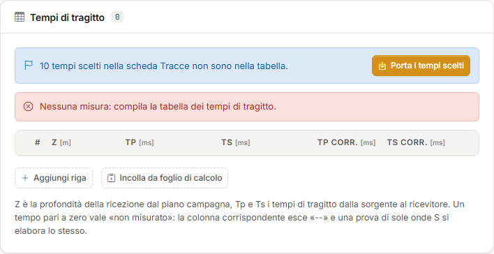
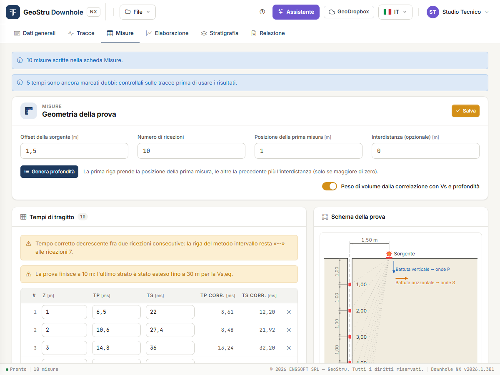

# Misure e geometria della prova

La scheda **Misure** contiene tutto ciò che il calcolo legge: la **geometria della prova** e
la tabella **profondità / T~p~ / T~s~**. I tempi arrivano dalla scheda [Tracce](tracce.md),
oppure li digiti o li incolli qui.

## Geometria della prova

| Campo | Significato |
|---|---|
| **Offset della sorgente** [m] | Distanza orizzontale d fra la sorgente e l'asse del foro. Entra nella correzione dei tempi. |
| **Numero di ricezioni** | Quante righe deve avere la tabella. |
| **Posizione della prima misura** [m] | Profondità della prima ricezione. |
| **Interdistanza (opzionale)** [m] | Passo fra una ricezione e la successiva. |

Gli ultimi tre campi servono a **generare la colonna delle profondità**; il calcolo legge
le profondità scritte in tabella, non questi campi. L'**offset della sorgente** invece entra
direttamente nel calcolo: controllalo sempre.

**Genera profondità** porta la tabella al numero di ricezioni indicato. La prima riga prende
la posizione della prima misura, le altre la precedente più l'interdistanza. Con
interdistanza zero restano le profondità già scritte. I tempi già presenti non vengono
toccati.

Se il numero di ricezioni è minore delle righe presenti, l'app chiede conferma prima di
eliminare le righe in fondo.

## Portare i tempi scelti

I tempi scelti nella scheda [Tracce](tracce.md) non entrano da soli nella tabella. Quando la
tabella non li riporta, sopra di essa compare una striscia:

- azzurra, *«n tempi scelti nella scheda Tracce non sono nella tabella»*, se la tabella è
  vuota o non contiene tempi;
- gialla, *«n tempi scelti nella scheda Tracce sono diversi da quelli della tabella:
  portarli sostituisce la tabella»*, se la tabella ha già dei tempi diversi.

Premi **Porta i tempi scelti**.

Che cosa succede:

- la tabella viene **sostituita** dai tempi scelti, ordinati per profondità, in
  millisecondi;
- basta **una sola onda**: l'altra colonna resta a zero, cioè «non misurato»;
- le profondità non positive o doppie non possono essere misure: restano fuori e una
  striscia le elenca;
- se fra i tempi portati ce ne sono ancora di **marcati dubbi**, una striscia lo ricorda:
  *«n tempi sono ancora marcati dubbi: controllali sulle tracce prima di usare i
  risultati»*.

!!! warning "Poi controlla la geometria"
    Il passaggio scrive profondità e tempi, non la geometria. Imposta l'**Offset della
    sorgente** con il valore vero: senza, i tempi corretti sono sbagliati.

## La tabella dei tempi di tragitto

Una riga per ricezione:

- **Z** [m] — profondità della ricezione dal piano campagna;
- **Tp** [ms] e **Ts** [ms] — tempi di tragitto dalla sorgente al ricevitore, come letti
  sulle tracce (non corretti);
- **Tp corr.** e **Ts corr.** [ms] — i **tempi corretti** alla verticale, t · z / SR con
  SR = √(z² + d²). Li calcola il programma, in sola lettura: si aggiornano quando cambiano
  tempi, profondità o offset. «--» vuol dire che il tempo non è misurato;
- **γ** [kN/m³] — solo con il peso di volume assegnato (vedi sotto).

Le profondità devono essere **positive e strettamente crescenti**.

**Un tempo pari a zero vale «non misurato»**. La colonna corrispondente esce «--» nei
risultati e il resto si calcola lo stesso: una prova di sole onde S si elabora lasciando a
zero tutti i T~p~.

**Aggiungi riga** aggiunge una riga in fondo, la **×** toglie la riga.

Sopra la tabella compaiono anche gli **avvisi del calcolo** (per esempio il tempo corretto
decrescente), gli stessi della scheda [Elaborazione](elaborazione.md#errori-e-avvisi): li
vedi mentre correggi i dati.

### Incollare da un foglio di calcolo

**Incolla da foglio di calcolo** apre un riquadro di testo. Copia le celle dal foglio e
incollale lì:

- una riga per misura: Z, T~p~, T~s~ e, se vuoi, γ;
- colonne separate da tabulazione o punto e virgola;
- decimali con virgola o con punto.

**Importa** sostituisce la tabella con le righe incollate. Poi premi **Salva**.

Puoi anche incollare un blocco di celle direttamente in una cella della tabella: le righe
si riempiono a partire da quella.

### Salvare

**Salva**, in alto a destra, registra geometria e tabella. Finché non salvi, accanto al
pulsante compare **Modifiche non salvate**.

Non serve premerlo a ogni cifra: poco dopo che hai smesso di scrivere l'app salva da sé, in
sottofondo, e ridisegna lo schema e i tempi corretti. Se cambi scheda con modifiche in
sospeso, le salva prima di cambiare.

Se una riga ha un errore (una profondità fuori ordine, un tempo negativo), una striscia
rossa sopra la tabella indica la riga da correggere.

## Peso di volume: automatico o assegnato

L'interruttore **Peso di volume dalla correlazione con Vs e profondità** decide da dove
viene γ, che serve per i moduli G, E~d~, E, E~v~.

**Acceso (predefinito).** γ è stimato per ogni strato e intervallo da una correlazione
empirica con V~s~ e profondità. È una stima: la formula è in
[Cenni teorici](teoria.md#peso-di-volume-dalla-correlazione).

**Spento.** Nella tabella compare la colonna **γ** e scrivi tu il peso di volume a ogni
ricezione, per esempio da prove di laboratorio.

- Nel metodo intervallo ogni intervallo usa il γ della sua ricezione.
- Nel metodo diretto ogni sismostrato usa la **media** dei γ delle ricezioni che contiene.
- Dove γ manca, γ e i moduli escono «--». Velocità e coefficiente di Poisson non dipendono
  da γ e si calcolano comunque.

## Schema della prova

A destra, lo **Schema della prova** disegna il foro, la sorgente con il suo offset, le
ricezioni alle profondità della tabella con le quote, i **raggi** dalla sorgente a ogni
ricezione e le due **battute**: verticale per le onde P, orizzontale per le onde S. Si
ridisegna mentre scrivi. Serve a controllare a colpo d'occhio che geometria e profondità
siano quelle volute; lo stesso disegno entra nella relazione e si esporta in DXF.

---

*Hai trovato un errore in questa pagina? [Segnalacelo](mailto:info@geostru.ai?subject=Help%20Downhole%20NX) o apri una [Pull Request](https://github.com/EngSoft-Geostru/geostru-help-nx/edit/main/downhole/docs/it/misure.md).*
