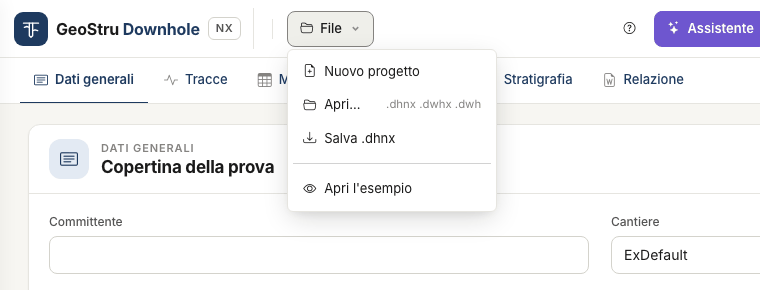
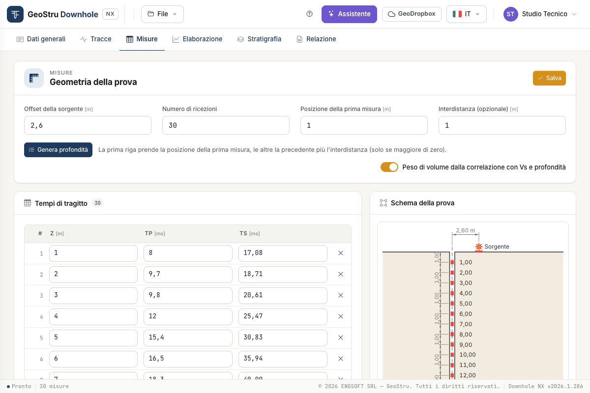
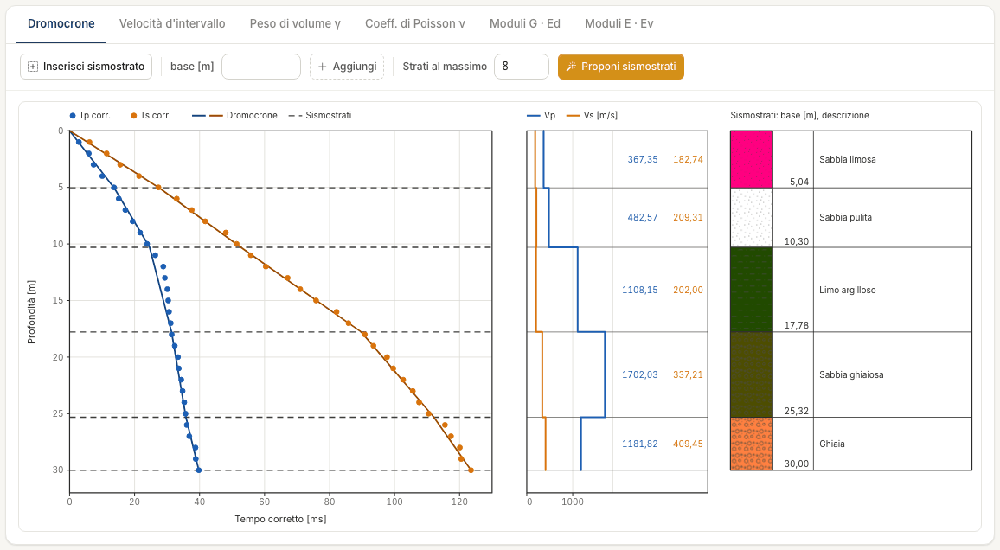
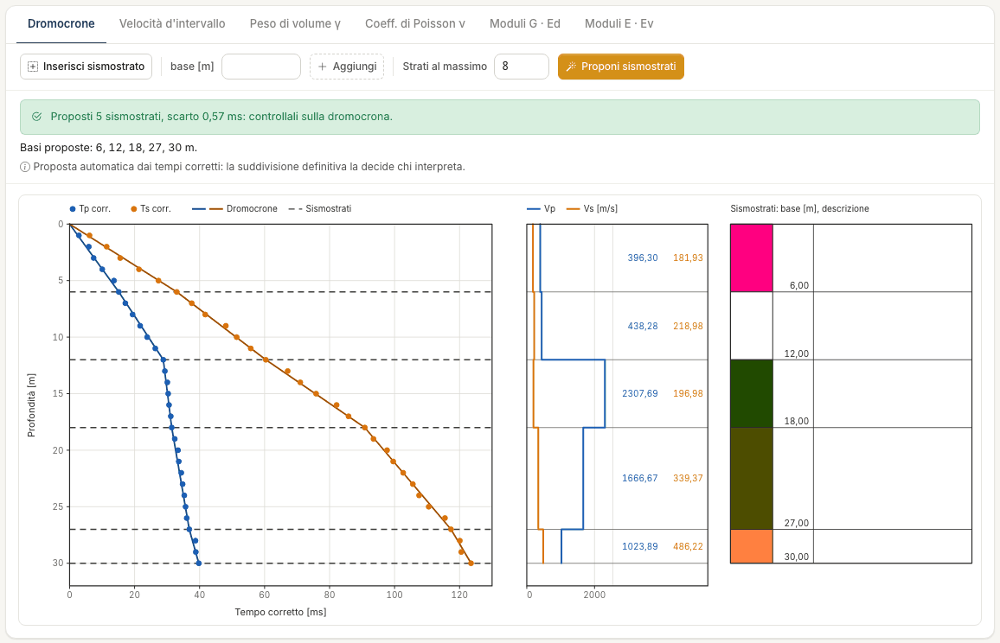

# Guida rapida (5 minuti)

Fai il giro completo con il progetto di esempio: una prova con **30 ricezioni a passo 1 m**,
da 1 a 30 m, sorgente a 2,6 m dal foro e cinque sismostrati. Non serve caricare nulla.

## 1. Apri l'esempio

Vai su [nx.geostru.ai/downhole](https://nx.geostru.ai/downhole/) con il tuo account GeoStru.
L'app si apre sulla scheda **Dati generali** con un progetto vuoto.

Apri il menu **File** e scegli **Apri l'esempio**. Se in sessione c'è già un progetto, una
striscia sotto la barra avvisa che verrà sostituito: premi **Conferma**.

## 2. Guarda le misure

Apri la scheda **Misure**. In alto c'è la **Geometria della prova**: offset della sorgente
2,6 m, 30 ricezioni, prima misura a 1 m, interdistanza 1 m. Sotto, la tabella **Tempi di
tragitto** con profondità Z e tempi T~p~ e T~s~ in millisecondi; a destra lo **Schema della
prova**.

## 3. Leggi l'elaborazione

Apri la scheda **Elaborazione**. Non c'è un pulsante «Calcola»: i risultati sono sempre
allineati ai dati.

In alto a destra leggi **V~s,30~ = 242,86 m/s**, calcolata fra 0 e 30 m. Sotto, il grafico
**Dromocrone** con i tempi corretti delle onde P (blu) e S (arancio) e le cinque linee
tratteggiate dei sismostrati; accanto, il profilo di V~p~ e V~s~ per strato e la colonna dei
sismostrati.

## 4. Prova a spostare un sismostrato

1. Premi **Inserisci sismostrato** e fai clic sul grafico a circa 12 m: nasce una linea
   tratteggiata e una riga nella tabella **Sismostrati del metodo diretto**. Esci con Esc.
2. Trascina la linea su o giù: velocità e moduli dei due strati vicini si aggiornano al
   rilascio.
3. Per toglierla, premi il cestino nella riga e poi **Elimina**.

La V~s,30~ resta 242,86 m/s: nel metodo diretto non dipende da dove metti gli strati. Il
perché è in [Elaborazione](elaborazione.md#velocita-equivalente-vseq).

## 5. Fai proporre i sismostrati

Sopra il grafico premi **Proponi sismostrati**. L'esempio ha già i suoi strati, quindi una
striscia mostra le basi proposte, **6, 12, 18, 27, 30 m**, e chiede se sostituirli: premi
**Sostituisci**, oppure **Tieni i miei** per lasciare tutto com'è.

La proposta è la suddivisione che meglio segue i tempi corretti; chi aveva interpretato la
prova aveva scelto 5,04 – 10,30 – 17,78 – 25,32 – 30 m. La V~s,30~ è sempre 242,86 m/s.
Dettagli in [Elaborazione](elaborazione.md#proporre-i-sismostrati).

## 6. Passa al metodo intervallo

In alto a destra premi **Intervallo**. Il grafico diventa **Velocità d'intervallo** e la
tabella **Interpretazione delle misure** mostra V~p~, V~s~, γ, ν e i moduli per ogni
ricezione. Con **Importa dal metodo diretto** porti qui i cinque sismostrati, agganciati
alle profondità di misura. Torna a **Diretto** quando hai finito.

## 7. Genera la relazione

Apri la scheda **Relazione**, lascia attive le sezioni che ti servono e premi **Genera
Word**. Il browser scarica il documento.

!!! note "Questa azione consuma crediti"
    **Genera Word** ed **Esporta DXF** consumano crediti NX; tutto il resto di questa guida
    è gratuito. Se la generazione non va a buon fine non viene addebitato nulla.

## 8. Salva il progetto

**File → Salva .dhnx** scarica il progetto sul tuo computer. Fallo prima di chiudere: il
progetto vive sul server solo per la durata della sessione.

## Con i tuoi dati

- **Hai le tracce registrate**: **File → Nuovo progetto**, poi la scheda
  [Tracce](tracce.md) per caricarle e scegliere i tempi, a mano o partendo da **Proponi i
  tempi**.
- **Hai già i tempi** (da un foglio di calcolo o da un rapporto di prova): vai alla scheda
  [Misure](misure.md) e usa **Incolla da foglio di calcolo**.
- **Hai un progetto del desktop** (`.dwhx` o `.dwh`): **File → Apri…**. Vedi
  [File, progetti del desktop e GeoDropbox](file.md).

---

*Hai trovato un errore in questa pagina? [Segnalacelo](mailto:info@geostru.ai?subject=Help%20Downhole%20NX) o apri una [Pull Request](https://github.com/EngSoft-Geostru/geostru-help-nx/edit/main/downhole/docs/it/quickstart.md).*
