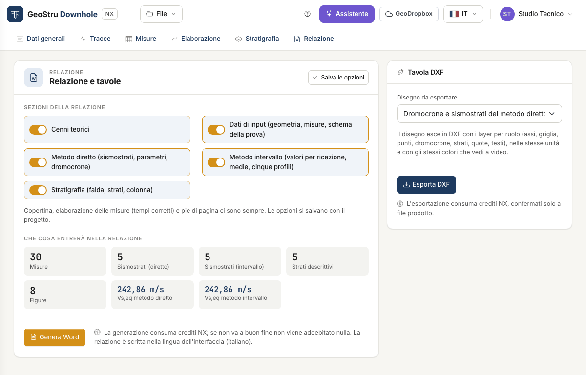

# Relazione, DXF e crediti

Dalla scheda **Relazione** escono i due elaborati della prova: la **relazione in Word** e le
**tavole DXF** dei grafici. Sono le due azioni dell'app che, insieme ai messaggi
all'assistente, consumano crediti.

## Prima di generare

Controlla tre cose, tutte gratuite:

1. i campi della scheda **Dati generali** (committente, cantiere, località, data, operatore,
   responsabile, descrizione, note, coordinate): compaiono sulla copertina e nel piè di
   pagina;
2. i sismostrati e la V~s,eq~ nella scheda [Elaborazione](elaborazione.md);
3. il riquadro **Che cosa entrerà nella relazione**: numero di misure, sismostrati dei due
   metodi, strati descrittivi, figure e V~s,eq~ dei due metodi.

Se le misure mancano o contengono errori, **Genera Word** è disattivato e una nota dice che
cosa correggere.

## Sezioni della relazione

Cinque interruttori scelgono che cosa includere.

| Sezione | Contenuto |
|---|---|
| **Cenni teorici** | La prova, la procedura, i due metodi, i parametri elastici, la V~s,eq~, i limiti e la bibliografia. |
| **Dati di input** | Geometria, tabella dei tempi misurati, schema della prova. |
| **Metodo diretto** | V~s,eq~, sismostrati, parametri per strato, dromocrone. |
| **Metodo intervallo** | V~s,eq~, parametri per intervallo di misura, sismostrati e valori medi, i cinque profili (velocità, γ, ν, G·E~d~, E·E~v~). |
| **Stratigrafia** | Falda, strati e colonna. Entra solo se la scheda Stratigrafia ha almeno uno strato. |

**Copertina**, **indice**, **elaborazione delle misure** (la tabella dei tempi corretti) e
piè di pagina ci sono sempre.

Le opzioni si salvano con il progetto: **Salva le opzioni**, oppure cambia scheda e l'app le
salva da sé.

## Genera Word

**Genera Word** produce un file `.docx` e il browser lo scarica.

- La relazione è scritta **nella lingua dell'interfaccia**: per averla in inglese, cambia
  lingua dal selettore in alto prima di generarla.
- Le figure sono gli stessi disegni che vedi a video.
- All'apertura Word può chiedere di aggiornare i campi: accetta, e l'indice prende i numeri
  di pagina. In alternativa, tasto destro sull'indice → **Aggiorna campo**.
- I valori non calcolabili restano «--», come a video; gli avvisi del calcolo sono riportati
  nel documento.

Il documento è un file Word normale: puoi modificarlo, aggiungere il tuo logo, convertirlo
in PDF dal tuo programma di scrittura.

## Tavola DXF

Nella card **Tavola DXF** scegli il **Disegno da esportare** e premi **Esporta DXF**:

- Schema della prova
- Dromocrone e sismostrati del metodo diretto
- Profilo delle velocità d'intervallo
- Profilo del peso di volume d'intervallo
- Profilo del coefficiente di Poisson d'intervallo
- Profilo dei moduli G ed E~d~ d'intervallo
- Profilo dei moduli E ed E~v~ d'intervallo
- Colonna stratigrafica

Ogni esportazione produce **un** disegno, con i layer per ruolo (assi, griglia, punti,
dromocrone, strati, quote, testi), nelle stesse unità e con gli stessi colori che vedi a
video. I testi sono nella lingua dell'interfaccia.

Se il disegno scelto è vuoto (per esempio la colonna stratigrafica senza strati), l'app lo
dice e non esporta nulla.

## Crediti

### Che cosa li consuma

| Azione | Quando viene addebitata |
|---|---|
| **Genera Word** | A documento prodotto. |
| **Esporta DXF** | A file prodotto. |
| **Messaggio all'assistente** | Quando la risposta arriva. |

### Che cosa è gratuito

Caricare le tracce, scegliere i tempi, compilare le misure, elaborare, inserire e spostare i
sismostrati, guardare tutti i grafici e le tabelle a video, compilare la stratigrafia,
salvare e aprire il progetto, aprire l'esempio.

### Quanto costano

Questo manuale non riporta i prezzi: cambiano con il listino, pubblicato su
[geostru.ai](https://www.geostru.ai/). Il tuo **saldo** è nel menu utente, in alto a destra.

Se il saldo non basta, l'app non genera nulla e mostra una striscia con i **crediti
necessari**, il **saldo** e il pulsante **Acquista crediti**. Il progetto resta in sessione:
ricarica i crediti e riprova.

### Se qualcosa va storto

**Se un'operazione non va a buon fine, non viene addebitato nulla.** Vale per ogni caso che
l'app può incontrare:

- errore durante la generazione del Word o del DXF;
- misure non valide o disegno vuoto;
- sessione scaduta: l'app lo dice e non scrive né addebita nulla;
- servizio dei crediti non raggiungibile: riprova fra qualche minuto;
- assistente non disponibile o risposta non arrivata.

Le condizioni complete (validità dei crediti, rimborsi) sono nei
[Termini di servizio](https://geostru.ai/it/terms-of-service/).

---

*Hai trovato un errore in questa pagina? [Segnalacelo](mailto:info@geostru.ai?subject=Help%20Downhole%20NX) o apri una [Pull Request](https://github.com/EngSoft-Geostru/geostru-help-nx/edit/main/downhole/docs/it/relazione.md).*
