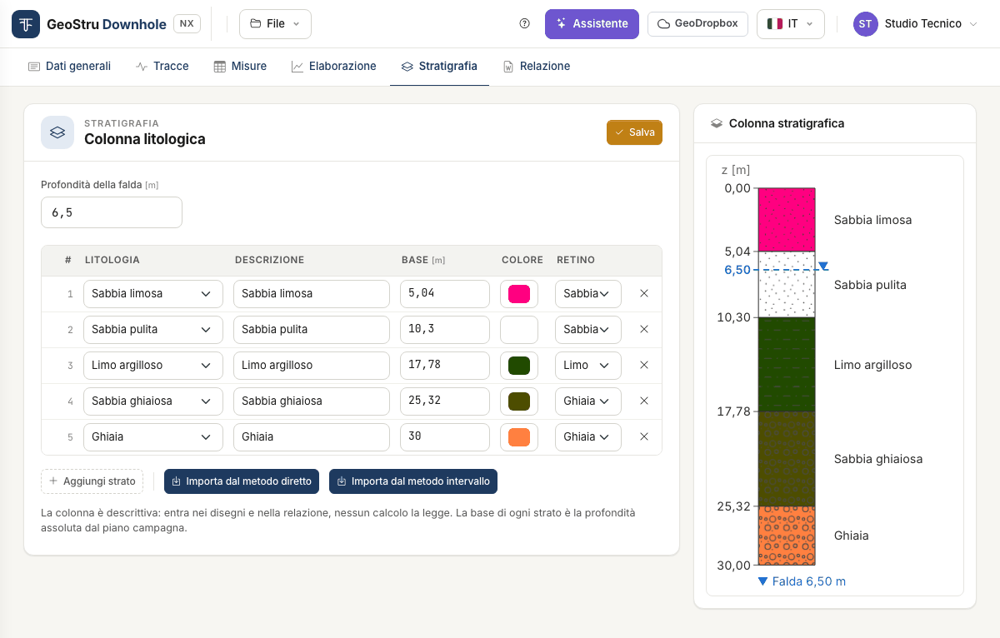

# Stratigrafia

La scheda **Stratigrafia** contiene la **colonna litologica** del sondaggio: falda e strati
con litologia, descrizione, colore e retino.

È una colonna **descrittiva**: entra nei disegni e nella relazione, ma **nessun calcolo la
legge**. Velocità, moduli e V~s,eq~ dipendono solo dalle misure e dai sismostrati della
scheda [Elaborazione](elaborazione.md). Se non ti serve in relazione, puoi lasciarla vuota.

## Falda

**Profondità della falda** [m] è la profondità dal piano campagna. Con un valore maggiore
di zero la falda è disegnata sulla colonna e scritta in relazione; con zero la relazione
riporta «Falda non rilevata entro la profondità indagata».

## Strati

Una riga per strato:

| Campo | Significato |
|---|---|
| **Litologia** | Una delle 14 voci dell'elenco, dalla sabbia pulita alla roccia. |
| **Descrizione** | Testo libero che compare accanto allo strato. |
| **Base** [m] | Profondità **assoluta** della base dal piano campagna, non lo spessore. |
| **Colore** | Colore di fondo dello strato. |
| **Retino** | Motivo grafico: sabbia, ghiaia, limo, argilla, terreno organico, roccia, o nessuno. |

Scegliendo la **litologia**, descrizione, retino e colore si precompilano; una descrizione
che hai scritto a mano non viene toccata.

**Aggiungi strato** crea una riga, la **×** la toglie. Premi **Salva** per registrare: la
colonna a destra si ridisegna con gli strati in ordine di profondità.

## Importare dai sismostrati

Spesso la colonna coincide con i sismostrati. Invece di riscriverla:

- **Importa dal metodo diretto** copia i sismostrati del metodo diretto;
- **Importa dal metodo intervallo** copia quelli del metodo intervallo.

Arrivano basi, litologie, descrizioni, colori e retini che hai dato agli strati nella scheda
Elaborazione. Gli strati scritti a mano vengono **sostituiti**: se ce ne sono, l'app chiede
conferma. Se il metodo scelto non ha sismostrati, la colonna resta vuota e l'app lo dice.

Dopo l'import puoi correggere le righe a mano. La colonna e i sismostrati restano
indipendenti: spostare un sismostrato dopo l'import non sposta lo strato della colonna.

!!! note "Attribuire la litologia"
    Le velocità da sole non dicono che terreno c'è. Usa la stratigrafia del sondaggio in
    cui è stata eseguita la prova.

---

*Hai trovato un errore in questa pagina? [Segnalacelo](mailto:info@geostru.ai?subject=Help%20Downhole%20NX) o apri una [Pull Request](https://github.com/EngSoft-Geostru/geostru-help-nx/edit/main/downhole/docs/it/stratigrafia.md).*
