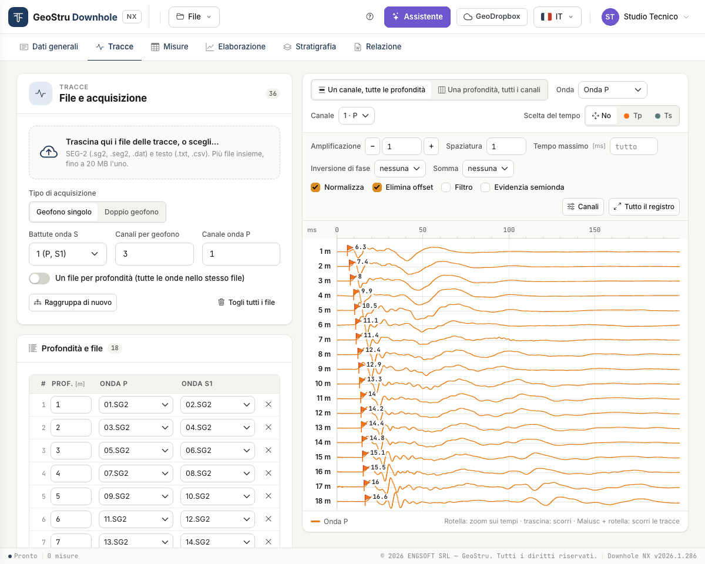
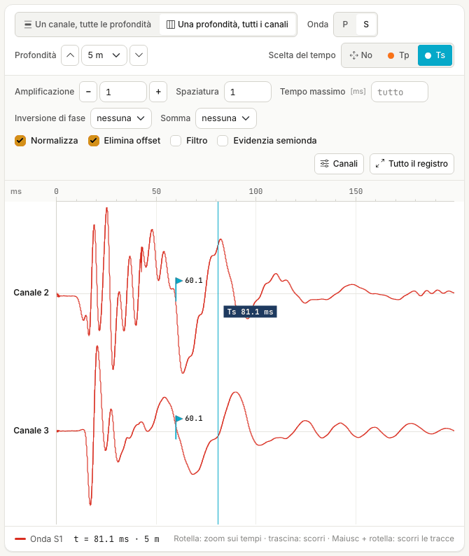
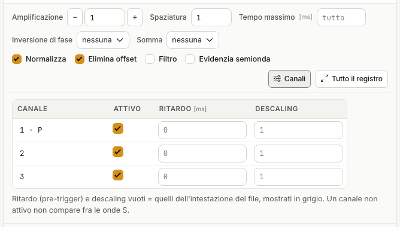
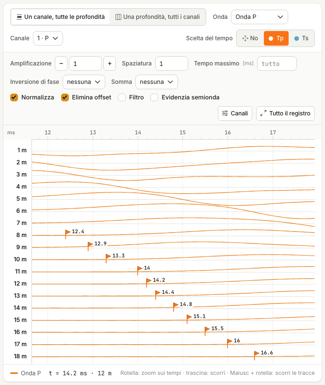
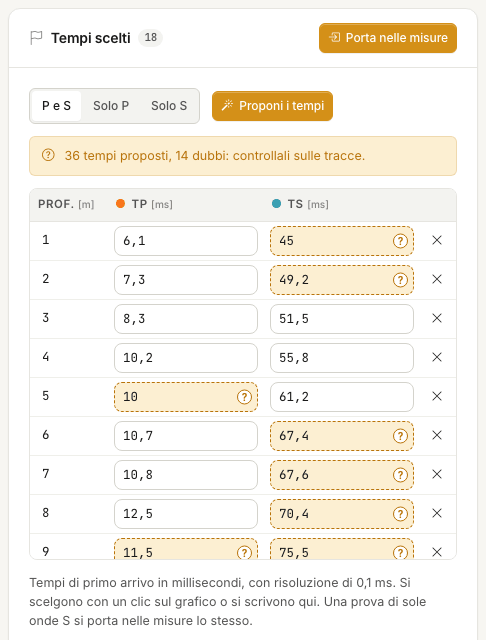
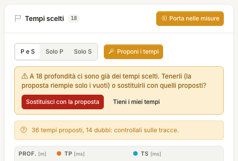
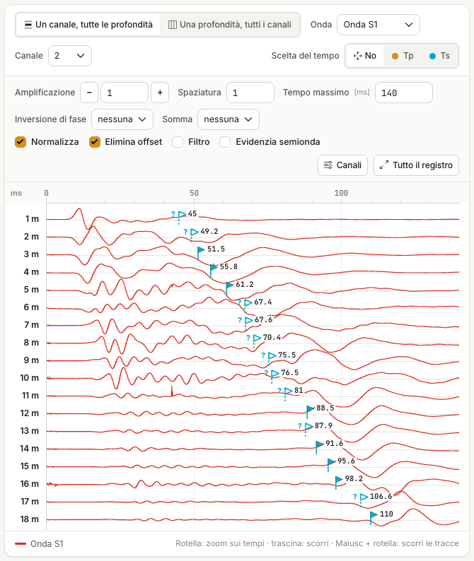
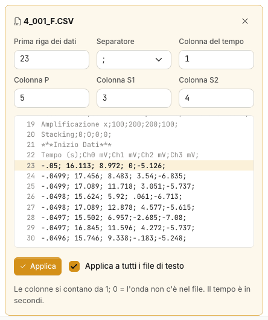
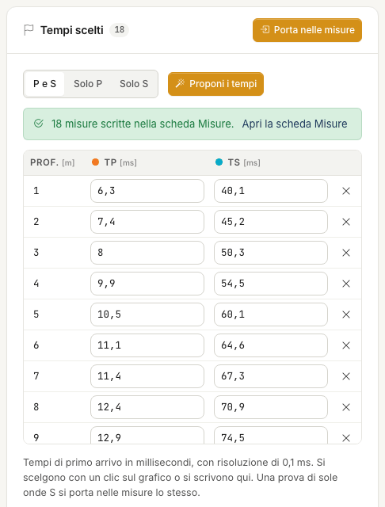

# Tracce e scelta dei tempi

Nella scheda **Tracce** carichi le registrazioni della prova, le guardi e scegli il **tempo di
primo arrivo** delle onde P (T~p~) e delle onde S (T~s~) a ogni profondità: a mano, con un
clic sulla traccia, oppure partendo dai tempi che l'app propone. Con **Porta nelle misure** i
tempi scelti diventano la tabella della scheda [Misure](misure.md).

Se i tempi li hai già, questa scheda non serve: vai direttamente alle Misure.

La scheda ha due colonne. A sinistra tre card: **File e acquisizione**, **Profondità e
file**, **Tempi scelti**. A destra la vista delle tracce.

## Caricare i file

Trascina i file sul riquadro tratteggiato, o fai clic per sceglierli. Puoi caricarne molti
insieme.

| Formato | Estensioni |
|---|---|
| SEG-2 | `.sg2`, `.seg2`, `.dat` |
| Testo, con le tracce in colonna | `.txt`, `.csv` |

Ogni file può pesare fino a **20 MB**; un progetto tiene al massimo **600 file**, **400
righe** di profondità e **64 canali**. Durante il caricamento una barra mostra «n di m
file»; alla fine una striscia riassume l'esito: quanti file sono entrati e, per quelli
rifiutati, il motivo.

Prima di caricare, imposta nella card **File e acquisizione** come è stata fatta la prova:

| Campo | Che cosa indica |
|---|---|
| **Tipo di acquisizione** | **Geofono singolo** o **Doppio geofono** (due sonde nello stesso file). |
| **Battute onda S** | **1 (P, S1)**: una battuta P e una battuta S per profondità. **2 (P, S1, S2)**: le due battute S orizzontali di verso opposto. |
| **Canali per geofono** | Quanti canali ha una sonda. 0 = tutti i canali del file. |
| **Canale onda P** | Il canale su cui leggere l'onda P (di solito quello verticale). |
| **Un file per profondità** | Ogni file contiene tutte le onde di una profondità. |

## Righe: una profondità, i suoi file

La card **Profondità e file** ha una riga per profondità, con il file della battuta P e
quelli delle battute S.

I file si raggruppano da soli **in ordine di nome** (conta il numero con cui il nome
inizia): a due a due con una battuta S, a tre a tre con due. Con 36 file e **Battute onda
S** = 1 ottieni 18 righe: `01` e `02` alla prima, `03` e `04` alla seconda, e così via.

Poi servono le profondità:

1. scrivi la profondità delle **prime due righe**;
2. le righe ancora vuote prendono il passo fra le due;
3. **Riempi dalle prime due** riscrive con quel passo tutte le righe dalla terza in giù.

Con **Un file per profondità** e nomi come `12` o `12m`, la profondità si legge dal nome.

Ogni cella si corregge a mano: la profondità si riscrive, il file si cambia dalla tendina,
la **×** toglie la riga, **Aggiungi riga** ne crea una vuota. Finché una riga non ha la
profondità, le sue tracce non compaiono nella vista.

- **Raggruppa di nuovo** ricostruisce le righe da tutti i file caricati con le opzioni
  correnti. Chiede conferma: le correzioni fatte a mano vanno perse.
- **Togli tutti i file** svuota file e righe. I tempi già scelti restano.
- **File caricati**, in fondo alla card, elenca i file con numero di tracce, campioni,
  passo di campionamento e durata.

## Le due viste

In alto, sopra il grafico, scegli come guardare le tracce.

**Un canale, tutte le profondità** — una traccia per profondità, dall'alto in basso: è la
sezione lungo il foro, quella su cui i primi arrivi si seguono da una profondità alla
successiva. Scegli l'**Onda** (Onda P, Onda S1, Onda S2, Onde S1 + S2 sovrapposte) e il
**Canale**.

**Una profondità, tutti i canali** — tutti i canali di una sola profondità. Scegli **P** o
**S** e la **Profondità**, con la tendina o con le frecce su e giù. Nella vista S compaiono
i canali attivi diversi da quello dell'onda P; con due battute S, S1 e S2 si sovrappongono
sullo stesso canale e l'inversione di polarità aiuta a riconoscere il primo arrivo dell'onda
di taglio.

## Comandi di visualizzazione

Cambiano solo il disegno, non i dati.

| Comando | Effetto |
|---|---|
| **Amplificazione** | Guadagno delle tracce: scrivi il valore, o usa **−** e **+** per ridurlo e aumentarlo a passi. |
| **Spaziatura** | Distanza fra le tracce. A 1 stanno tutte nella finestra. |
| **Tempo massimo** | Taglia il registro a quel tempo, in ms. Vuoto = tutto. |
| **Inversione di fase** | Inverte la polarità di S1 o di S2. |
| **Somma** | Mostra S1 − S2 oppure S2 − S1 al posto delle due tracce. |
| **Normalizza** | Ogni traccia è scalata sul proprio massimo. Senza, la scala è comune e le ampiezze si confrontano. |
| **Elimina offset** | Toglie a ogni traccia la sua media. |
| **Filtro** | Media mobile a 5 punti. |
| **Evidenzia semionda** | Riempie il lobo negativo delle tracce. |
| **Canali** | Apre la tabella dei canali (sotto). |
| **Tutto il registro** | Annulla zoom e scorrimento. |

Le ultime opzioni restano nel progetto: riaprendo la scheda ritrovi la vista com'era.

### Canali: attivo, ritardo, descaling

**Canali** apre una tabella con una riga per canale del file. Puoi spegnere un canale, o
scrivere un **Ritardo** (pre-trigger, in ms) e un **Descaling** diversi da quelli
dell'intestazione del file. I campi vuoti usano i valori del file, mostrati in grigio.

## Scegliere i tempi

La scelta a mano è la procedura di riferimento: anche i tempi proposti dall'app si
controllano, e si correggono, così.

1. In **Scelta del tempo** premi **Tp** o **Ts**. Scegliere Tp porta a video l'onda P,
   scegliere Ts le onde S.
2. Fai clic sulla traccia nel punto del primo arrivo.
3. Il tempo va alla profondità di quella traccia (nella vista per canale) o alla profondità
   a video (nella vista per profondità). Compare una **bandierina**, arancio per T~p~ e
   ciano per T~s~, e la riga della card **Tempi scelti** si aggiorna.

Un nuovo clic alla stessa profondità sostituisce il tempo. I tempi hanno una risoluzione di
**0,1 ms** e devono cadere dopo l'istante della battuta (t > 0).

Con **No** il clic non sceglie nulla: serve a scorrere e ingrandire senza rischi.

### Zoom e scorrimento

Sull'intero registro un pixel vale qualche decimo di millisecondo: per leggere bene il primo
arrivo ingrandisci.

- **Rotella**: zoom sull'asse dei tempi, attorno al puntatore.
- **Trascina**: scorre i tempi. Un trascinamento non è mai una scelta.
- **Maiusc + rotella**: scorre le tracce, quando non stanno tutte nella finestra.
- **Tutto il registro**: torna alla vista intera.

In basso a sinistra leggi sempre tempo e profondità sotto il puntatore.

### La tabella dei tempi scelti

La card **Tempi scelti** ha una riga per profondità, con T~p~ e T~s~ in millisecondi. I
valori si possono anche **scrivere o correggere a mano**; la **×** toglie i tempi di quella
profondità. Se una profondità non ha più una riga nella card **Profondità e file**, il suo
tempo resta ma è segnalato: non ha una traccia.

## Proporre i tempi

**Proponi i tempi**, nella card **Tempi scelti**, calcola una proposta dei tempi di primo
arrivo a tutte le profondità delle tracce caricate. È gratuito, e richiede qualche secondo.

Accanto al pulsante scegli le onde: **P e S**, **Solo P** oppure **Solo S**.

Alla fine una striscia riassume l'esito, per esempio *«36 tempi proposti, 14 dubbi:
controllali sulle tracce»*, e le bandierine compaiono sulle tracce come per i tempi scelti a
mano.

### Se ci sono già dei tempi

Se a qualche profondità hai già scelto dei tempi, l'app non li tocca senza chiedere. Una
striscia propone due strade:

- **Tieni i miei tempi** — la proposta riempie solo i vuoti;
- **Sostituisci con la proposta** — i tuoi tempi sono sostituiti da quelli proposti.

### I tempi dubbi

L'app marca come **dubbio** un tempo proposto che:

- si scosta di oltre 3 ms dall'andamento dei tempi alle profondità vicine;
- non cresce rispetto alla profondità precedente;
- cade su una traccia con poco segnale rispetto al rumore.

Un tempo dubbio si riconosce in due posti: nella tabella la cella è evidenziata e porta un
**«?»**; sulla traccia la bandierina è **vuota**, con un «?» accanto.

Il segno sparisce **quando il tempo lo scegli tu**: attiva **Tp** o **Ts** e fai clic sulla
traccia, anche nello stesso punto se la proposta ti convince, oppure scrivi il valore
corretto nella tabella.

«Dubbio» non vuol dire sbagliato: vuol dire **da guardare**. E un tempo non marcato non è
per questo giusto.

### Quanto fidarsi

Sul rilievo usato per le immagini di questa pagina (18 profondità), rispetto ai tempi scelti
a mano dall'operatore:

- **onde P** — scarto mediano 0,3 ms, massimo 1,4 ms: la proposta coincide con la lettura
  entro l'incertezza della lettura stessa;
- **onde S** — scarto mediano 1,4 ms, massimo 5,3 ms, su tempi di 40–110 ms; dieci tempi su
  diciotto sono marcati dubbi.

Le onde S sono il caso difficile, per due ragioni che ritrovi in quasi ogni prova:

- alle **prime profondità** l'onda di taglio è coperta dal treno delle onde P;
- dove il **treno d'onda cambia forma** da una profondità all'altra, il primo arrivo non si
  segue più con continuità.

!!! warning "Le proposte sulle S si controllano una per una"
    Passa nella vista **Un canale, tutte le profondità**, onda S, e guarda ogni bandierina,
    partendo da quelle vuote. Con due battute S usa anche la vista per profondità: lì
    l'inversione di polarità fra S1 e S2 dice dove arriva l'onda di taglio.

**Porta nelle misure** non distingue i tempi dubbi dagli altri: li porta tutti, e nelle
misure il segno non c'è più. Controlla prima. Tempi P che non crescono con la profondità
danno poi, in Elaborazione, l'avviso *«Tempo corretto decrescente»* e righe «--».

### Quando la proposta non parte

| Messaggio | Che cosa fare |
|---|---|
| *Non ci sono tracce da leggere…* | Carica i file e assegna la profondità a ogni riga. |
| *n file delle tracce non sono più sul server…* | Trascina di nuovo i file, poi richiedi la proposta. |
| *I file della battuta P e della battuta S hanno un numero diverso di canali…* | Controlla le righe e **Canali per geofono**. |
| *La proposta dei tempi non è riuscita su queste tracce* | Scegli i tempi a mano. |
| *Nessuna proposta alle profondità: … m* | A quelle profondità scegli il tempo a mano. |

In tutti questi casi non viene scritto nulla.

## Doppio geofono

Con **Doppio geofono** ogni file contiene le registrazioni di due sonde. I primi N canali
(N = **Canali per geofono**) sono della sonda superiore, alla profondità della riga; i
successivi N della sonda inferiore, una posizione più in basso (il passo fra la prima e la
seconda riga). Nella vista ogni traccia porta la nota «sonda superiore» o «sonda inferiore».

Se un file ha meno canali di quelli attesi (canali per geofono × 2), la scheda lo segnala.

## File di testo

Per un file `.txt` o `.csv` l'app deve sapere dove iniziano i dati e quali colonne leggere.
Al primo file di testo caricato si apre da solo il pannello **Opzioni di lettura del
testo**, con i valori che l'app ha riconosciuto e l'anteprima del file: controllali.

| Campo | Significato |
|---|---|
| **Prima riga dei dati** | La prima riga con i numeri, dopo l'intestazione. Nell'anteprima è evidenziata. |
| **Separatore** | `;`, `,` oppure tabulazione. |
| **Colonna del tempo** | In secondi. |
| **Colonna P**, **Colonna S1**, **Colonna S2** | Le colonne si contano da 1; 0 = l'onda non c'è nel file. |

**Applica** rilegge il file; con **Applica a tutti i file di testo** le stesse opzioni
valgono per tutti. Per riaprire il pannello di un file, usa il pulsante accanto al suo nome
nell'elenco **File caricati**.

## Portare i tempi nelle misure

Quando hai scelto i tempi, premi **Porta nelle misure** nella card **Tempi scelti**.

- I tempi passano alla tabella della scheda Misure, ordinati per profondità, in
  millisecondi.
- La tabella delle misure viene **sostituita**: se contiene già righe con dei tempi, l'app
  chiede conferma.
- Basta **una sola onda**: una prova di sole onde S si porta lo stesso, e l'altra colonna
  resta a zero, cioè «non misurata».
- Le profondità non positive o doppie non possono essere misure: restano fuori e la scheda
  le elenca.

!!! warning "Poi controlla la geometria"
    **Porta nelle misure** scrive profondità e tempi, non la geometria. Apri la scheda
    [Misure](misure.md) e imposta l'**Offset della sorgente**: senza il valore vero i tempi
    corretti sono sbagliati.

## Avvisi della scheda

| Avviso | Che cosa fare |
|---|---|
| *n righe non hanno la profondità: non entrano nelle viste* | Scrivi la profondità delle righe. |
| *Più righe hanno la stessa profondità: la vista per profondità mostra la prima* | Correggi la profondità doppia. |
| *I file della battuta P e della battuta S hanno un numero diverso di canali* | I canali si leggono per numero: controlla **Canale onda P** e **Canali per geofono**. L'app non assembla file P e S con un numero diverso di canali. |
| *Il file ha n canali: con il doppio geofono ne servono m* | Controlla **Canali per geofono** o il tipo di acquisizione. |
| *n file non sono più sul server: ricaricali* | Trascina di nuovo gli stessi file: si ricollegano alle righe, senza crearne di nuove. |
| *Le tracce pesano … MB e superano i … MB che entrano nel file .dhnx* | **Salva** scriverà solo i riferimenti alle tracce. Vedi [File](file.md#le-tracce-nel-file). |
| *Formato dei dati SEG-2 non supportato* | Il file usa una codifica dei campioni che l'app non legge. Vedi le [Domande frequenti](faq.md). |

---

*Hai trovato un errore in questa pagina? [Segnalacelo](mailto:info@geostru.ai?subject=Help%20Downhole%20NX) o apri una [Pull Request](https://github.com/EngSoft-Geostru/geostru-help-nx/edit/main/downhole/docs/it/tracce.md).*
