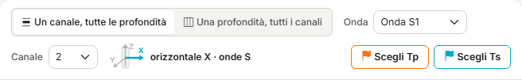
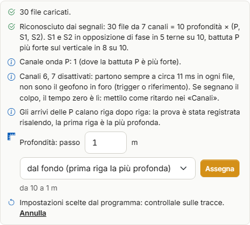
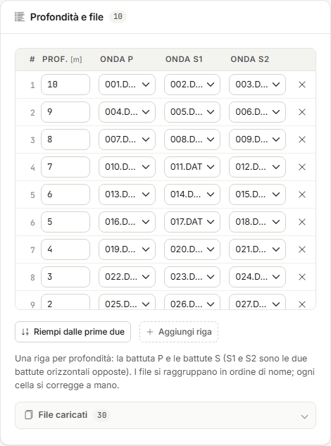
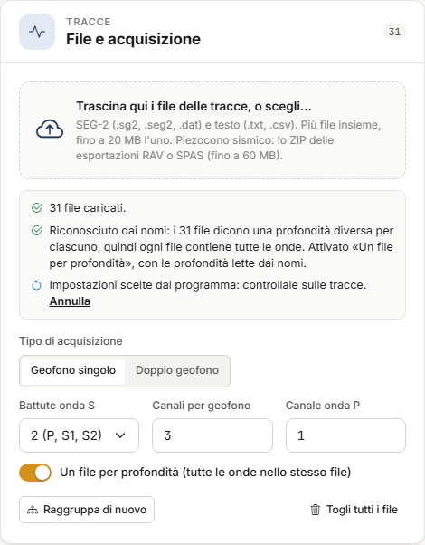

# Tracce e scelta dei tempi

Nella scheda **Tracce** carichi le registrazioni della prova, le guardi e scegli il **tempo di
primo arrivo** delle onde P (T~p~) e delle onde S (T~s~) a ogni profondità: a mano, con un
clic sulla traccia, oppure partendo dai tempi che l'app propone. I tempi scelti passano poi
nella tabella della scheda [Misure](misure.md), con il pulsante **Porta i tempi scelti**.

Se i tempi li hai già, questa scheda non serve: vai direttamente alle Misure.

La scheda ha due colonne. A sinistra tre card: **File e acquisizione**, **Profondità e
file**, **Tempi scelti**. A destra la vista delle tracce.

## Canali e battute: che cosa sono

È la distinzione da avere chiara prima di caricare i file.

**I canali sono i sensori del geofono.** Il geofono calato nel foro è **triassiale**: ha tre
sensori ad angolo retto, uno **verticale** (Z) e due **orizzontali** (X e Y). Ognuno scrive
su un canale del sismografo, quindi un file con tre canali contiene le tre componenti dello
stesso geofono. Il verticale registra bene le onde P, i due orizzontali le onde S.

**P, S1 e S2 sono battute, non canali.** Una battuta è un colpo dato in superficie, sulla
sorgente:

| Battuta | Come si dà | Dove si legge |
|---|---|---|
| **P** | colpo verticale sulla piastra | sul canale verticale |
| **S1** | colpo orizzontale in un verso | sui canali orizzontali |
| **S2** | colpo orizzontale nel verso opposto | sui canali orizzontali, con la polarità invertita rispetto a S1 |

Ogni battuta produce una registrazione con **tutti** i canali. Di solito ogni battuta è un
file; alcuni strumenti mettono invece tutte le battute di una profondità nello stesso file.

Alcuni sismografi registrano anche **canali in più**: il segnale del trigger, un sensore di
riferimento sulla sorgente, o la seconda sonda nel doppio geofono. Non sono il geofono in
foro, e per le onde S vanno esclusi (vedi [Canali](#canali-attivo-ritardo-descaling)).

Di qui i campi della card **File e acquisizione**:

- **Canale onda P** è il numero del canale del sensore **verticale**;
- **Canali per geofono** è quanti canali ha una sonda: 3 per un geofono triassiale;
- **Battute onda S** è quante battute S hai dato a ogni profondità, non quanti canali
  orizzontali ci sono.

Nella vista **Un canale, tutte le profondità**, accanto alla tendina **Canale**, un'icona del
geofono mostra quale sensore stai guardando, con l'asse in evidenza e la scritta
*verticale Z · onde P*, *orizzontale X · onde S* o *orizzontale Y · onde S*. Su un canale
oltre i tre del geofono l'icona non compare.

## Caricare i file

Trascina i file sul riquadro tratteggiato, o fai clic per sceglierli. Puoi caricarne molti
insieme.

| Formato | Estensioni |
|---|---|
| SEG-2 | `.sg2`, `.seg2`, `.dat` |
| Testo, con le tracce in colonna | `.txt`, `.csv` |
| Piezocono sismico: archivio delle esportazioni RAV o SPAS | `.zip` |

Ogni file può pesare fino a **20 MB**, l'archivio ZIP fino a **60 MB**; un progetto tiene al
massimo **600 file**, **400 righe** di profondità e **64 canali**. Durante il caricamento una
barra mostra «n di m file»; alla fine una striscia riassume l'esito: quanti file sono
entrati e, per quelli rifiutati, il motivo.

Prima di caricare puoi impostare nella card **File e acquisizione** come è stata fatta la
prova. Con file SEG-2 l'app spesso lo riconosce da sola (vedi sotto).

| Campo | Che cosa indica |
|---|---|
| **Tipo di acquisizione** | **Geofono singolo** o **Doppio geofono** (due sonde nello stesso file). |
| **Battute onda S** | **1 (P, S1)**: una battuta P e una battuta S per profondità. **2 (P, S1, S2)**: le due battute S orizzontali di verso opposto. |
| **Canali per geofono** | Quanti canali ha una sonda. 0 = tutti i canali del file. |
| **Canale onda P** | Il canale su cui leggere l'onda P: quello del sensore verticale. |
| **Un file per profondità (tutte le onde nello stesso file)** | Ogni file contiene tutte le battute di una profondità. |

### Il riconoscimento dell'acquisizione

Molti strumenti salvano i file con un **numero progressivo** (`001.DAT`, `002.DAT`…) e senza
dire nell'intestazione a quale profondità e a quale battuta corrispondono. In quel caso,
appena i file sono caricati, l'app **guarda i segnali** e prova a riconoscere come è stata
registrata la prova.

Lavora su file SEG-2, con il **Geofono singolo**, quando sono almeno sei, hanno tutti lo
stesso numero di canali e lo stesso passo di campionamento, e le righe sono ancora quelle
del raggruppamento automatico (non le hai corrette a mano). Decide solo ciò che i segnali
mostrano con chiarezza; il resto lo lascia com'è.

| Che cosa riconosce | Da che cosa | Che cosa cambia |
|---|---|---|
| **Terne P, S1, S2** | S1 e S2 in opposizione di fase sui canali orizzontali, battuta P più forte sul verticale, con regolarità ogni tre file | **Battute onda S** = 2; le righe si raggruppano a tre a tre |
| **Canale onda P** | il canale dove la battuta P è più forte | **Canale onda P** |
| **Canali di trigger** | canali il cui arrivo cade sempre allo stesso istante in ogni file, oltre i tre del geofono | il canale viene spento nella tabella **Canali**; **Canali per geofono** passa a 0 |
| **Verso della registrazione** | gli arrivi delle P che calano o crescono riga dopo riga | propone di assegnare le profondità dal fondo o dall'alto |

Il riepilogo compare nella striscia sotto il riquadro di caricamento, per esempio:

> *Riconosciuto dai segnali: 30 file da 7 canali = 10 profondità × (P, S1, S2). S1 e S2 in
> opposizione di fase in 5 terne su 10, battuta P più forte sul verticale in 8 su 10.*

seguito dal canale P, dai canali disattivati e dal verso. In fondo alla striscia,
*Impostazioni scelte dal programma: controllale sulle tracce* e **Annulla**, che rimette le
impostazioni di prima.

**Le profondità.** Nei file il passo fra una profondità e l'altra non c'è: lo dai tu. La
riga **Profondità: passo** è già compilata con 1 m e con il verso riconosciuto
(**dal fondo (prima riga la più profonda)** o **dall'alto (prima riga la più
superficiale)**); sotto, l'anteprima dice che cosa verrà scritto, per esempio «da 10 a 1 m».
Cambia passo o verso se serve, poi premi **Assegna**. Nessuna profondità entra senza che tu
l'abbia vista.

!!! warning "Il riconoscimento è un aiuto, non una certezza"
    Controlla sempre il risultato sulle tracce: che a ogni riga le tre battute siano quelle
    giuste, che la prima riga sia davvero la più profonda o la più superficiale, che i canali
    spenti non siano del geofono. Se un canale di trigger segna l'istante del colpo, il
    tempo zero è lì: scrivilo come **Ritardo** nella tabella **Canali**.

### Piezocono sismico (archivio ZIP)

Le prove con il **piezocono sismico** (SCPTU) si caricano trascinando l'**archivio ZIP** con
le esportazioni RAV o SPAS. L'archivio si carica da solo, senza altri file insieme.

L'app legge le registrazioni e prepara l'acquisizione:

- **somma le battute** ripetute alla stessa profondità, separatamente per la battuta
  sinistra, la destra e la P;
- assegna **S1 = sinistra** e **S2 = destra**; se la sonda ha salvato la battuta destra già
  invertita, la riporta al segno fisico, così S1 e S2 sono opposte;
- toglie dalle onde S la parte **uguale a tutte le profondità**, che non è un'onda che si
  propaga;
- scrive una riga per profondità, già con la sua profondità, e i tre file P, S1 e S2.

L'archivio **sostituisce** l'acquisizione precedente (file, righe, opzioni); i tempi già
scelti restano. Una striscia riassume che cosa è stato letto.

!!! warning "Distanza della sorgente e tempo zero"
    Nei file del piezocono non ci sono né la distanza della sorgente dal foro né il ritardo
    del trigger. La striscia dice quanto vale ora l'**Offset della sorgente** nella scheda
    Misure, e il tempo zero è il primo campione. Verificali prima del calcolo.

Il passo successivo è **Proponi i tempi**, poi il controllo sulle tracce.

## Righe: una profondità, i suoi file

La card **Profondità e file** ha una riga per profondità, con il file della battuta P e
quelli delle battute S.

I file si raggruppano da soli **in ordine di nome** (conta il numero con cui il nome
inizia): a due a due con una battuta S, a tre a tre con due. Con 36 file e **Battute onda
S** = 1 ottieni 18 righe: `01` e `02` alla prima, `03` e `04` alla seconda, e così via.

### La profondità dal nome del file

L'app legge la profondità dal nome solo quando il nome la dice **con l'unità**: un numero
seguito da **m**, come `12m`, `1m ps`, `12,5 m P` o `12m_S1`. Con **Un file per profondità**
vale anche un numero da solo, come `12`.

Un numero **nudo con zeri a sinistra**, come `001.DAT` o `06.sg2`, è il **progressivo** dello
strumento, non una profondità: la riga resta senza profondità e la scrivi tu.

Se i nomi indicano una profondità diversa per ogni file, la prova ha tutte le onde nello
stesso file: al caricamento l'app accende da sola **Un file per profondità**, ricompone le
righe (una per file, con la profondità letta dal nome) e lo scrive nell'esito, con
**Annulla** per tornare alle impostazioni di prima.

### Scrivere le profondità

Se le profondità non vengono dai nomi né dal riconoscimento:

1. scrivi la profondità delle **prime due righe**;
2. le righe ancora vuote prendono il passo fra le due;
3. **Riempi dalle prime due** riscrive con quel passo tutte le righe dalla terza in giù.

Ogni cella si corregge a mano: la profondità si riscrive, il file si cambia dalla tendina,
la **×** toglie la riga, **Aggiungi riga** ne crea una vuota. Finché una riga non ha la
profondità, le sue tracce non compaiono nella vista.

- **Raggruppa di nuovo** ricostruisce le righe da tutti i file caricati con le opzioni
  correnti. Chiede conferma: le correzioni fatte a mano vanno perse.
- **Togli tutti i file** svuota file e righe, dopo una conferma. I tempi già scelti
  restano: serve a ripartire con un altro rilievo senza perdere il lavoro fatto.
- **File caricati**, in fondo alla card, elenca i file con numero di tracce, campioni,
  passo di campionamento e durata.

## Le due viste

In alto, sopra il grafico, scegli come guardare le tracce.

**Un canale, tutte le profondità** — una traccia per profondità, dall'alto in basso: è la
sezione lungo il foro, quella su cui i primi arrivi si seguono da una profondità alla
successiva. Scegli l'**Onda** (Onda P, Onda S1, Onda S2, Onde S1 + S2 sovrapposte) e il
**Canale**; l'icona del geofono dice quale sensore è.

**Una profondità, tutti i canali** — tutti i canali di una sola profondità. Scegli **P** o
**S** e la **Profondità**, con la tendina o con le frecce su e giù. Nella vista S compaiono
i canali attivi diversi da quello dell'onda P; con due battute S in file separati, S1 e S2
si sovrappongono sullo stesso canale e l'inversione di polarità aiuta a riconoscere il primo
arrivo dell'onda di taglio.

## Comandi di visualizzazione

Cambiano solo il disegno, non i dati.

| Comando | Effetto |
|---|---|
| **Amplificazione** | Guadagno delle tracce: scrivi il valore, o usa **−** e **+** per ridurlo e aumentarlo a passi. |
| **Spaziatura** | Distanza fra le tracce. A 1 stanno tutte nella finestra. |
| **Tempo massimo** | Taglia il registro a quel tempo, in ms. Vuoto = tutto. |
| **Inversione di fase** | Inverte la polarità di S1 o di S2. |
| **Somma** | Mostra S1 − S2 oppure S2 − S1 al posto delle due tracce. |
| **Normalizza** | Ogni traccia è scalata sul proprio massimo. Senza, la scala è comune e le ampiezze si confrontano. |
| **Elimina offset** | Toglie a ogni traccia la sua media. |
| **Filtro** | Media mobile a 5 punti. |
| **Evidenzia semionda** | Riempie il lobo negativo delle tracce. |
| **Canali** | Apre la tabella dei canali (sotto). |
| **Tutto il registro** | Annulla zoom e scorrimento. |

Le ultime opzioni restano nel progetto: riaprendo la scheda ritrovi la vista com'era.

### Canali: attivo, ritardo, descaling

**Canali** apre una tabella con una riga per canale del file; il canale dell'onda P è
marcato «· P». Puoi spegnere un canale, o scrivere un **Ritardo** (pre-trigger, in ms) e un
**Descaling** diversi da quelli dell'intestazione del file. I campi vuoti usano i valori del
file, mostrati in grigio. Un canale non attivo non compare fra le onde S: è il modo di
escludere un canale di trigger o di riferimento.

## Scegliere i tempi

La scelta a mano è la procedura di riferimento: anche i tempi proposti dall'app si
controllano, e si correggono, così.

1. Premi **Scegli Tp** o **Scegli Ts**, in alto a destra nella vista. Il pulsante resta
   acceso; **Scegli Tp** porta a video l'onda P, **Scegli Ts** le onde S.
2. Fai clic sulla traccia nel punto del primo arrivo.
3. Il tempo va alla profondità di quella traccia (nella vista per canale) o alla profondità
   a video (nella vista per profondità). Compare una **bandierina**, arancio per T~p~ e
   ciano per T~s~, e la riga della card **Tempi scelti** si aggiorna.

Un nuovo clic alla stessa profondità sostituisce il tempo. I tempi hanno una risoluzione di
**0,1 ms** e devono cadere dopo l'istante della battuta (t > 0).

Per smettere di scegliere **ripremi il pulsante acceso** oppure premi **Esc**: il clic torna
a non scegliere nulla e serve solo a scorrere e ingrandire. In basso a destra la riga di
aiuto ricorda in che modo sei.

### Zoom e scorrimento

Sull'intero registro un pixel vale qualche decimo di millisecondo: per leggere bene il primo
arrivo ingrandisci.

- **Rotella**: zoom sull'asse dei tempi, attorno al puntatore.
- **Trascina**: scorre i tempi. Un trascinamento non è mai una scelta.
- **Maiusc + rotella**: scorre le tracce, quando non stanno tutte nella finestra.
- **Tutto il registro**: torna alla vista intera.

In basso a sinistra leggi sempre tempo e profondità sotto il puntatore.

### La tabella dei tempi scelti

La card **Tempi scelti** ha una riga per profondità, con T~p~ e T~s~ in millisecondi. I
valori si possono anche **scrivere o correggere a mano**; la **×** toglie i tempi di quella
profondità. Se una profondità non ha più una riga nella card **Profondità e file**, il suo
tempo resta ma è segnalato: non ha una traccia.

## Proporre i tempi

**Proponi i tempi**, nella card **Tempi scelti**, calcola una proposta dei tempi di primo
arrivo a tutte le profondità delle tracce caricate. È gratuito, e richiede qualche secondo.

Accanto al pulsante scegli le onde: **P e S**, **Solo P** oppure **Solo S**.

Alla fine una striscia riassume l'esito, per esempio *«20 tempi proposti, 5 dubbi:
controllali sulle tracce»*, e le bandierine compaiono sulle tracce come per i tempi scelti a
mano.

### Se ci sono già dei tempi

Se a qualche profondità hai già scelto dei tempi, l'app non li tocca senza chiedere. Una
striscia propone due strade:

- **Tieni i miei tempi** — la proposta riempie solo i vuoti;
- **Sostituisci con la proposta** — i tuoi tempi sono sostituiti da quelli proposti.

### I tempi dubbi

L'app marca come **dubbio** un tempo proposto che:

- si scosta di oltre 3 ms dall'andamento dei tempi alle profondità vicine;
- non cresce rispetto alla profondità precedente;
- cade su una traccia con poco segnale rispetto al rumore.

Un tempo dubbio si riconosce in due posti: nella tabella la cella è evidenziata e porta un
**«?»**; sulla traccia la bandierina è **vuota**, con un «?» accanto.

Il segno sparisce **quando il tempo lo scegli tu**: premi **Scegli Tp** o **Scegli Ts** e fai
clic sulla traccia, anche nello stesso punto se la proposta ti convince, oppure scrivi il
valore corretto nella tabella.

«Dubbio» non vuol dire sbagliato: vuol dire **da guardare**. E un tempo non marcato non è
per questo giusto.

### Quanto fidarsi

Su un rilievo reale di 18 profondità (caso 8 della
[Validazione](validazione.md#caso-8-le-proposte-automatiche)), rispetto ai tempi scelti a
mano dall'operatore:

- **onde P** — scarto mediano 0,3 ms, massimo 1,4 ms: la proposta coincide con la lettura
  entro l'incertezza della lettura stessa;
- **onde S** — scarto mediano 1,4 ms, massimo 5,3 ms, su tempi di 40–110 ms; dieci tempi su
  diciotto sono marcati dubbi.

Le onde S sono il caso difficile, per due ragioni che ritrovi in quasi ogni prova:

- alle **prime profondità** l'onda di taglio è coperta dal treno delle onde P;
- dove il **treno d'onda cambia forma** da una profondità all'altra, il primo arrivo non si
  segue più con continuità.

!!! warning "Le proposte sulle S si controllano una per una"
    Passa nella vista **Un canale, tutte le profondità**, onda S, e guarda ogni bandierina,
    partendo da quelle vuote. Con due battute S usa anche la vista per profondità: lì
    l'inversione di polarità fra S1 e S2 dice dove arriva l'onda di taglio.

I tempi dubbi passano nelle misure come gli altri, e nelle misure il segno non c'è più:
dopo il passaggio la scheda Misure ricorda quanti erano ancora dubbi. Controllali prima.
Tempi P che non crescono con la profondità danno poi, in Elaborazione, l'avviso *«Tempo
corretto decrescente»* e righe «--».

### Quando la proposta non parte

| Messaggio | Che cosa fare |
|---|---|
| *Non ci sono tracce da leggere…* | Carica i file e assegna la profondità a ogni riga. |
| *n file delle tracce non sono più sul server…* | Trascina di nuovo i file, poi richiedi la proposta. |
| *I file della battuta P e della battuta S hanno un numero diverso di canali…* | Controlla le righe e **Canali per geofono**. |
| *La proposta dei tempi non è riuscita su queste tracce* | Scegli i tempi a mano. |
| *Nessuna proposta alle profondità: … m* | A quelle profondità scegli il tempo a mano. |

In tutti questi casi non viene scritto nulla.

## Doppio geofono

Con **Doppio geofono** ogni file contiene le registrazioni di due sonde. I primi N canali
(N = **Canali per geofono**) sono della sonda superiore, alla profondità della riga; i
successivi N della sonda inferiore, una posizione più in basso (il passo fra la prima e la
seconda riga). Nella vista ogni traccia porta la nota «sonda superiore» o «sonda inferiore».

Se un file ha meno canali di quelli attesi (canali per geofono × 2), la scheda lo segnala.
Il riconoscimento automatico dell'acquisizione non lavora con il doppio geofono.

## File di testo

Per un file `.txt` o `.csv` l'app deve sapere dove iniziano i dati e quali colonne leggere.
Al primo file di testo caricato si apre da solo il pannello **Opzioni di lettura del
testo**, con i valori che l'app ha riconosciuto e l'anteprima del file: controllali.

| Campo | Significato |
|---|---|
| **Prima riga dei dati** | La prima riga con i numeri, dopo l'intestazione. Nell'anteprima è evidenziata. |
| **Separatore** | `;`, `,` oppure tabulazione. |
| **Colonna del tempo** | In secondi. |
| **Colonna P**, **Colonna S1**, **Colonna S2** | Le colonne si contano da 1; 0 = l'onda non c'è nel file. |

**Applica** rilegge il file; con **Applica a tutti i file di testo** le stesse opzioni
valgono per tutti. Per riaprire il pannello di un file, usa il pulsante accanto al suo nome
nell'elenco **File caricati**.

## Portare i tempi nelle misure

I tempi scelti qui non sono ancora le misure del calcolo. Il passaggio si fa dalla scheda
[Misure](misure.md#portare-i-tempi-scelti): quando la tabella non riporta i tempi scelti
nelle Tracce, sopra la tabella compare una striscia con il pulsante **Porta i tempi
scelti**.

Basta **una sola onda**: una prova di sole onde S si porta lo stesso, e l'altra colonna
resta a zero, cioè «non misurato».

## Avvisi della scheda

| Avviso | Che cosa fare |
|---|---|
| *n righe non hanno la profondità: non entrano nelle viste* | Scrivi la profondità delle righe, o assegnale dalla striscia del riconoscimento. |
| *Più righe hanno la stessa profondità: la vista per profondità mostra la prima* | Correggi la profondità doppia. |
| *I nomi dei file indicano una profondità diversa per ogni file…* | Attiva **Un file per profondità**. |
| *I file della battuta P e della battuta S hanno un numero diverso di canali* | I canali si leggono per numero: controlla **Canale onda P** e **Canali per geofono**. L'app non assembla file P e S con un numero diverso di canali. |
| *Il file ha n canali: con il doppio geofono ne servono m* | Controlla **Canali per geofono** o il tipo di acquisizione. |
| *n file non sono più sul server: ricaricali* | Trascina di nuovo gli stessi file: si ricollegano alle righe, senza crearne di nuove. |
| *Le tracce pesano … MB e superano i … MB che entrano nel file .dhnx* | **Salva** scriverà solo i riferimenti alle tracce. Vedi [File](file.md#le-tracce-nel-file). |
| *Formato dei dati SEG-2 non supportato* | Il file usa una codifica dei campioni che l'app non legge. Vedi le [Domande frequenti](faq.md). |
| *un archivio ZIP si carica da solo* | Trascina lo ZIP del piezocono senza altri file. |
| *Lo ZIP non contiene registrazioni del piezocono sismico…* | L'archivio non ha esportazioni RAV o SPAS: controlla di aver scelto quello giusto. |
| *L'archivio ZIP è troppo grande…* | Al massimo 60 MB, 256 MB una volta estratto, 20 000 voci. |

---

*Hai trovato un errore in questa pagina? [Segnalacelo](mailto:info@geostru.ai?subject=Help%20Downhole%20NX) o apri una [Pull Request](https://github.com/EngSoft-Geostru/geostru-help-nx/edit/main/downhole/docs/it/tracce.md).*
