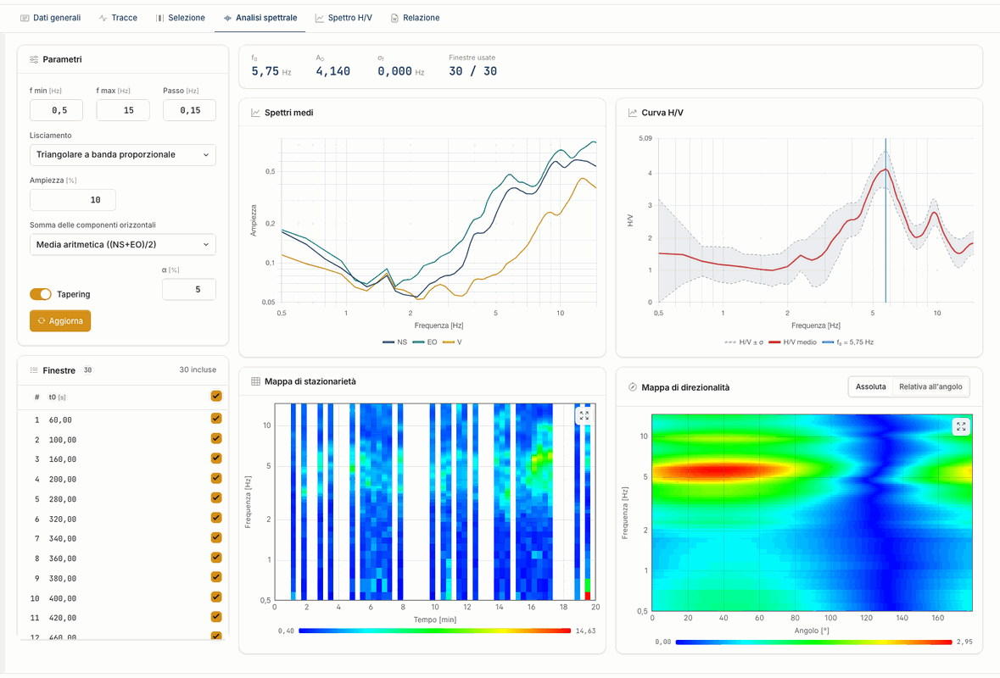
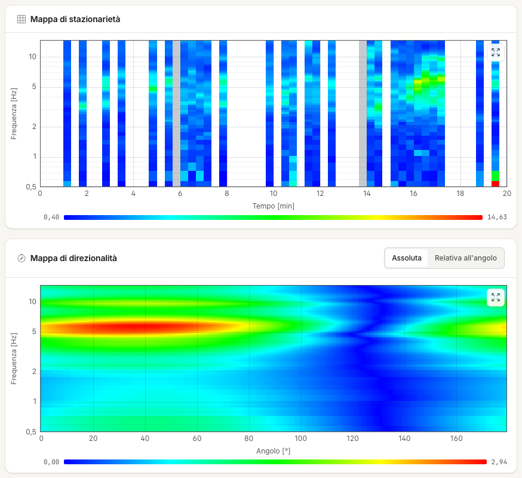

# Spectral analysis

For each window and component the server applies the taper, computes the Fourier transform and smooths the spectrum. It then averages the included windows and computes the H/V curve. The calculation starts when you open the tab.

If you change a parameter or a box in the **Windows** list, **To be updated** appears: press **Update** to recalculate. At the top of the tab you read f~0~, A~0~, σ~f~ and the **Windows
used**.

## Frequency band

| Parameter | Default |
|---|---|
| f min | 0.5 Hz |
| f max | 15 Hz (excluded) |
| Step | 0.15 Hz |

With these values the grid has 96 points, from 0.50 to 14.75 Hz. The band also decides where the peak is searched: choose a range that contains the frequencies
you care about with margin on both sides.

## Smoothing

| Type | Band around the central frequency f~c~ | Weight |
|---|---|---|
| Konno-Ohmachi | proportional, f~c~ · percentage | Konno and Ohmachi function, **Bandwidth coefficient (b)**, default 40 |
| Moving average | proportional, f~c~ · percentage | uniform |
| Triangular, constant band | constant, percentage · (f max − f min) | triangular |
| Triangular, proportional band | proportional, f~c~ · percentage | triangular |

The percentage is the **Width** field. The default is **Triangular, proportional bandwidth** at 10 %. The taper is a 5 % Tukey window: you set it with **Tapering** and α.

!!! note "If you come from the desktop program"
    In the desktop program the labels of the two triangular types were swapped: the default appeared as "constant" but had the proportional band. Here the name
    tells the truth, and the numbers do not change for the same calculation.

## Sum of the horizontals

| Sum | Formula |
|---|---|
| NS only | NS / V |
| EW only | EW / V |
| Arithmetic mean (default) | ((NS + EW) / 2) / V |
| Quadratic mean | √((NS² + EW²) / 2) / V |
| Vector sum | √(NS² + EW²) / V |

The vector sum is what the desktop program called "geometric mean": it gives values about √2 times the quadratic mean. The report uses the same name.

## The charts

**Mean spectra.** The three components against frequency. Around a stratigraphic peak the V component usually forms a trough. A sharp peak on all three is suspect:
it may be an industrial source.

**H/V curve.** Mean ± σ. The σ is relative, see [Theory](teoria.md).

**Stationarity map.** H/V of each window over time. A stable peak is a continuous horizontal band; interruptions show disturbances worth excluding. A click on the map picks the window in the list.

**Directionality map.** H/V against angle from 0 to 179°. A peak concentrated in one direction may indicate a directional source or a non-1D effect. The map is a
weighting of the mean amplitudes, not a rotation of the traces. The scale changes with **Absolute** and **Relative to the angle**.

---

*Found an error on this page? [Let us know](mailto:info@geostru.ai?subject=Help%20HVSR%20NX) or open a [Pull Request](https://github.com/EngSoft-Geostru/geostru-help-nx/edit/main/hvsr/docs/en/analisi-spettrale.md).*
