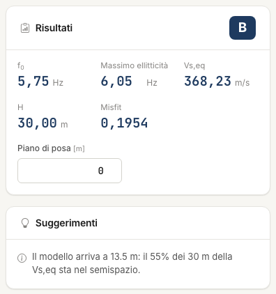

# V~s,eq~, category and hints

From the current model the app derives V~s,eq~ and the subsoil category, which you read in the **Results** box of the **H/V spectrum** tab. The result is worth as much as the model.

## V~s,eq~

Under NTC 2018 §3.2.2:

```text
Vs,eq = H / Σ(hᵢ / Vsᵢ)
```

H is the depth of the bedrock, the first layer with V~s~ ≥ 800 m/s, if it lies within 30 m of the foundation level; otherwise 30 m. The half-space is infinite: if the model ends before
30 m, the half-space extends to 30 m.

If the foundations are not at ground level, enter the **Foundation level** in the **Results** box: V~s,eq~ and bedrock are measured from there.

## Category

| Category | Condition |
|---|---|
| A | V~s,eq~ > 800 m/s |
| B | 360 < V~s,eq~ ≤ 800 |
| C | 180 ≤ V~s,eq~ ≤ 360 |
| D | 100 < V~s,eq~ < 180 |
| E | as C or D, with bedrock within 30 m |

At 100 m/s or below the app does not classify: assess the special cases S1 and S2.



!!! note "Differences from the desktop program"
    The desktop program did not extend the average to 30 m, counted the half-space thickness and did not compute V~s,eq~ when the first layer was already ≥ 800 m/s. HVSR NX values may
    therefore differ: 343 m/s against 224 on the desktop tutorial model. See [Validation](validazione.md).

## Hints

The **Suggestions** box, below the results, flags what deserves a check. They are not errors.

| Hint | Meaning |
|---|---|
| f~0~ not reproduced | the ellipticity maximum is more than 15 % from the measured f~0~ |
| Few parameters | the search has 2 free parameters at most: unlock something |
| Parameter at the limit | a value is close to its minimum or maximum: widen the range |
| Diverging ellipticity | the ellipticity maximum exceeds the H/V one 5 times: contrast probably too high |
| Different scale | with **Normalise the ellipticity** off, the two curves have very different scales: turn it on |
| Inconsistent geometry | V~s~/4H of the layer above the contrast is more than 30 % from f~0~ |
| Short model | layers end before 30 m: V~s,eq~ depends on the extended half-space |
| Velocity inversion | a layer is more than 10 % slower than the one above |

---

*Found an error on this page? [Let us know](mailto:info@geostru.ai?subject=Help%20HVSR%20NX) or open a [Pull Request](https://github.com/EngSoft-Geostru/geostru-help-nx/edit/main/hvsr/docs/en/categoria.md).*
