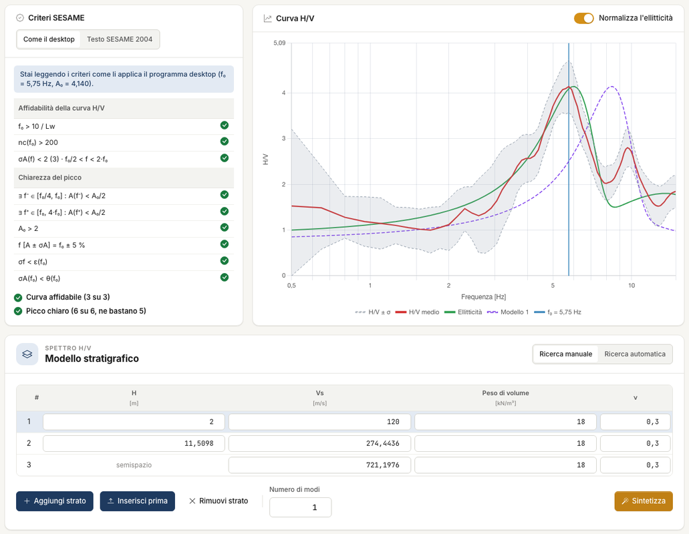
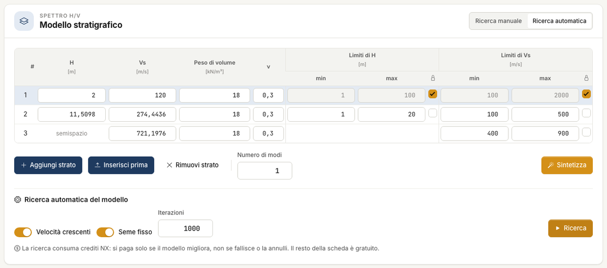
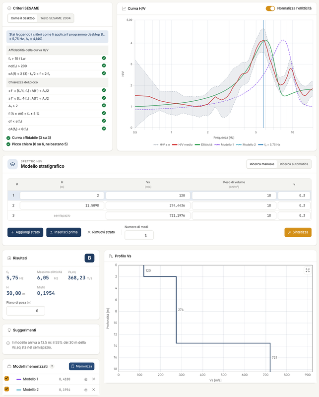

# Model and search

The layered model is the interpretive part of the analysis. From the model the engine computes the **ellipticity** of Rayleigh waves, that is the theoretical H/V curve, and
compares it with the measured one. You write the model in the **H/V spectrum** tab, below the curve.

## The layer table

One row per layer, from the top. **The last one is the half-space**: it is infinite and has no thickness.

| Field | Meaning |
|---|---|
| H | thickness [m] |
| Vs | shear wave velocity [m/s] |
| Unit weight | [kN/m³], typically 15–30 |
| ν | Poisson's ratio, links V~p~ to V~s~ |

With an empty table, **Add layer** creates two rows: a 5 m layer at 300 m/s and the half-space at 800 m/s, with 18 kN/m³ and ν = 0.3. Every further **Add layer** inserts a row above the
half-space, 5 m thick, with the other values of the previous layer. For **Insert before** and **Remove layer** click the row first. Unit weight and ν stay fixed during the search.

The **Number of modes** says how many curves to draw. The comparison uses the fundamental mode only; the higher ones are for reading.

**Normalise the ellipticity**, above the curve and on in new projects, brings the ellipticity maximum to that of the H/V curve. The misfit does not change.

## Synthesise: the model you write

**Synthesise** computes the ellipticity and misfit of the model in the table, without optimising and without using credits. It is the way to try by hand: you change a thickness or a
velocity and look at the curve.

## Search: the model the program finds

Press **Automatic search** at the top right: the table shows **H limits**, **Vs limits** and the padlock boxes, and the **Automatic model search** box appears below. **Manual search**
hides all this. The **Search** changes H and V~s~ to bring the ellipticity closer to the measured curve.

| Option | Meaning |
|---|---|
| min and max | the range to search; defaults H 1–100 m, V~s~ 100–2000 m/s |
| Padlock | the parameter stays at the value written |
| Increasing velocities | V~s~ does not decrease with depth; on in new projects |
| Fixed seed | two identical searches give the same result; on in new projects |
| Iterations | default 1000 |

Press **Search**: a bar shows the progress and **Cancel** interrupts it. The Search uses credits, only if the model improves: if it fails, if you cancel it or if it finds nothing better,
you do not pay and the project does not change. You can repeat it: the model in the table is the starting point of the next run.

!!! warning "Lock what you know"
    The curve depends on the ratio between V~s~ and H: multiplying all thicknesses and all velocities by the same number, the curve stays identical and V~s,eq~ changes. On an example,
    three models with the same curve give categories E, C and B. **At least one layer must be fixed with independent data**: a borehole, a downhole test, a MASW.

## The misfit

The misfit measures the **shape** distance between the measured curve and the fundamental mode, each normalised to its own maximum. The lower the better, but it only has **relative**
value: it serves to compare two models on the same data. The misfit is multiplied by a factor that grows if the fundamental mode is missing in part of the band.

## Several models

**Store** copies the current model to **Stored models**, with its misfit. The box on each row shows or hides it on the H/V curve, the arrow icon applies it as the current model, the **×**
removes it. It is the correct way to show uncertainty: if different models explain the curve, say so in the report.

---

*Found an error on this page? [Let us know](mailto:info@geostru.ai?subject=Help%20HVSR%20NX) or open a [Pull Request](https://github.com/EngSoft-Geostru/geostru-help-nx/edit/main/hvsr/docs/en/modello.md).*
