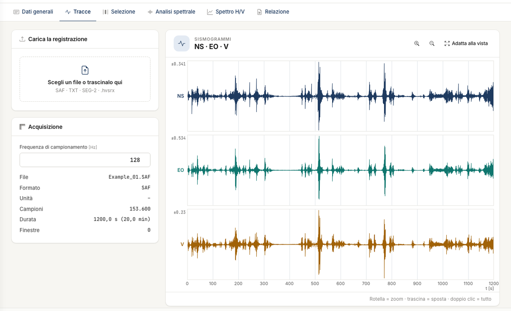
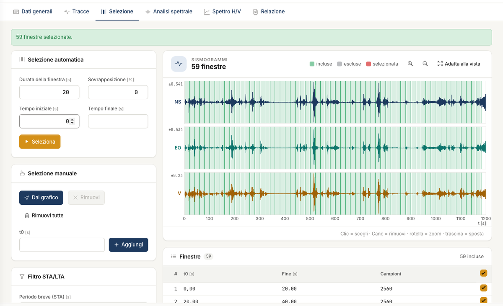
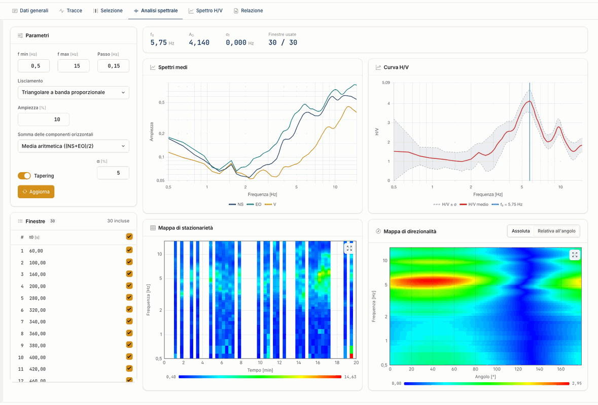
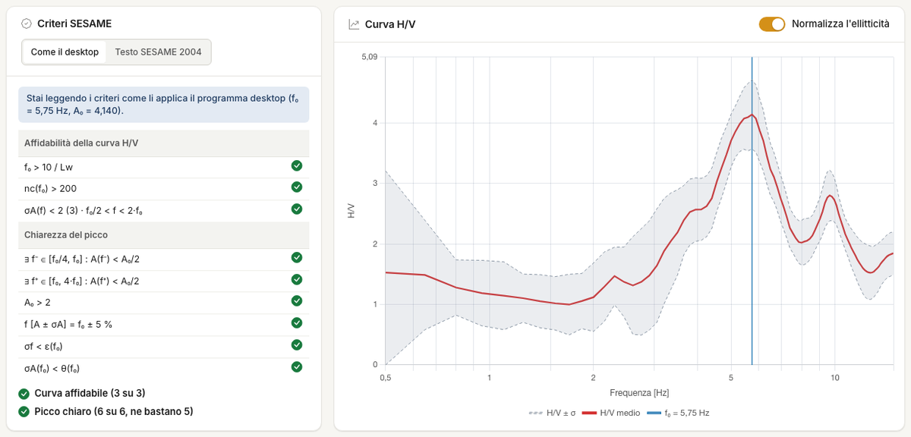

# Quick start (5 minutes)

You go from the recording to the H/V curve with the default settings. You need an account with access to the app. If you have no trace file at hand, open
the demonstration project with **File → Open the example**.

## 1. Import the traces

Open [nx.geostru.ai/hvsr](https://nx.geostru.ai/hvsr/) and go to the **Traces** tab. Drop a SAF, text or SEG-2 file on the **Choose a file or drop it here** box. For text and
SEG-2 files complete the options and press **Import**. Check that the sampling frequency is right and that the three components are in the right place.

## 2. Create the windows

In the **Selection** tab leave the proposed values, 20 s windows without overlap over the whole recording, and press **Select**. Then press **Filter** to remove the windows
with transients.

## 3. Read the spectrum

The **Spectral analysis** tab shows the mean spectra, the H/V curve and the stationarity and directionality maps: they are computed when you open the tab. The rows of the
stationarity map must show the peak at the same frequency throughout the recording.

## 4. Check f~0~ and SESAME

In the **H/V spectrum** tab read f~0~, A~0~ and the outcome of the **SESAME criteria**. Check on the curve that f~0~ is a real peak, not the edge of the band.

## 5. Generate the report

In the **Report** tab check the **Preview** and press **Generate Word**.

## Next steps

To estimate the V~s~ profile go to [Model and search](modello.md). For a complete analysis follow the [Tutorial](tutorial.md).

---

*Found an error on this page? [Let us know](mailto:info@geostru.ai?subject=Help%20HVSR%20NX) or open a [Pull Request](https://github.com/EngSoft-Geostru/geostru-help-nx/edit/main/hvsr/docs/en/quickstart.md).*
