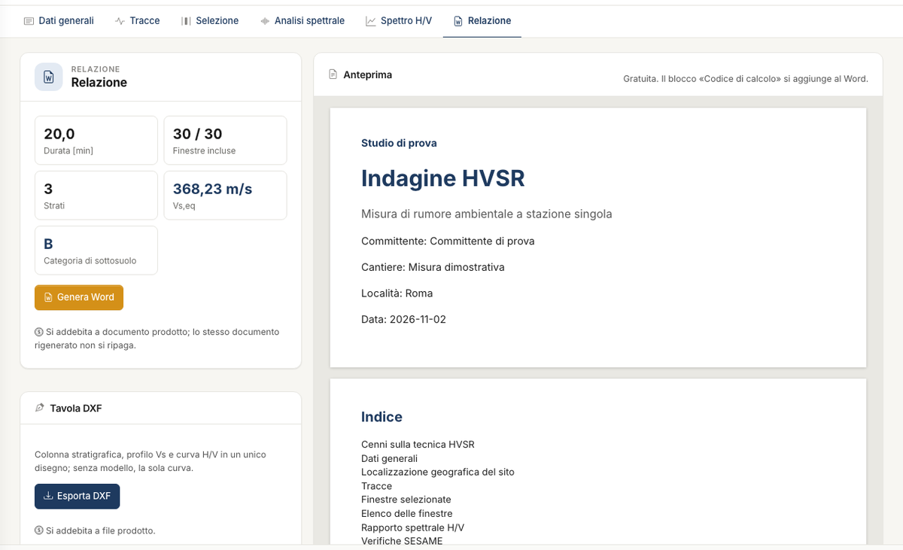

# Report, exports and credits

The **Report** tab sums up duration, included windows, layers, V~s,eq~ and category, and gathers all the outputs. It needs an H/V curve: traces loaded and at least two included
windows.

## Word report

The **Preview** is free and uses the same code as the document. **Generate Word** downloads the document, which contains:

- notes on the technique;
- general data and location;
- traces;
- windows, with the list of included and excluded ones, mean spectra and maps;
- H/V ratio with f~0~, parameters and table of SESAME checks, with the criteria you chose;
- model, if present: layers, V~s~ profile, V~s,eq~, category and summary sheet.

The report closes with the **Calculation code** block required by §10.2 NTC: software, engine version, document code and data fingerprint. The block does not appear in the preview. The
code is verified at `geostru.ai/verify/<code>`. The verification says that the document was issued, not that the calculations are free of errors.

## DXF sheet

**Export DXF** produces stratigraphic column, V~s~ profile and H/V curve in one vector drawing. Without a model it contains the curve only. The colour maps do not go into a DXF.

## CSV data

The **H/V curve**, **Mean spectra** and **Traces** buttons download the numerical data. They are free, with a semicolon separator and a decimal point. The same three files are also in the
**File** menu, under **Export to CSV**.

## What uses credits

| Action | Credits |
|---|---|
| Traces, windows, filter, spectrum, maps, SESAME checks | free |
| Synthesise, V~s,eq~, category, suggestions | free |
| Report preview, CSV | free |
| Search | yes, only if the model improves |
| Generate Word | yes, when the document is produced |
| Export DXF | yes, when the file is produced |
| Message to the assistant | yes, on a successful reply |

If an operation fails or you interrupt it, you do not pay. Regenerating the same document is not charged again. Credit balance and expiry are in the user menu.

---

*Found an error on this page? [Let us know](mailto:info@geostru.ai?subject=Help%20HVSR%20NX) or open a [Pull Request](https://github.com/EngSoft-Geostru/geostru-help-nx/edit/main/hvsr/docs/en/relazione.md).*
