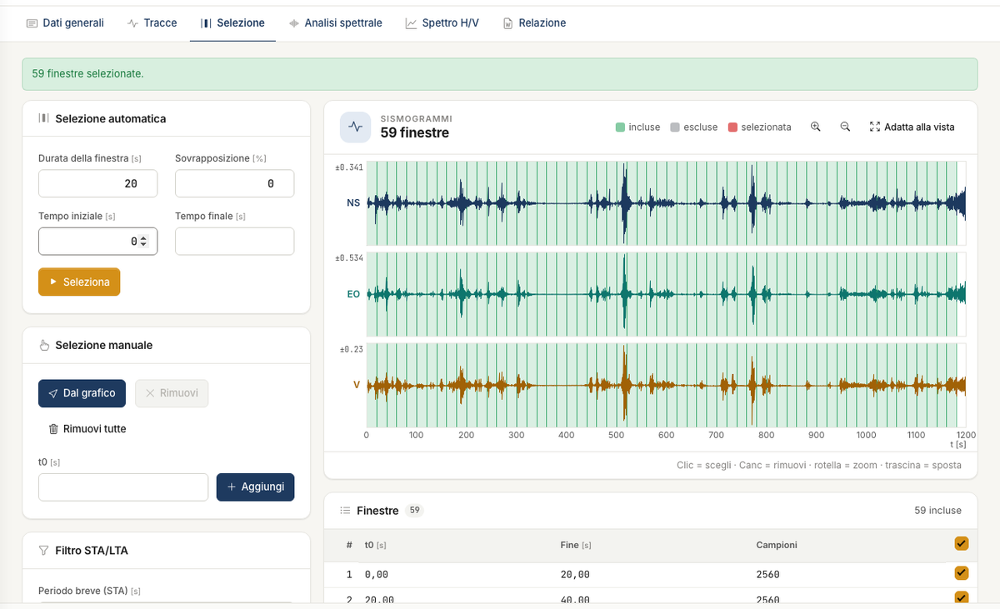
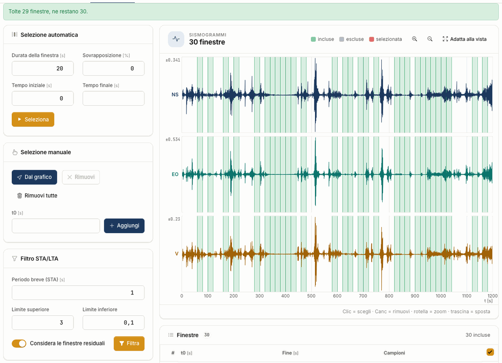

# Selection

The H/V curve is not computed on the whole recording but on many **windows** that are averaged. In this tab you decide which ones.

## Automatic selection

Fill in the fields and press **Select**. The windows appear on the seismograms and in the **Windows** list.

| Parameter | Default | Meaning |
|---|---|---|
| Window length | 20 s | duration of each window |
| Overlap | 0 % | how much a window covers the next |
| Start time and End time | 0 and empty | the part to use; empty = end of the recording |

With 1200 s and 20 s windows you get **59 windows**, not 60: the last complete one stays out, as in the desktop.

Choose the length according to the frequency you expect: SESAME asks for f~0~ > 10/l~w~, so with 20 s the useful range starts above 0.5 Hz. Lower frequencies need longer windows.

## Manual selection

- **Exclude or include** a window with the box in the list: it stays listed but does not enter the averages. The box at the head of the column acts on all.
- **Remove** a window: click it on the plot or in the list, then press **Remove** or the Del key. **Remove all** asks for confirmation.
- **Add** a window: enter the start time in **t0** and press **Add**. With **From the plot** you move a band over the seismograms and, when you release the click, the window is added.
  If it overlaps another one the app tells you: choose **Add anyway** or **Cancel**.

On the seismograms the wheel zooms and dragging pans the view. Excluded windows stay visible in grey on the stationarity map, so you can assess the choice. Mean spectra, H/V
curve and checks **always and only use the included windows**.

## STA/LTA filter

The filter compares the short mean of the amplitude (STA) with the long one (LTA), on each component. If the ratio goes outside the limits, the window contains a transient. Press
**Filter**: the window is **removed from the list**, on all three components, and the message says how many are left.

| Parameter | Default | Meaning |
|---|---|---|
| Short period (STA) | 1 s | duration of the STA; the LTA is the window length |
| Upper limit | 3 | above, an impulsive event |
| Lower limit | 0.1 | below, an anomalous quiet stretch |
| Consider residual windows | yes | also checks the piece left after the last block |

Removed windows do not stay in grey: on the seismograms they leave a gap. To get them back add them by hand or press **Select** again.

!!! warning "Re-read f~0~ after the filter"
    Removing windows can change the maximum of the curve. On a test file, removing 3 windows out of 60 left two almost equal peaks and f~0~ jumped from 1.55 to 12.2 Hz. f~0~ is the
    absolute maximum: look at the curve.

!!! note "Differences from the desktop"
    The desktop filter had a defect and, having found a certain window to discard, also deleted all the following ones. HVSR NX checks every window, so it keeps more: on the tutorial
    recording 30 against 0, on another test recording 44 against 16. See [Validation](validazione.md).

---

*Found an error on this page? [Let us know](mailto:info@geostru.ai?subject=Help%20HVSR%20NX) or open a [Pull Request](https://github.com/EngSoft-Geostru/geostru-help-nx/edit/main/hvsr/docs/en/selezione.md).*
