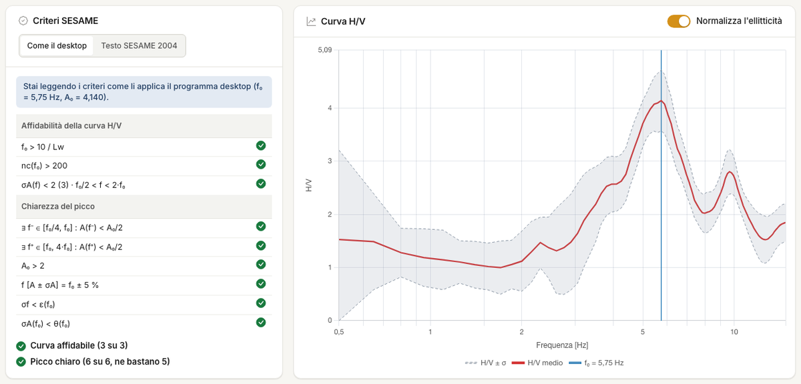
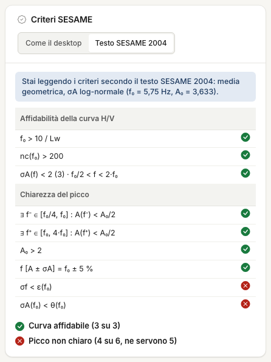

# H/V spectrum

In this tab you read the result of the measurement: f~0~, A~0~ and the SESAME checks. The [model](modello.md) starts here too.

## f~0~ and A~0~

**f~0~** is the frequency of the maximum of the H/V curve, **A~0~** its value. The maximum is the **absolute one over the whole band**, on the frequency grid. You read them above the criteria table and in **Results**.

!!! warning "A maximum on the edge is not a peak"
    If f~0~ equals f min, or the last frequency of the grid, the curve is rising towards the edge. Widen the band or narrow it around the peak you care about, in the [Spectral analysis](analisi-spettrale.md) tab. On a
    test file f~0~ is 0.5 Hz with the 0.5–15 Hz band and 3.4 Hz with the 2–25 Hz band.

## SESAME checks

The SESAME (2004) guidelines give 3 criteria for **curve reliability**, which must all pass, and 6 for **peak clarity**, of which at least 5 must pass.

| Curve reliability | Condition |
|---|---|
| Adequate window | f~0~ > 10 / l~w~ |
| Enough cycles | n~c~ = l~w~ · n~w~ · f~0~ > 200 |
| Limited scatter | σ~A~(f) < 2 between 0.5 f~0~ and 2 f~0~ (< 3 if f~0~ < 0.5 Hz) |

| Peak clarity | Condition |
|---|---|
| Drop on the left | there is f in [f~0~/4, f~0~] with A(f) < A~0~/2 |
| Drop on the right | there is f in [f~0~, 4 f~0~] with A(f) < A~0~/2 |
| Amplitude | A~0~ > 2 |
| Peak stability | the peaks of A·σ~A~ and A/σ~A~ lie within f~0~ ± 5 % |
| Uncertainty of f~0~ | σ~f~ < ε(f~0~) |
| Scatter at the peak | σ~A~(f~0~) < θ(f~0~) |

| f~0~ [Hz] | < 0.2 | 0.2–0.5 | 0.5–1 | 1–2 | > 2 |
|---|---|---|---|---|---|
| ε | 0.25 f~0~ | 0.20 f~0~ | 0.15 f~0~ | 0.10 f~0~ | 0.05 f~0~ |
| θ | 3 | 2.5 | 2 | 1.78 | 1.58 |

Here l~w~ is the window duration and n~w~ the number of included windows.

## Two ways of applying the criteria

The desktop program applies these criteria with some differences from the text: it counts samples instead of windows, uses a relative σ instead of σ~A~, and estimates
σ~f~ from the ± σ curves instead of window by window. The result is **more permissive**. Above the table choose **As the desktop**
or **SESAME 2004 text**: the tab always says which ones you are reading and the choice stays in the project. The default is **As the desktop**.

!!! warning "Before you sign"
    On the test files, of the five peaks that are "clear" under the desktop criteria four are not under the 2004 text. Check the result with the text: the table is in
    [Validation](validazione.md). With the text the curve is the geometric mean of the windows, so f~0~ and A~0~ may differ from those of the curve on screen.

!!! note "The checks do not speak for the geology"
    They say the peak is well measured, not that it is stratigraphic. An industrial source can pass them all: that is why you need the maps and spectra.

---

*Found an error on this page? [Let us know](mailto:info@geostru.ai?subject=Help%20HVSR%20NX) or open a [Pull Request](https://github.com/EngSoft-Geostru/geostru-help-nx/edit/main/hvsr/docs/en/spettro-hv.md).*
