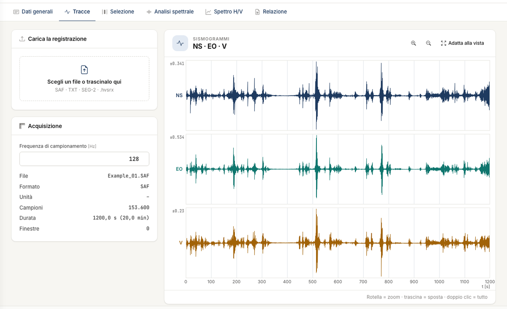

# Traces

The **Traces** tab receives the three-component recording: **NS** (north-south), **EW** (east-west), **V** (vertical).

## Importing a file

Drop the file on the **Choose a file or drop it here** box, or click the box. A SAF file is read at once. For text and SEG-2 files the options appear: complete them and press
**Import**, or **Cancel**. If you have no file, **Open the example** loads the demonstration project.

| Format | Extensions | Components | F~s~ |
|---|---|---|---|
| SESAME ASCII | `.saf` | fixed order V, N, E | from the `SAMP_FREQ` line |
| Text | `.txt`, `.asc`, `.csv`, `.dat` | you indicate the columns | you enter it; a `SAMP_FREQ` line in the file replaces it |
| SEG-2 | `.sg2`, `.seg2`, `.dat` | you assign the traces; proposal: V = 1, NS = 2, EW = 3 | from the sampling interval |

A `.dat` file is recognised from its content. You can drop a desktop `.hvsrx` project on the same box: it opens as a project. Details and limits in [Files](file.md).

After the import the **Acquisition** box shows file, format, samples, duration and number of windows. On the **Seismograms** the wheel zooms, dragging pans the view, double click and
**Fit to view** return to the whole recording.

### Text files

For a text file you indicate **First data row**, **First column**, **Fs**, **NS column**, **EW column**, **V column** and **Separator** (space, tab, semicolon, comma). If you leave the
first row at 1, the app skips the header by itself until it reaches the numbers.

## What to check

- **F~s~.** A wrong F~s~ shifts all frequencies, f~0~ included, without any other sign. Compare it with the instrument report. You can correct it in the **Acquisition** box: the
  windows are cleared, so the app asks you to **Confirm**.
- **The components.** If the vertical is swapped with a horizontal, the H/V curve loses its meaning.
- **The duration.** Below 20 minutes the app warns and lets you continue.
- **Obvious disturbances.** Transients and saturation are already visible here, and you can remove them in the [Selection](selezione.md) tab.

!!! note "No processing on the traces"
    No filters, mean removal or unit conversion are applied: the data enter the calculation as they are in the file. Units are a label. The H/V ratio is dimensionless, the
    amplitudes of the mean spectra are relative.

---

*Found an error on this page? [Let us know](mailto:info@geostru.ai?subject=Help%20HVSR%20NX) or open a [Pull Request](https://github.com/EngSoft-Geostru/geostru-help-nx/edit/main/hvsr/docs/en/tracce.md).*
