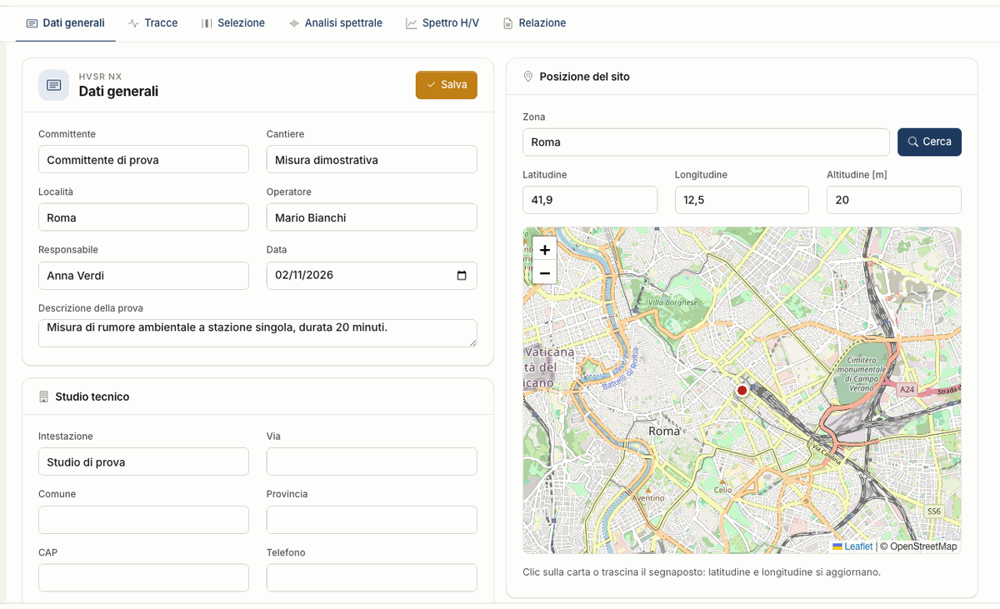

# Workflow

A project goes through the tabs from left to right. You can go back at any time: if you change windows or parameters, curves and checks are
recalculated.

## The measurement

The tromograph stays still on the ground for **at least 20 minutes**, well coupled to the soil, away from machinery and trees and without strong wind. It
records NS, EW and V. The SESAME guidelines ask for longer durations the lower the frequency you expect. The app warns below 20 minutes and lets you
continue.

## The tabs

| Tab | What you do | What you get |
|---|---|---|
| General data | enter client, site, operator, date, position | the report heading |
| [Traces](tracce.md) | import the file, check F~s~ and components | the three seismograms |
| [Selection](selezione.md) | choose length and overlap, press **Select**, exclude or add windows, press **Filter** | the list of windows in use |
| [Spectral analysis](analisi-spettrale.md) | choose band, smoothing, sum of the horizontals | mean spectra, H/V ± σ, maps |
| [H/V spectrum](spettro-hv.md) | read the checks; write a [model](modello.md), press **Synthesise** or **Search** | f~0~, SESAME, ellipticity, misfit, [V~s,eq~ and category](categoria.md), hints |
| [Report](relazione.md) | check the preview, press **Generate Word** or **Export DXF** | Word, DXF, CSV |

## General data

Client, site, locality, operator, supervisor, date, survey description and position go into the report, together with the data in the **Consulting firm** box. They do not enter the
calculation.

In the **Site location** enter the **Area** and press **Search**, or click the map or drag the marker: latitude and longitude update. **Save** writes the tab into the project, and the same
happens when you move to another tab.

## The logic

1. The **H/V curve** and its checks are already a result: f~0~ does not depend on any model.
2. The **layered model** is an interpretation: its theoretical curve is compared with the measured one.
3. **V~s,eq~ and category** depend on the model, and therefore on what you fixed with independent data.

Save often with **File → Save**: the project lives in the session, see [Files](file.md).

---

*Found an error on this page? [Let us know](mailto:info@geostru.ai?subject=Help%20HVSR%20NX) or open a [Pull Request](https://github.com/EngSoft-Geostru/geostru-help-nx/edit/main/hvsr/docs/en/workflow.md).*
