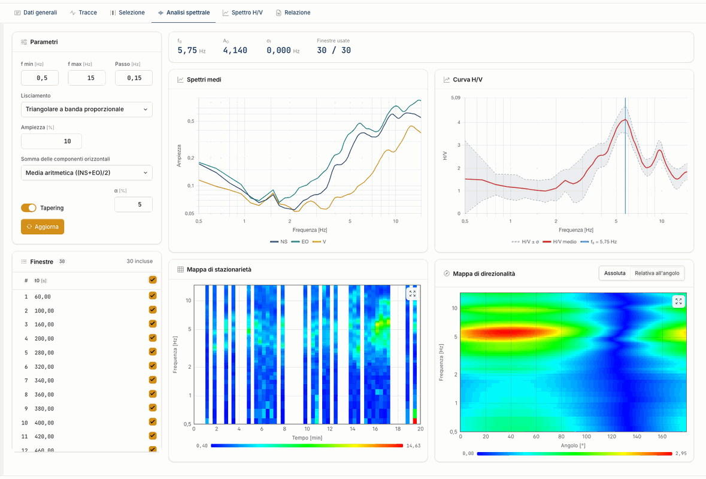
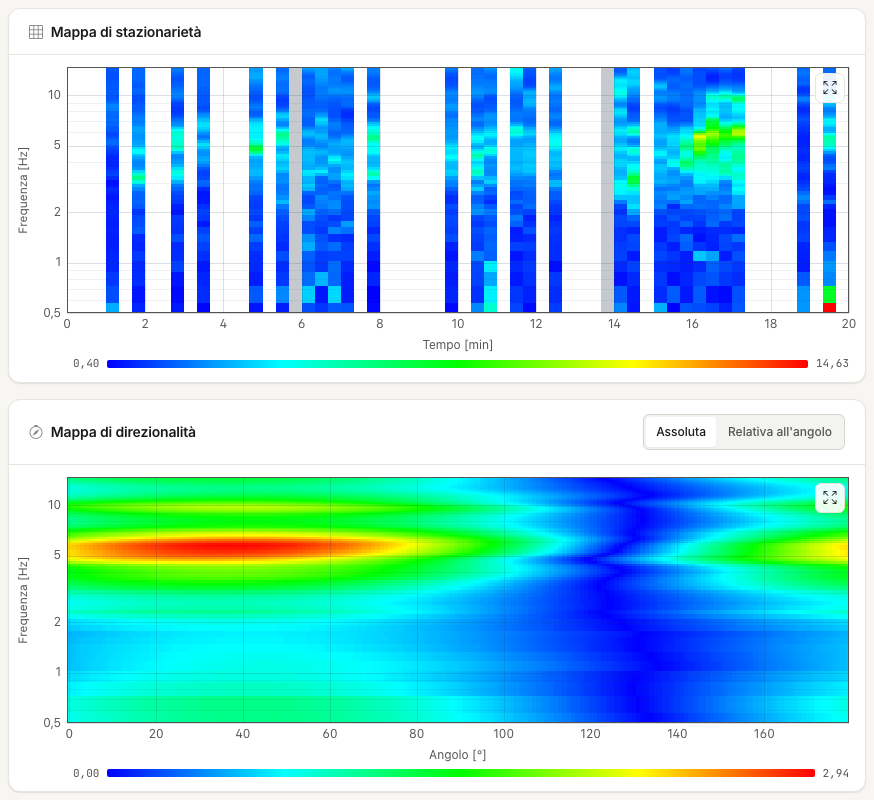

# Analisi spettrale

Per ogni finestra e componente il server applica il taper, calcola la trasformata di Fourier e liscia lo spettro. Poi media le finestre
incluse e calcola la curva H/V. Il calcolo parte quando apri la scheda.

Se cambi un parametro o una casella nell'elenco **Finestre** compare **Da aggiornare**: premi **Aggiorna** per ricalcolare. In testa alla scheda leggi f~0~, A~0~, σ~f~ e
le **Finestre usate**.

## Banda di frequenza

| Parametro | Predefinito |
|---|---|
| f min | 0,5 Hz |
| f max | 15 Hz (esclusa) |
| Passo | 0,15 Hz |

Con questi valori la griglia ha 96 punti, da 0,50 a 14,75 Hz. La banda decide anche dove si cerca il picco: scegli un intervallo che contenga
le frequenze che ti interessano con margine su entrambi i lati.

## Lisciamento

| Tipo | Banda attorno alla frequenza centrale f~c~ | Peso |
|---|---|---|
| Konno-Ohmachi | proporzionale, f~c~ · percentuale | funzione di Konno e Ohmachi, **Coefficiente di banda (b)**, predefinito 40 |
| Media mobile | proporzionale, f~c~ · percentuale | uniforme |
| Triangolare a banda costante | costante, percentuale · (f max − f min) | triangolare |
| Triangolare a banda proporzionale | proporzionale, f~c~ · percentuale | triangolare |

La percentuale è il campo **Ampiezza**. Il predefinito è **Triangolare a banda proporzionale** al 10 %. Il taper è una finestra di Tukey al 5 %: lo regoli con **Tapering** e α.

!!! note "Se vieni dal desktop"
    Nel desktop le etichette dei due triangolari erano scambiate: il predefinito appariva come «costante» ma aveva la banda proporzionale.
    Qui il nome dice il vero, e i numeri a parità di calcolo non cambiano.

## Somma delle orizzontali

| Somma | Formula |
|---|---|
| Solo NS | NS / V |
| Solo EO | EO / V |
| Media aritmetica (predefinita) | ((NS + EO) / 2) / V |
| Media quadratica | √((NS² + EO²) / 2) / V |
| Somma vettoriale | √(NS² + EO²) / V |

La somma vettoriale è ciò che nel desktop si chiamava «media geometrica»: dà valori circa √2 volte la media quadratica. Nella relazione compare con lo stesso nome.

## I grafici

**Spettri medi.** Le tre componenti in funzione della frequenza. Attorno a un picco stratigrafico la V forma di norma un avvallamento.
Un picco nitido su tutte e tre è sospetto: può essere una sorgente industriale.

**Curva H/V.** Media ± σ. La σ è relativa, vedi [Cenni teorici](teoria.md).

**Mappa di stazionarietà.** H/V di ogni finestra nel tempo. Un picco stabile è una banda orizzontale continua; le interruzioni indicano
disturbi che conviene escludere. Un clic sulla mappa sceglie la finestra nell'elenco.

**Mappa di direzionalità.** H/V in funzione dell'angolo da 0 a 179°. Un picco concentrato su una direzione può indicare una sorgente
direzionale o un effetto non 1D. La mappa è una pesatura delle ampiezze medie, non una rotazione delle tracce.
La scala si cambia con **Assoluta** e **Relativa all'angolo**.

---

*Hai trovato un errore in questa pagina? [Segnalacelo](mailto:info@geostru.ai?subject=Help%20HVSR%20NX) o apri una [Pull Request](https://github.com/EngSoft-Geostru/geostru-help-nx/edit/main/hvsr/docs/it/analisi-spettrale.md).*
