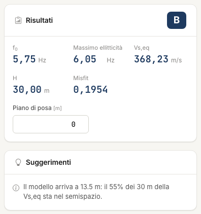

# V~s,eq~, categoria e suggerimenti

Dal modello corrente l'app ricava V~s,eq~ e la categoria di sottosuolo, che leggi nel riquadro **Risultati** della scheda **Spettro H/V**. Il risultato vale quanto il modello.

## V~s,eq~

Secondo le NTC 2018 §3.2.2:

```text
Vs,eq = H / Σ(hᵢ / Vsᵢ)
```

H è la profondità del substrato, primo strato con V~s~ ≥ 800 m/s, se sta entro 30 m dal piano di posa; altrimenti 30 m. Il semispazio è
infinito: se il modello finisce prima di 30 m, il semispazio si prolunga fino a 30 m.

Se le fondazioni non sono al piano campagna scrivi il **Piano di posa** nel riquadro **Risultati**: V~s,eq~ e substrato si misurano da lì.

## Categoria

| Categoria | Condizione |
|---|---|
| A | V~s,eq~ > 800 m/s |
| B | 360 < V~s,eq~ ≤ 800 |
| C | 180 ≤ V~s,eq~ ≤ 360 |
| D | 100 < V~s,eq~ < 180 |
| E | come C o D, con substrato entro 30 m |

A 100 m/s o meno l'app non classifica: valuta i casi speciali S1 e S2.



!!! note "Differenze dal desktop"
    Il desktop non estendeva la media a 30 m, contava lo spessore del semispazio e non calcolava V~s,eq~ con il primo strato già ≥ 800 m/s. I
    valori di HVSR NX possono quindi differire: sul modello del tutorial del desktop 343 m/s contro 224. Vedi [Validazione](validazione.md).

## Suggerimenti

Il riquadro **Suggerimenti**, sotto i risultati, segnala ciò che merita un controllo. Non sono errori.

| Segnalazione | Che cosa significa |
|---|---|
| f~0~ non riprodotta | il massimo dell'ellitticità dista più del 15 % da f~0~ misurata |
| Pochi parametri | la ricerca ha al massimo 2 parametri liberi: sblocca qualcosa |
| Parametro al limite | un valore è a ridosso del minimo o del massimo: allarga l'intervallo |
| Ellitticità divergente | il massimo dell'ellitticità supera di 5 volte quello H/V: contrasto probabilmente eccessivo |
| Scala diversa | con **Normalizza l'ellitticità** spenta, le due curve hanno scale molto diverse: attivala |
| Geometria incoerente | V~s~/4H dello strato sopra il contrasto dista più del 30 % da f~0~ |
| Modello corto | gli strati finiscono prima di 30 m: V~s,eq~ dipende dal semispazio prolungato |
| Inversione di velocità | uno strato è più lento di oltre il 10 % di quello sopra |

---

*Hai trovato un errore in questa pagina? [Segnalacelo](mailto:info@geostru.ai?subject=Help%20HVSR%20NX) o apri una [Pull Request](https://github.com/EngSoft-Geostru/geostru-help-nx/edit/main/hvsr/docs/it/categoria.md).*
