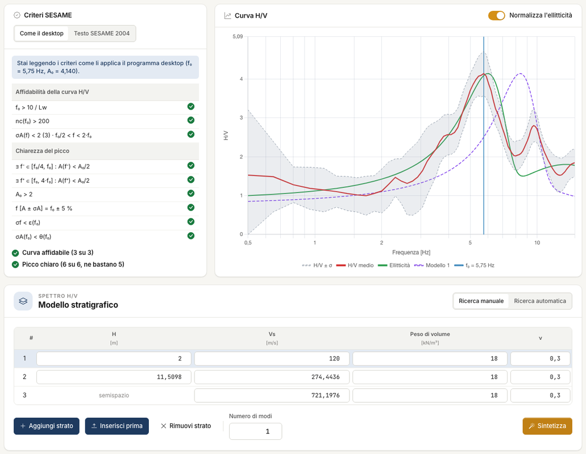
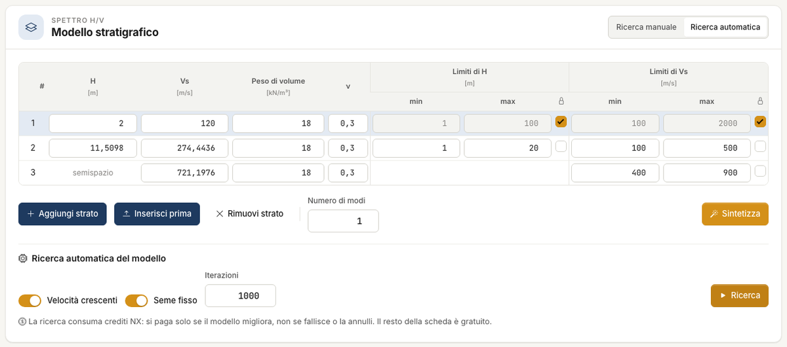
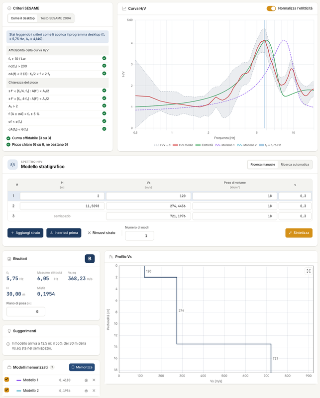

# Modello e ricerca

Il modello a strati è la parte interpretativa dell'analisi. Dal modello il motore calcola l'**ellitticità** delle onde di Rayleigh, cioè la
curva H/V teorica, e la confronta con quella misurata. Il modello si scrive nella scheda **Spettro H/V**, sotto la curva.

## La tabella degli strati

Una riga per strato, dall'alto. **L'ultima è il semispazio**: è infinito e non ha spessore.

| Campo | Significato |
|---|---|
| H | spessore [m] |
| Vs | velocità delle onde di taglio [m/s] |
| Peso di volume | [kN/m³], tipicamente 15–30 |
| ν | coefficiente di Poisson, lega V~p~ a V~s~ |

Con la tabella vuota, **Aggiungi strato** crea due righe: uno strato di 5 m a 300 m/s e il semispazio a 800 m/s, con 18 kN/m³ e ν = 0,3. Ogni altro
**Aggiungi strato** inserisce una riga sopra il semispazio, di 5 m, con gli altri valori dello strato precedente. Per **Inserisci prima** e **Rimuovi strato** fai prima clic sulla
riga. Peso di volume e ν restano fissi durante la ricerca.

Il **Numero di modi** dice quante curve disegnare. Il confronto usa solo il modo fondamentale; i superiori servono da lettura.

**Normalizza l'ellitticità**, sopra la curva e attiva nei progetti nuovi, porta il massimo dell'ellitticità su quello della curva H/V. Il misfit non cambia.

## Sintetizza: il modello che scrivi tu

**Sintetizza** calcola ellitticità e misfit del modello in tabella, senza ottimizzare e senza consumare crediti. È il modo per provare a mano:
cambi uno spessore o una velocità e guardi la curva.

## Ricerca: il modello che trova il programma

Premi **Ricerca automatica** in alto a destra: nella tabella compaiono **Limiti di H**, **Limiti di Vs** e le caselle col lucchetto, e sotto il riquadro
**Ricerca automatica del modello**. **Ricerca manuale** nasconde tutto questo. La **Ricerca** modifica H e V~s~ per avvicinare l'ellitticità alla curva misurata.

| Opzione | Significato |
|---|---|
| min e max | l'intervallo in cui cercare; predefiniti H 1–100 m, V~s~ 100–2000 m/s |
| Lucchetto | il parametro resta al valore scritto |
| Velocità crescenti | V~s~ non diminuisce con la profondità; attiva nei progetti nuovi |
| Seme fisso | due ricerche uguali danno lo stesso risultato; attivo nei progetti nuovi |
| Iterazioni | predefinito 1000 |

Premi **Ricerca**: una barra mostra l'avanzamento e **Annulla** la interrompe. La Ricerca consuma crediti, solo se il modello migliora: se fallisce, se la annulli o se
non trova di meglio, non paghi e il progetto non cambia. Si può
ripetere: il modello in tabella è il punto di partenza della corsa successiva.

!!! warning "Blocca ciò che sai"
    La curva dipende dal rapporto fra V~s~ e H: moltiplicando tutti gli spessori e tutte le velocità per lo stesso numero, la curva resta
    identica e la V~s,eq~ cambia. Su un esempio, tre modelli con la stessa curva danno categorie E, C e B. **Almeno uno strato va fissato con un
    dato indipendente**: un sondaggio, una prova in foro, una MASW.

## Il misfit

Il misfit misura la distanza di **forma** fra la curva misurata e il modo fondamentale, ciascuno normalizzato al proprio massimo. Più è basso,
meglio è, ma ha valore solo **relativo**: serve a confrontare due modelli sullo stesso dato. Il misfit si moltiplica per un fattore che
cresce se il modo fondamentale manca in parte della banda.

## Più modelli

**Memorizza** copia il modello corrente in **Modelli memorizzati**, con il suo misfit. La casella di ogni riga lo mostra o lo nasconde sulla curva H/V, l'icona con la freccia lo
applica come modello corrente, la **×** lo rimuove. È il modo corretto di mostrare l'incertezza: se modelli diversi spiegano la curva, dillo in relazione.

---

*Hai trovato un errore in questa pagina? [Segnalacelo](mailto:info@geostru.ai?subject=Help%20HVSR%20NX) o apri una [Pull Request](https://github.com/EngSoft-Geostru/geostru-help-nx/edit/main/hvsr/docs/it/modello.md).*
