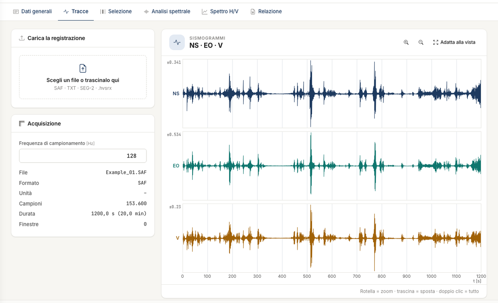
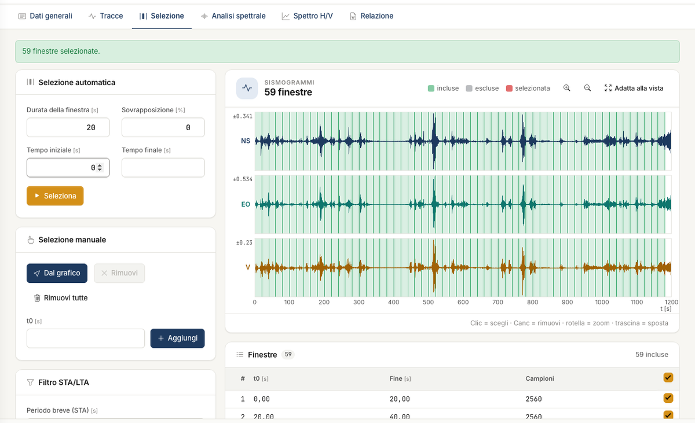
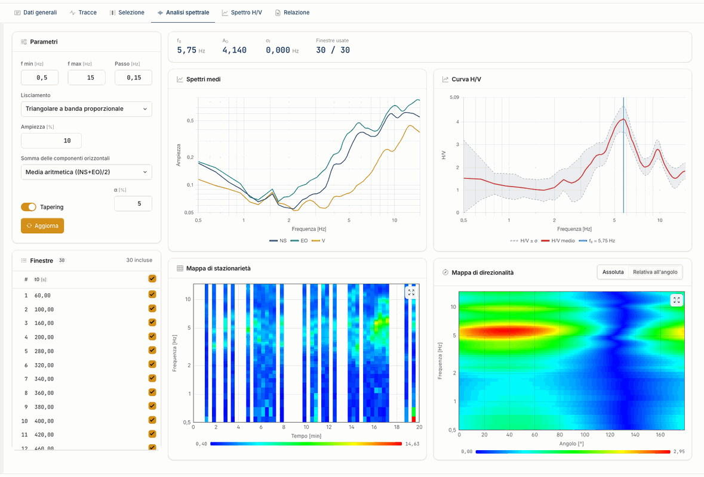
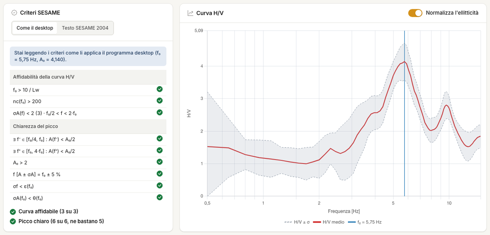

# Guida rapida (5 minuti)

Arrivi dalla registrazione alla curva H/V con i parametri predefiniti. Serve un account con accesso all'app. Se non hai un file di tracce sottomano,
apri il progetto dimostrativo con **File → Apri l'esempio**.

## 1. Importa le tracce

Apri [nx.geostru.ai/hvsr](https://nx.geostru.ai/hvsr/) e vai alla scheda **Tracce**. Trascina un file SAF, testo o SEG-2 nel riquadro **Scegli un file
o trascinalo qui**. Per il testo e il SEG-2 completa le opzioni e premi **Importa**. Controlla che la frequenza di campionamento sia giusta e che le tre
componenti siano al posto giusto.

## 2. Crea le finestre

Nella scheda **Selezione** lascia i valori proposti, finestre da 20 s senza sovrapposizione su tutta la registrazione, e premi **Seleziona**. Premi poi
**Filtra** per togliere le finestre con transitori.

## 3. Leggi lo spettro

Nella scheda **Analisi spettrale** trovi gli spettri medi, la curva H/V e le mappe di stazionarietà e direzionalità: si calcolano quando apri la scheda.
Le righe della mappa di stazionarietà devono mostrare il picco alla stessa frequenza per tutta la registrazione.

## 4. Controlla f~0~ e SESAME

Nella scheda **Spettro H/V** leggi f~0~, A~0~ e l'esito dei **Criteri SESAME**. Controlla sulla curva che f~0~ sia un picco vero, non il bordo della banda.

## 5. Genera la relazione

Nella scheda **Relazione** controlla l'**Anteprima** e premi **Genera Word**.

## Passi successivi

Per stimare il profilo V~s~ vai a [Modello e ricerca](modello.md). Per un'analisi completa segui il [Tutorial](tutorial.md).

---

*Hai trovato un errore in questa pagina? [Segnalacelo](mailto:info@geostru.ai?subject=Help%20HVSR%20NX) o apri una [Pull Request](https://github.com/EngSoft-Geostru/geostru-help-nx/edit/main/hvsr/docs/it/quickstart.md).*
