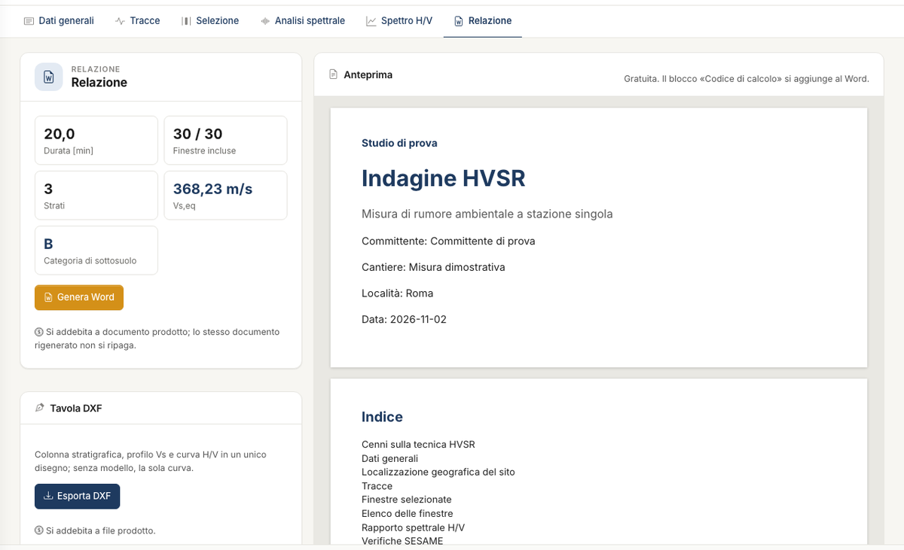

# Relazione, esportazioni e crediti

La scheda **Relazione** riassume durata, finestre incluse, strati, V~s,eq~ e categoria, e raccoglie tutte le uscite. Serve una curva H/V: tracce caricate e almeno due
finestre incluse.

## Relazione Word

L'**Anteprima** è gratuita e usa lo stesso codice del documento. **Genera Word** scarica il documento, che contiene:

- cenni sulla tecnica;
- dati generali e localizzazione;
- tracce;
- finestre, con l'elenco delle incluse e delle escluse, spettri medi e mappe;
- rapporto H/V con f~0~, parametri e tabella delle verifiche SESAME, con i criteri che hai scelto;
- modello, se presente: strati, profilo V~s~, V~s,eq~, categoria e quadro riassuntivo.

La relazione chiude con il blocco **Codice di calcolo** chiesto dal §10.2 NTC: software, versione del motore, codice del documento e impronta
dei dati. Il blocco non compare in anteprima. Il codice si verifica su `geostru.ai/verify/<codice>`. La verifica dice che il documento è stato emesso, non che i calcoli
sono esenti da errori.

## Tavola DXF

**Esporta DXF** produce colonna stratigrafica, profilo V~s~ e curva H/V in un unico disegno vettoriale. Senza modello contiene la sola curva. Le mappe a colori non entrano
in un DXF.

## Dati in CSV

I pulsanti **Curva H/V**, **Spettri medi** e **Tracce** scaricano i dati numerici. Sono gratuiti e hanno il punto e virgola come separatore e il punto decimale. Gli stessi tre
file sono anche nel menu **File**, sotto **Esporta in CSV**.

## Che cosa consuma crediti

| Azione | Crediti |
|---|---|
| Tracce, finestre, filtro, spettro, mappe, verifiche SESAME | gratis |
| Sintetizza, V~s,eq~, categoria, suggerimenti | gratis |
| Anteprima della relazione, CSV | gratis |
| Ricerca | sì, solo se il modello migliora |
| Genera Word | sì, a documento prodotto |
| Esporta DXF | sì, a file prodotto |
| Messaggio all'assistente | sì, a risposta riuscita |

Se un'operazione fallisce o la interrompi, non paghi. Rigenerare lo stesso documento non si ripaga. Il saldo e la scadenza dei crediti sono nel menu utente.

---

*Hai trovato un errore in questa pagina? [Segnalacelo](mailto:info@geostru.ai?subject=Help%20HVSR%20NX) o apri una [Pull Request](https://github.com/EngSoft-Geostru/geostru-help-nx/edit/main/hvsr/docs/it/relazione.md).*
