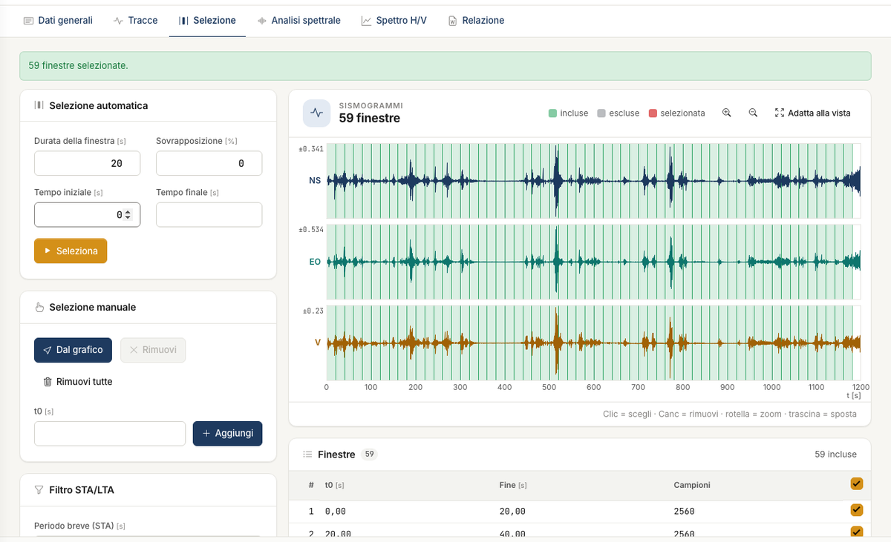
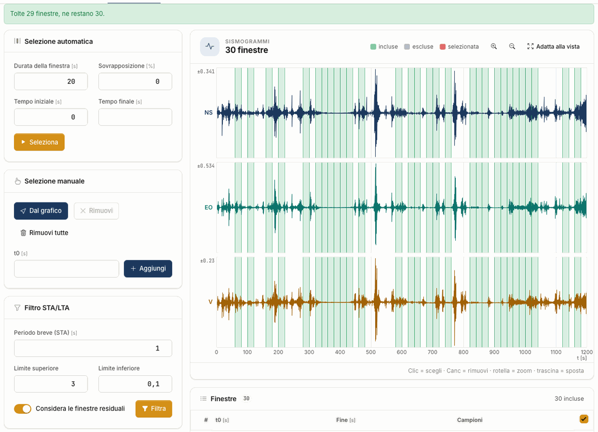

# Selezione

La curva H/V non si calcola su tutta la registrazione ma su molte **finestre** di cui si fa la media. In questa scheda decidi quali.

## Selezione automatica

Compila i campi e premi **Seleziona**. Le finestre compaiono sui sismogrammi e nell'elenco **Finestre**.

| Parametro | Predefinito | Significato |
|---|---|---|
| Durata della finestra | 20 s | durata di ogni finestra |
| Sovrapposizione | 0 % | quanto una finestra copre la successiva |
| Tempo iniziale e Tempo finale | 0 e vuoto | la parte da usare; vuoto = fine della registrazione |

Con 1200 s e finestre da 20 s ottieni **59 finestre**, non 60: l'ultima completa resta fuori, come nel desktop.

Scegli la durata in base alla frequenza che ti aspetti: SESAME chiede f~0~ > 10/l~w~, quindi con 20 s l'intervallo utile comincia sopra 0,5 Hz.
Per frequenze più basse servono finestre più lunghe.

## Selezione manuale

- **Escludi o includi** una finestra con la casella nell'elenco: resta in elenco, ma non concorre alle medie. La casella in testa alla colonna agisce su tutte.
- **Rimuovi** una finestra: fai clic su di essa nel grafico o nell'elenco, poi premi **Rimuovi** o il tasto Canc. **Rimuovi tutte** chiede conferma.
- **Aggiungi** una finestra: scrivi l'istante iniziale in **t0** e premi **Aggiungi**. Con **Dal grafico** muovi una banda sui sismogrammi e, al rilascio del clic,
  la finestra viene aggiunta. Se si sovrappone a un'altra l'app te lo dice: scegli **Aggiungi lo stesso** o **Annulla**.

Sui sismogrammi la rotella fa lo zoom e il trascinamento sposta la vista. Le finestre escluse restano visibili in grigio nella mappa di stazionarietà, così puoi
valutare la scelta. Spettri medi, curva H/V e verifiche usano **sempre e solo le finestre incluse**.

## Filtro STA/LTA

Il filtro confronta la media breve dell'ampiezza (STA) con quella lunga (LTA), su ciascuna componente. Se il rapporto esce dai limiti, la
finestra contiene un transitorio. Premi **Filtra**: la finestra viene **tolta dall'elenco**, su tutte e tre le componenti, e il messaggio dice quante ne restano.

| Parametro | Predefinito | Significato |
|---|---|---|
| Periodo breve (STA) | 1 s | durata dello STA; l'LTA è la durata della finestra |
| Limite superiore | 3 | sopra, un evento impulsivo |
| Limite inferiore | 0,1 | sotto, un tratto anomalo di quiete |
| Considera le finestre residuali | sì | controlla anche il pezzo che resta dopo l'ultimo blocco |

Le finestre tolte non restano in grigio: sui sismogrammi al loro posto c'è un vuoto. Per riaverle aggiungile a mano o premi di nuovo **Seleziona**.

!!! warning "Rileggi f~0~ dopo il filtro"
    Togliere finestre può cambiare il massimo della curva. Su un file di prova, togliere 3 finestre su 60 ha lasciato due picchi quasi pari
    e f~0~ è saltata da 1,55 a 12,2 Hz. f~0~ è il massimo assoluto: guarda la curva.

!!! note "Differenze dal desktop"
    Il filtro del desktop aveva un difetto e, trovata una certa finestra da scartare, cancellava anche tutte le successive. HVSR NX
    guarda ogni finestra, quindi ne tiene di più: sulla registrazione del tutorial 30 contro 0, su un'altra di prova 44 contro 16. Vedi [Validazione](validazione.md).

---

*Hai trovato un errore in questa pagina? [Segnalacelo](mailto:info@geostru.ai?subject=Help%20HVSR%20NX) o apri una [Pull Request](https://github.com/EngSoft-Geostru/geostru-help-nx/edit/main/hvsr/docs/it/selezione.md).*
