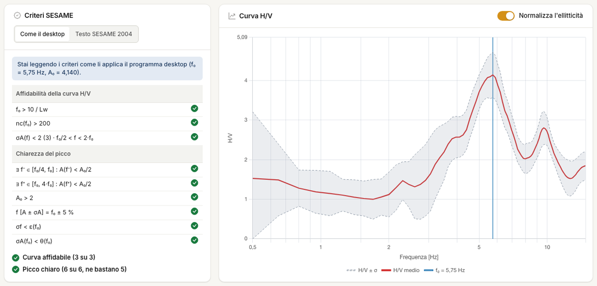
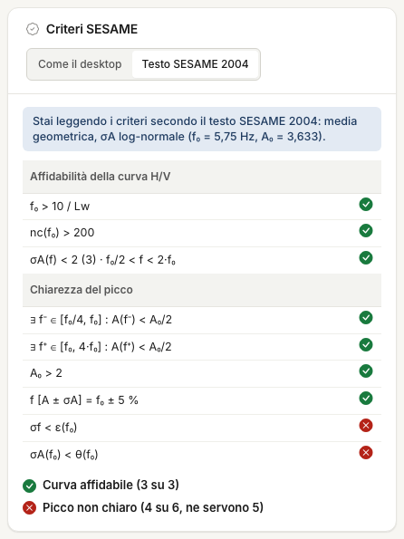

# Spettro H/V

In questa scheda leggi il risultato della misura: f~0~, A~0~ e le verifiche SESAME. Da qui parte anche il [modello](modello.md).

## f~0~ e A~0~

**f~0~** è la frequenza del massimo della curva H/V, **A~0~** il suo valore. Il massimo è quello **assoluto su tutta la banda**, sulla griglia
di frequenze. Li leggi sopra la tabella dei criteri e in **Risultati**.

!!! warning "Un massimo sul bordo non è un picco"
    Se f~0~ coincide con f min, o con l'ultima frequenza della griglia, la curva sta salendo verso il bordo. Allarga la banda o restringila
    attorno al picco che ti interessa, nella scheda [Analisi spettrale](analisi-spettrale.md). Su un file di prova f~0~ è 0,5 Hz con la banda 0,5–15 Hz e 3,4 Hz con la banda 2–25 Hz.

## Verifiche SESAME

Le linee guida SESAME (2004) danno 3 criteri di **affidabilità della curva**, che devono passare tutti, e 6 di **chiarezza del picco**, di cui
ne devono passare almeno 5.

| Affidabilità della curva | Condizione |
|---|---|
| Finestra adeguata | f~0~ > 10 / l~w~ |
| Cicli sufficienti | n~c~ = l~w~ · n~w~ · f~0~ > 200 |
| Dispersione contenuta | σ~A~(f) < 2 fra 0,5 f~0~ e 2 f~0~ (< 3 se f~0~ < 0,5 Hz) |

| Chiarezza del picco | Condizione |
|---|---|
| Discesa a sinistra | esiste f in [f~0~/4, f~0~] con A(f) < A~0~/2 |
| Discesa a destra | esiste f in [f~0~, 4 f~0~] con A(f) < A~0~/2 |
| Ampiezza | A~0~ > 2 |
| Stabilità del picco | i picchi di A·σ~A~ e A/σ~A~ stanno entro f~0~ ± 5 % |
| Incertezza su f~0~ | σ~f~ < ε(f~0~) |
| Dispersione al picco | σ~A~(f~0~) < θ(f~0~) |

| f~0~ [Hz] | < 0,2 | 0,2–0,5 | 0,5–1 | 1–2 | > 2 |
|---|---|---|---|---|---|
| ε | 0,25 f~0~ | 0,20 f~0~ | 0,15 f~0~ | 0,10 f~0~ | 0,05 f~0~ |
| θ | 3 | 2,5 | 2 | 1,78 | 1,58 |

Qui l~w~ è la durata della finestra e n~w~ il numero di finestre incluse.

## Due modi di applicare i criteri

Il desktop applica questi criteri con alcune differenze dal testo: conta i campioni al posto delle finestre, usa una σ relativa invece di
σ~A~, stima σ~f~ dalle curve ± σ invece che finestra per finestra. Il risultato è **più permissivo**. Sopra la tabella scegli **Come il desktop**
o **Testo SESAME 2004**: la scheda dice sempre quali stai leggendo e la scelta resta nel progetto. Il predefinito è **Come il desktop**.

!!! warning "Prima di firmare"
    Sui file di prova, dei cinque picchi «chiari» con i criteri del desktop quattro non lo sono con il testo del 2004. Controlla l'esito
    con il testo: la tabella è in [Validazione](validazione.md). Con il testo la curva è la media geometrica delle finestre, quindi f~0~
    e A~0~ possono differire da quelle della curva a video.

!!! note "Le verifiche non parlano della geologia"
    Dicono che il picco è ben misurato, non che sia stratigrafico. Una sorgente industriale può passarle tutte: per questo servono mappe e spettri.

---

*Hai trovato un errore in questa pagina? [Segnalacelo](mailto:info@geostru.ai?subject=Help%20HVSR%20NX) o apri una [Pull Request](https://github.com/EngSoft-Geostru/geostru-help-nx/edit/main/hvsr/docs/it/spettro-hv.md).*
