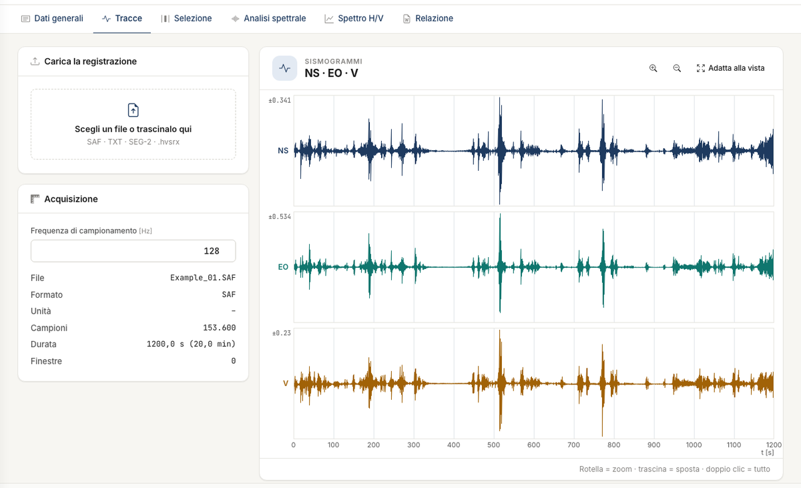
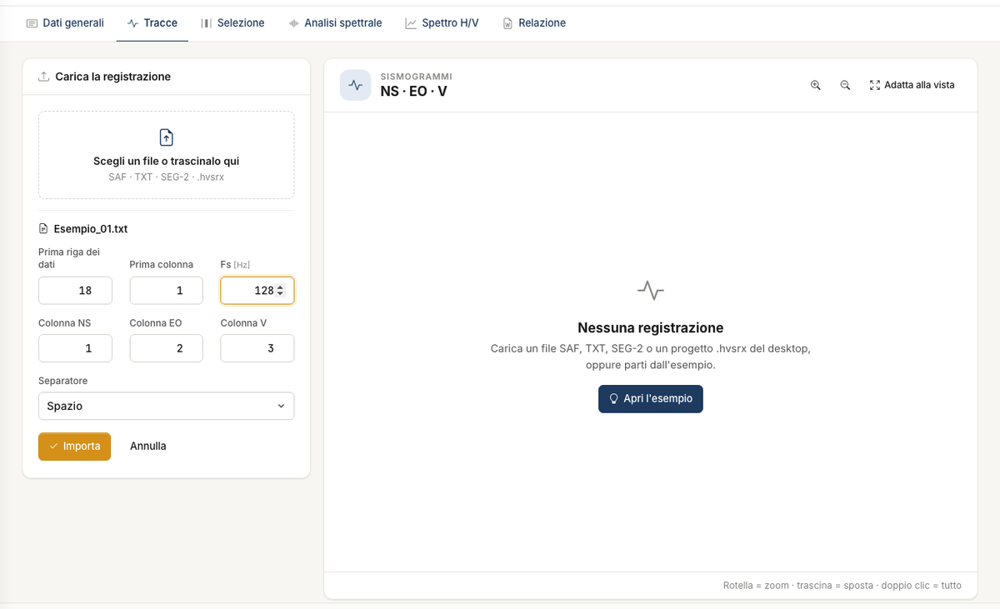

# Tracce

La scheda **Tracce** riceve la registrazione a tre componenti: **NS** (nord-sud), **EO** (est-ovest), **V** (verticale).

## Importare un file

Trascina il file nel riquadro **Scegli un file o trascinalo qui**, oppure fai clic sul riquadro. Un SAF si legge subito. Per il testo e il SEG-2 compaiono le
opzioni: completale e premi **Importa**, oppure **Annulla**. Se non hai un file, **Apri l'esempio** carica il progetto dimostrativo.

| Formato | Estensioni | Componenti | F~s~ |
|---|---|---|---|
| SESAME ASCII | `.saf` | ordine fisso V, N, E | dalla riga `SAMP_FREQ` |
| Testo | `.txt`, `.asc`, `.csv`, `.dat` | indichi tu le colonne | la scrivi tu; una riga `SAMP_FREQ` nel file la sostituisce |
| SEG-2 | `.sg2`, `.seg2`, `.dat` | assegni le tracce; proposta: V = 1, NS = 2, EO = 3 | dall'intervallo di campionamento |

Un `.dat` si riconosce dal contenuto. Nello stesso riquadro puoi lasciare un progetto `.hvsrx` del desktop: si apre come progetto. Dettagli e limiti in [File](file.md).

Dopo l'importazione il riquadro **Acquisizione** riporta file, formato, campioni, durata e numero di finestre. Sui **Sismogrammi** la rotella fa lo zoom, il
trascinamento sposta la vista, il doppio clic e **Adatta alla vista** tornano all'intera registrazione.

### File di testo

Per un file di testo indichi **Prima riga dei dati**, **Prima colonna**, **Fs**, **Colonna NS**, **Colonna EO**, **Colonna V** e **Separatore** (spazio,
tabulazione, punto e virgola, virgola). Se lasci la prima riga a 1, l'app salta da sola l'intestazione fino ai numeri.

## Che cosa controllare

- **F~s~.** Una F~s~ sbagliata sposta tutte le frequenze, f~0~ compresa, senza alcun altro segnale. Confrontala con il rapporto dello
  strumento. Puoi correggerla nel riquadro **Acquisizione**: le finestre si azzerano, quindi l'app chiede **Conferma**.
- **Le componenti.** Se la verticale è scambiata con un'orizzontale, la curva H/V perde senso.
- **La durata.** Sotto i 20 minuti l'app avvisa e ti lascia proseguire.
- **Disturbi evidenti.** Transitori e saturazioni si vedono già qui, e nella scheda [Selezione](selezione.md) puoi toglierli.

!!! note "Nessuna elaborazione sulle tracce"
    Non si applicano filtri, rimozione della media o conversione di unità: il dato entra nel calcolo com'è nel file. Le unità sono
    un'etichetta. Il rapporto H/V è adimensionale, le ampiezze degli spettri medi sono relative.

---

*Hai trovato un errore in questa pagina? [Segnalacelo](mailto:info@geostru.ai?subject=Help%20HVSR%20NX) o apri una [Pull Request](https://github.com/EngSoft-Geostru/geostru-help-nx/edit/main/hvsr/docs/it/tracce.md).*
