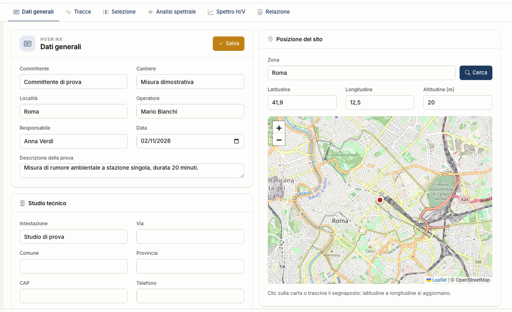

# Flusso di lavoro

Un progetto attraversa le schede da sinistra a destra. Puoi tornare indietro in ogni momento: se cambi finestre o parametri, curve e
verifiche si ricalcolano.

## La misura

Il tromografo sta fermo sul terreno per **almeno 20 minuti**, ben accoppiato al suolo, lontano da macchine e alberi e senza vento forte.
Registra NS, EO e V. Le linee guida SESAME chiedono durate maggiori quanto più bassa è la frequenza che ti aspetti. L'app avvisa sotto i
20 minuti e ti lascia proseguire.

## Le schede

| Scheda | Che cosa fai | Che cosa ottieni |
|---|---|---|
| Dati generali | scrivi committente, cantiere, operatore, data, posizione | l'intestazione della relazione |
| [Tracce](tracce.md) | importi il file, controlli F~s~ e componenti | i tre sismogrammi |
| [Selezione](selezione.md) | scegli durata e sovrapposizione, premi **Seleziona**, escludi o aggiungi finestre, premi **Filtra** | l'elenco delle finestre usate |
| [Analisi spettrale](analisi-spettrale.md) | scegli banda, lisciamento, somma delle orizzontali | spettri medi, H/V ± σ, mappe |
| [Spettro H/V](spettro-hv.md) | leggi le verifiche; scrivi un [modello](modello.md), premi **Sintetizza** o **Ricerca** | f~0~, SESAME, ellitticità, misfit, [V~s,eq~ e categoria](categoria.md), suggerimenti |
| [Relazione](relazione.md) | controlli l'anteprima, premi **Genera Word** o **Esporta DXF** | Word, DXF, CSV |

## Dati generali

Committente, cantiere, località, operatore, responsabile, data, descrizione della prova e posizione finiscono nella relazione, insieme ai dati del riquadro
**Studio tecnico**. Non entrano nel calcolo.

Nella **Posizione del sito** scrivi la **Zona** e premi **Cerca**, oppure fai clic sulla carta o trascina il segnaposto: latitudine e longitudine si aggiornano. **Salva** scrive la
scheda nel progetto, e lo stesso avviene quando passi a un'altra scheda.

## Il filo logico

1. La **curva H/V** e le verifiche sono già un risultato: f~0~ non dipende da alcun modello.
2. Il **modello a strati** è un'interpretazione: la sua curva teorica viene confrontata con quella misurata.
3. **V~s,eq~ e categoria** dipendono dal modello, quindi da ciò che hai fissato con dati indipendenti.

Salva spesso con **File → Salva**: il progetto vive in sessione, vedi [File](file.md).

---

*Hai trovato un errore in questa pagina? [Segnalacelo](mailto:info@geostru.ai?subject=Help%20HVSR%20NX) o apri una [Pull Request](https://github.com/EngSoft-Geostru/geostru-help-nx/edit/main/hvsr/docs/it/workflow.md).*
