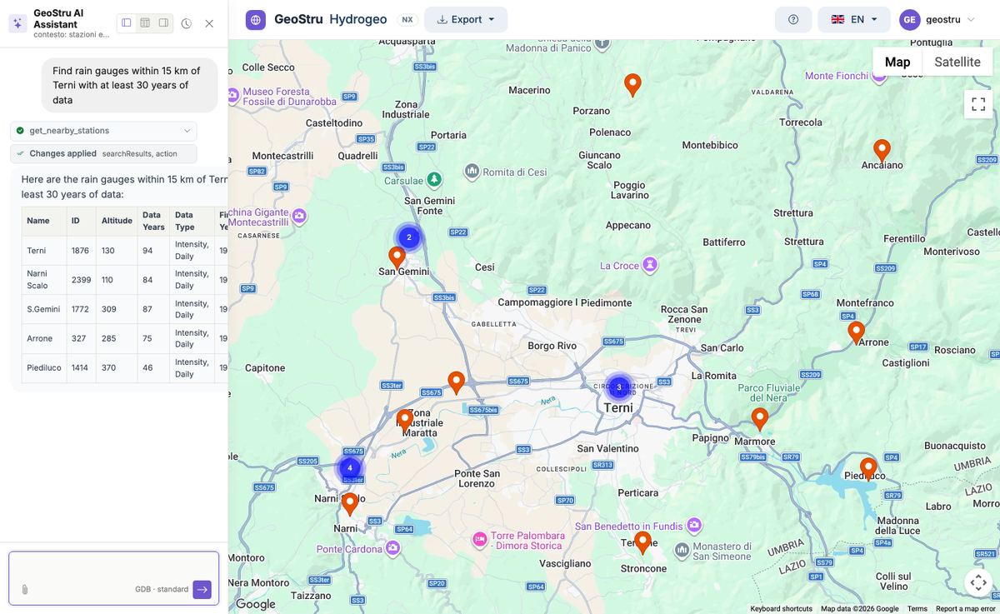

# AI assistant

The **assistant** is the main way to search for stations. Open it with the button at the
bottom right; the panel can be docked on the left, on the right or at the bottom.

Write in your own words. The assistant queries the Hydrogeo NX database, acts on the map and
answers with tables and explanations.

## What it can do

| Request | Example |
|---|---|
| Search by area | "Find stations in Calabria", "Stations in the province of Cuneo" |
| Search by basin | "Rain gauges in the Tiber basin" |
| Search around a point | "Rain gauges within 15 km of Terni", "Stations within 10 km of 45.07, 7.68" |
| Filter | "… with at least 30 years of data", "… above 1000 m", "… from the ARPAV source" |
| Move the map | "Go to Bolzano", "Show Sardinia" |
| Select | "Select the first three", "Deselect all" |
| Read the data | "Show me the annual maxima of Terni", "Summary of station 1876" |
| Export | "Export Terni to Excel", "Export in GeoStru format" |
| Basin contributions | "Monthly contributions of the … basin": runoff in l/s/km² and in mm, where the Annals publish them |

You can **attach** a CSV or Excel file (for instance a list of stations or coordinates) and
ask the assistant to use it.

## Quick actions

When it opens, the panel offers a few **quick actions**: "Find stations in Calabria",
"Stations with 20+ years in Apulia", "Export in GeoStru format", "Open RunoffLab for
analysis", "Open a support ticket".

## Support

For a problem or a question about the app, ask the assistant to **open a support ticket**:
describe your request in the message and GeoStru support takes it over.

## Limits

- The assistant **does not compute statistics**: for Gumbel, GEV, TCEV and the curves use
  Runoff Lab NX.
- Answers are generated automatically and **may contain errors**: the values to use are those
  of the tables and of the exports.
- Each message uses credits. Exports requested through the assistant cost the same as those
  from the menu. See [Access and credits](crediti.md).

---

*Found an error on this page? [Let us know](mailto:info@geostru.ai?subject=Help%20Hydrogeo%20NX) or open a [Pull Request](https://github.com/EngSoft-Geostru/geostru-help-nx/edit/main/hydrogeo/docs/en/assistente.md).*
