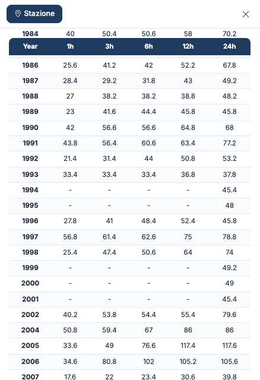
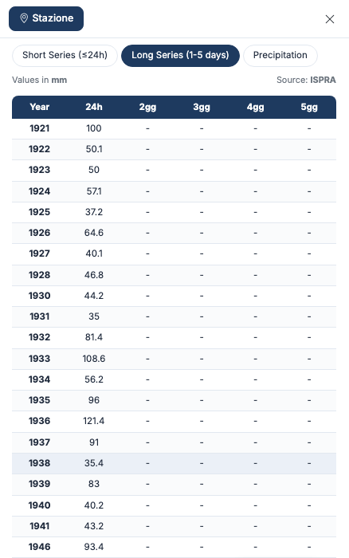
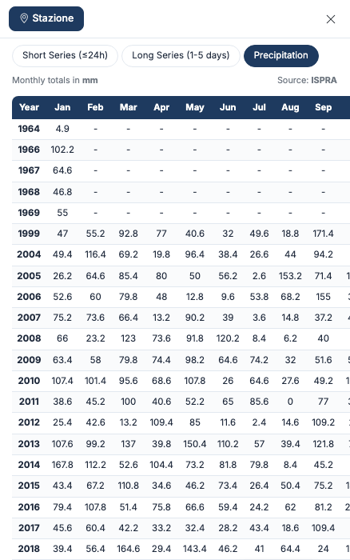

# Data tables

Once unlocked, the station sheet shows three tables. Switch between them with the buttons
above the table. All values are in **millimetres** and the source is shown at the top right.

## Short Series (≤24h)

For each year, the **maximum rainfall depth** fallen in **1, 3, 6, 12 and 24** consecutive
hours. This is the series the rainfall depth-duration-frequency curve is derived from.

## Long Series (1-5 days)

For each year, the maximum rainfall fallen in **1, 2, 3, 4 and 5** consecutive days (columns
24h, 2gg, 3gg, 4gg, 5gg — *gg* stands for days).

## Precipitation

The **monthly totals** of rainfall, from January to December, and the yearly total in the
**Tot** column, derived from the daily records.

## Reading the tables

- **A dash (–)** marks a value the source did not publish. In the oldest years it is normal to
  have only the 24-hour maximum: short durations need a recording rain gauge.
- **A missing year** has no data for that series.
- **A value of 0** is a data point, not missing data.
- The values are **as published by the source**: Hydrogeo NX does not correct, fill in or
  estimate missing data.
- A station with daily rainfall only has no short or long series: only the **Precipitation**
  table appears, or the message "No data available for this series".

!!! tip "Series for statistics"
    For Gumbel, GEV or TCEV you need the **Short Series**, with at least 20 years of data.
    Runoff Lab NX imports them directly: see [Links with the other NX apps](integrazioni.md).

## Credits

The first table that opens right after unlocking is included. The other tables, and the same
table reopened later, use credits. See [Access and credits](crediti.md).

---

*Found an error on this page? [Let us know](mailto:info@geostru.ai?subject=Help%20Hydrogeo%20NX) or open a [Pull Request](https://github.com/EngSoft-Geostru/geostru-help-nx/edit/main/hydrogeo/docs/en/dati.md).*
