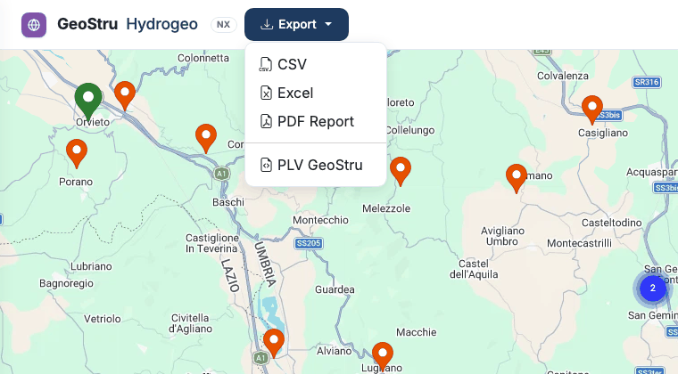

# Exports and formats

The **Export** menu, at the top, exports the **last station selected**. If no station is
selected, the app asks you to select one.



## The formats

| Format | Content | Use |
|---|---|---|
| **CSV** | The annual maxima, one row per year and duration | Spreadsheets, scripts, other software |
| **Excel** | Three sheets: **Stazione** (station details), **Intensita** (annual maxima), **Misure** (precipitation) | Checking and processing in Excel |
| **PDF Report** | The station report | Attachment to the technical report |
| **PLV GeoStru** | Station details and annual maxima in the GeoStru exchange format | GeoStru desktop software |

### CSV

UTF-8 text, **semicolon** separator, dot as decimal separator. Header row:

```text
station_name;region;year;month;day;duration_hours;precipitation_mm;data_type
```

`duration_hours` is the duration in hours (1, 3, 6, 12, 24, 48…), `precipitation_mm` the
year's maximum rainfall depth for that duration.

### Excel

An `.xlsx` file with the **Stazione**, **Intensita** and **Misure** sheets, ready to filter
and to chart.

### PDF Report

A laid-out report, **in Italian**, with:

- the station details;
- the table of the **short series (1h – 24h)**;
- the table of the **long series (1 – 5 days)**;
- at the end the **"Software utilizzato"** (software used) block: program name and version,
  licensee, a **code** with the address where anyone can verify it online, and the
  fingerprint of the data used.

### PLV GeoStru

A text file in sections:

```text
[STATION]
Name=Terni
Region=Umbria
Province=Terni
Latitude=42.559722
Longitude=12.650278
Altitude=130.00
Basin=Nera

[INTENSITY_DATA]
Duration(h);Year;Precipitation(mm)
1;1937;16.6
…
```

It is the rainfall data exchange format of the GeoStru desktop software.

!!! note "Runoff Lab NX"
    To take a station into Runoff Lab NX **you do not need a file**: Runoff Lab imports it
    directly from Hydrogeo NX. See [Links with the other NX apps](integrazioni.md).

### HydrOnline XML

On request, the [assistant](assistente.md) also exports the station in HydrOnline XML format.

## Licence and credits

Every file carries the **name of the licensee**. Every export uses credits; repeating the
same export shortly afterwards is not charged again. See [Access and credits](crediti.md).

---

*Found an error on this page? [Let us know](mailto:info@geostru.ai?subject=Help%20Hydrogeo%20NX) or open a [Pull Request](https://github.com/EngSoft-Geostru/geostru-help-nx/edit/main/hydrogeo/docs/en/formati.md).*
