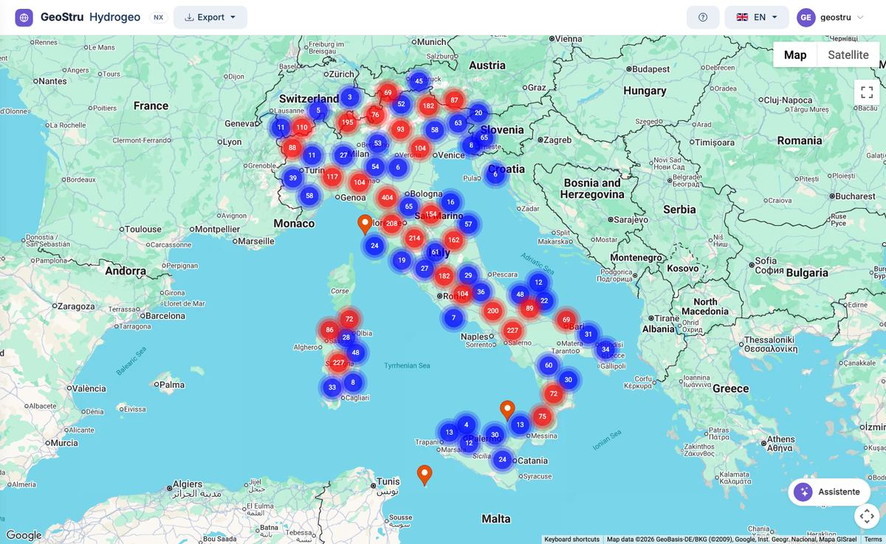

# Hydrogeo NX — Rainfall data

**Hydrogeo NX** puts Italy's rainfall data on one map: the records published by **ISPRA** in
the Hydrological Annals and by the **regional hydrological services**. Find the rain gauges
around your site, read the **annual maximum rainfall** from 1 to 24 hours and from 1 to 5
days and the **monthly precipitation**, and take the series into your study or into
[Runoff Lab NX](https://help.nx.geostru.ai/runofflab/en/) for the statistical analysis.

[**Open the app**](https://nx.geostru.ai/hydrogeo/){ .md-button .md-button--primary }
[Quick start](quickstart.md){ .md-button }

## The database

- **More than 6,000 rain-gauge stations** in all twenty Italian regions.
- **More than 4,000 stations with annual maximum series** by duration.
- **Records from 1916** to the latest year published by each source.
- **Official sources only**: ISPRA and twelve regional services. The list is in
  [Data sources and limits](fonti.md).

The current figures are shown in the panel of the app's **?** button.

## What it does and what it does not do

Hydrogeo NX is the **data step**: it finds the stations, shows the values as the source
published them and exports them.

**It does not compute statistics.** Probability distributions (Gumbel, GEV, Pearson III,
TCEV), rainfall depth-duration-frequency curves h = a·tⁿ, design storms and hydrographs are
in **Runoff Lab NX**, which imports the series directly from Hydrogeo NX. See
[Links with the other NX apps](integrazioni.md).

## Who it is for

Hydraulic engineers, geologists, hydrologists and environmental consultants who need reliable
rainfall data for urban drainage, hydraulic compatibility studies, hydraulic invariance,
flood studies, culverts and storage tanks.

## How you work

1. **Search for stations** by asking the [assistant](assistente.md): the map opens empty
   and fills with the search results.
2. **Open the sheet** of a station by clicking its marker: source, position, years of data,
   relevance rating. See [Map and station sheet](mappa.md).
3. **Unlock the data** and read the [tables](dati.md): short series, long series, monthly
   precipitation.
4. **Export** the station to CSV, Excel, PDF or PLV. See [Exports and formats](formati.md).
5. **Take the series into Runoff Lab NX** for the statistics.

!!! note "About the screenshots"
    The screenshots show the English interface. Some labels of the app (such as the
    "Stazione" tab and the "Assistente" button) are still in Italian.

## Chapters

- [Quick start (5 minutes)](quickstart.md) — from the search to the first table.
- [The complete workflow](workflow.md) — from the project site to the rainfall curve.
- [Map and station sheet](mappa.md)
- [Data tables](dati.md)
- [AI assistant](assistente.md)
- [Exports and formats](formati.md)
- [Links with the other NX apps](integrazioni.md) — Atlante, Runoff Lab, HID, GeoDropbox.
- [Access and credits](crediti.md)
- [Data sources and limits](fonti.md)
- [Glossary](glossario.md)
- [FAQ](faq.md)

---

*Found an error on this page? [Let us know](mailto:info@geostru.ai?subject=Help%20Hydrogeo%20NX) or open a [Pull Request](https://github.com/EngSoft-Geostru/geostru-help-nx/edit/main/hydrogeo/docs/en/index.md).*
