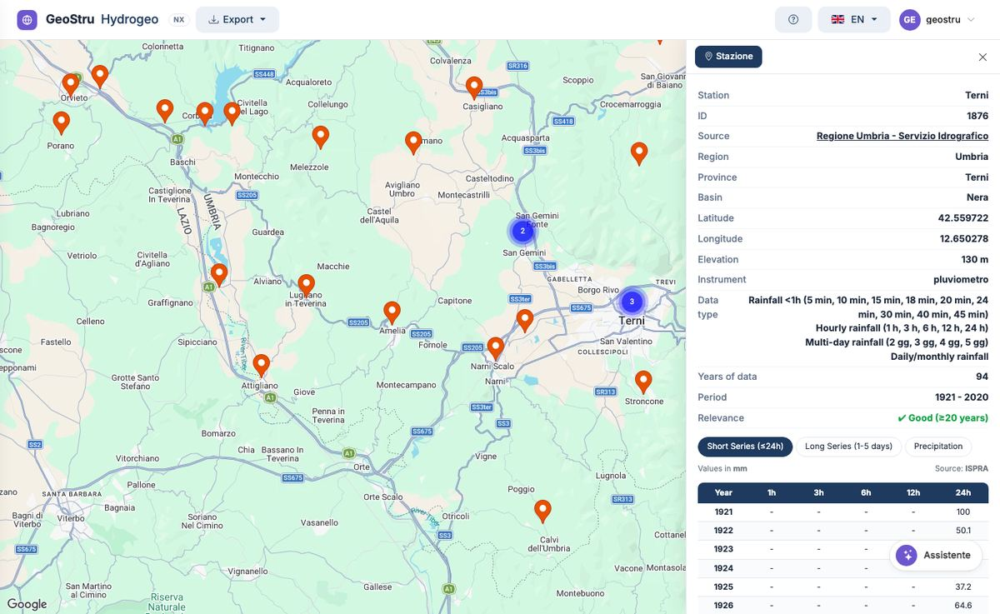
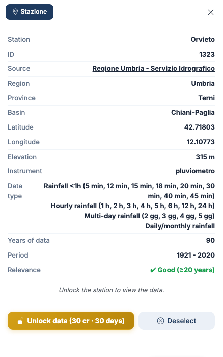

# Map and station sheet

## The map

The map opens **empty**. Stations appear when you search for them with the
[assistant](assistente.md), or when you arrive from Atlante NX with the project site.

- **Orange markers** are the stations found; **green** ones are the selected stations.
- When you zoom out, nearby stations are **grouped** in a circle showing how many there are:
  zoom in or click the circle to separate them.
- Stations at the **same point** (for instance the old and the new station of the same town)
  fan out when you click them.
- At the top right choose **Map** or **Satellite**; the app remembers your choice.
- The stations found and the selected ones stay on the map until you close the browser tab.

The red **Sito (Atlante NX)** marker shows the project site when you open Hydrogeo NX from
Atlante NX. See [Links with the other NX apps](integrazioni.md).

!!! note "Stations without coordinates"
    Some historical stations of the Annals have no coordinates in the database. The assistant
    finds them and shows their data, but they cannot appear on the map.

## The station sheet

Clicking a marker selects the station and opens its **sheet** on the right.

| Field | Meaning |
|---|---|
| **Station** | Name of the station, as given by the source |
| **ID** | Identifier of the station in Hydrogeo NX: use it to ask the assistant about it |
| **Source** | Body that publishes the data, with a link where one exists |
| **Region**, **Province**, **Basin** | Administrative position and river basin |
| **Latitude**, **Longitude** | Coordinates in decimal degrees (WGS84) |
| **Elevation** | Elevation of the station in m a.s.l. |
| **Instrument** | Type of instrument: rain gauge, recording rain gauge, thermo-rain gauge… |
| **Data type** | What the station measures: sub-hourly, hourly, multi-day, daily/monthly rainfall |
| **Years of data** | Number of years with data |
| **Period** | First and last year with data |
| **Relevance** | Rating of the record length |

### Relevance

| Rating | Years of data | Use |
|---|---|---|
| ✔ **Good** | 20 or more | Suitable for a statistical analysis of the maxima |
| ⚠ **Medium** | 10 to 20 | Use with care, preferably compared with nearby stations |
| ✘ **Low** | fewer than 10 | Not enough on its own for statistics |

Relevance counts only the **number of years**, not the continuity of the record: a station
with 30 years spread over a century is still "Good". Always check the period and the table.

### "Data type" and tables

The **Data type** entry also lists sub-hourly durations (5, 10, 15 minutes…) when the source
publishes them. The app's tables show durations of 1, 3, 6, 12 and 24 hours and from 1 to 5
days: see [Data tables](dati.md).

## Selecting and deselecting

- You can select **several stations**: each one turns green.
- The **export** applies to the last station selected.
- **Deselect**, at the bottom of the sheet, removes the station from the selection; the **×**
  at the top closes the sheet.

## A station to unlock

Until you unlock it, the sheet shows the station details and the **Unlock data** button
instead of the tables.

What unlocking costs and how long it lasts is explained in [Access and credits](crediti.md).

---

*Found an error on this page? [Let us know](mailto:info@geostru.ai?subject=Help%20Hydrogeo%20NX) or open a [Pull Request](https://github.com/EngSoft-Geostru/geostru-help-nx/edit/main/hydrogeo/docs/en/mappa.md).*
