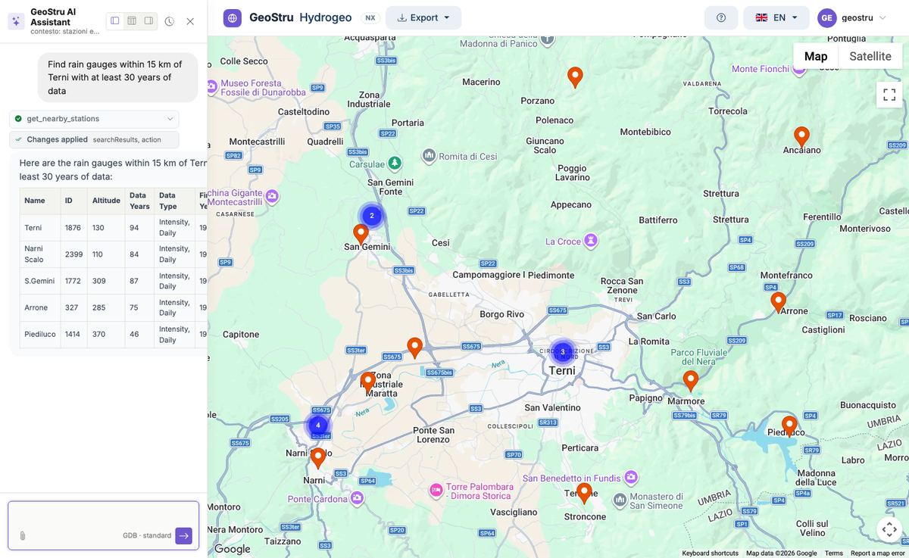
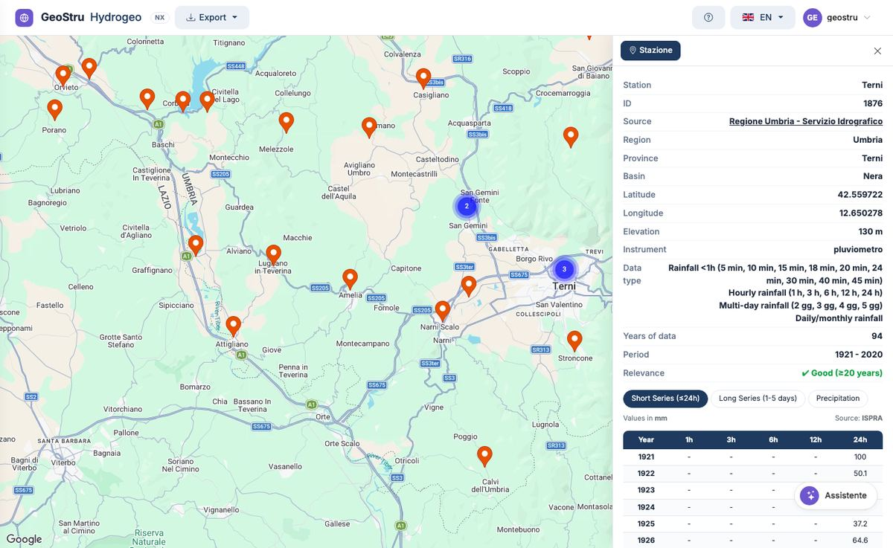
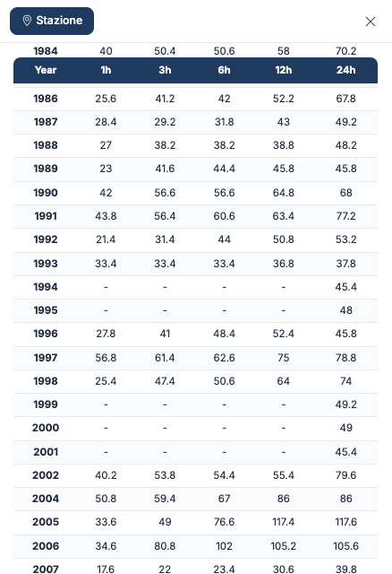

# Quick start — your first table in 5 minutes

In five minutes you find a real station, read its sheet and its annual maximum rainfall.

## 1. Open the app

Go to [nx.geostru.ai/hydrogeo](https://nx.geostru.ai/hydrogeo/) and sign in with your
GeoStru NX account. The top bar holds **Export**, the **?** help button, the language and the
user menu; the **Assistente** (assistant) button is at the bottom right.

The map opens **empty**: stations appear when you search for them.

## 2. Search for stations

Open the assistant and write what you need, for example:

```text
Find rain gauges within 15 km of Terni with at least 30 years of data
```

The assistant queries the database, places the stations on the map and lists them in a table
with name, elevation, years of data and data type.



You can also start from one of the assistant's **quick actions**, such as "Find stations in
Calabria". More examples in [AI assistant](assistente.md).

## 3. Open the sheet

Click an orange marker. The marker turns green and the **station sheet** opens on the right:
source, region, province, basin, coordinates, elevation, instrument, data types, years of
data, period and **relevance**.



Look at the **relevance**: "Good (≥20 years)" means a record long enough for a statistical
analysis.

## 4. Unlock the data

At the bottom of the sheet press **Unlock data**. Unlocking uses credits and includes the
first table; the details are in [Access and credits](crediti.md).

## 5. Read the annual maxima

The **Short Series (≤24h)** table opens: for each year, the maximum rainfall depth in 1, 3,
6, 12 and 24 hours, in millimetres. **Long Series (1-5 days)** and **Precipitation** show the
other two tables.



## Next steps

- **Export** the station: **Export** menu → CSV, Excel, PDF Report or PLV GeoStru. See
  [Exports and formats](formati.md).
- **Run the statistics** in Runoff Lab NX: **Import → From Hydrogeo NX…**. See
  [Links with the other NX apps](integrazioni.md).
- **Start from the project site** with Atlante NX: see [The complete workflow](workflow.md).

---

*Found an error on this page? [Let us know](mailto:info@geostru.ai?subject=Help%20Hydrogeo%20NX) or open a [Pull Request](https://github.com/EngSoft-Geostru/geostru-help-nx/edit/main/hydrogeo/docs/en/quickstart.md).*
