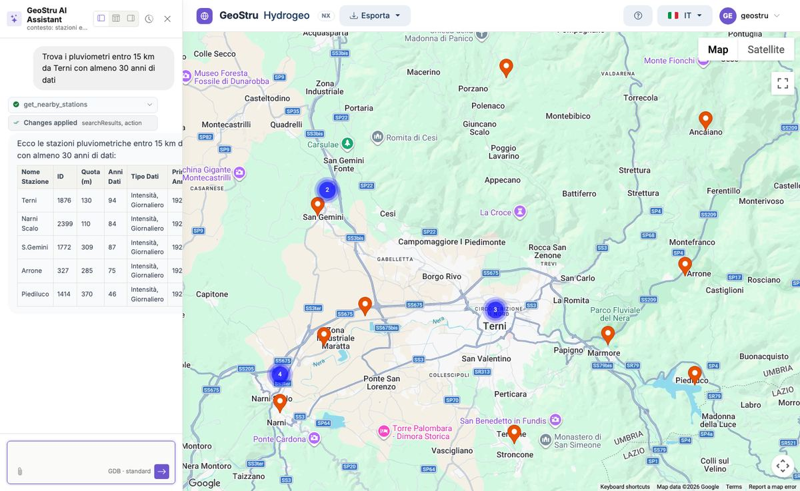

# Assistente AI

L'**Assistente** è il modo principale per cercare le stazioni. Lo apri con il pulsante in
basso a destra; il pannello si può agganciare a sinistra, a destra o in basso.

Scrivi con parole tue. L'assistente interroga il database di Hydrogeo NX, agisce sulla mappa
e ti risponde con tabelle e spiegazioni.

## Che cosa sa fare

| Richiesta | Esempio |
|---|---|
| Cercare per area | «Trova stazioni in Calabria», «Stazioni in provincia di Cuneo» |
| Cercare per bacino | «Pluviometri del bacino del Tevere» |
| Cercare attorno a un punto | «Pluviometri entro 15 km da Terni», «Stazioni entro 10 km da 45.07, 7.68» |
| Filtrare | «… con almeno 30 anni di dati», «… sopra i 1000 m», «… della fonte ARPAV» |
| Muoversi sulla mappa | «Vai su Bolzano», «Inquadra la Sardegna» |
| Selezionare | «Seleziona le prime tre», «Deseleziona tutto» |
| Leggere i dati | «Mostrami i massimi annui di Terni», «Riepilogo della stazione 1876» |
| Esportare | «Esporta Terni in Excel», «Esporta in formato GeoStru» |
| Contributi di bacino | «Contributi mensili del bacino…»: deflussi in l/s/km² e in mm, dove gli Annali li pubblicano |

Puoi **allegare** un file CSV o Excel (per esempio un elenco di stazioni o di coordinate) e
chiedere all'assistente di usarlo.

## Azioni rapide

All'apertura il pannello propone alcune **azioni rapide**: «Trova stazioni in Calabria»,
«Stazioni con 20+ anni in Puglia», «Esporta in formato GeoStru», «Apri RunoffLab per le
analisi», «Apri un ticket di supporto».

## Assistenza

Per un problema o una domanda sull'app, chiedi all'assistente di **aprire un ticket di
supporto**: descrivi la richiesta nel messaggio e la prende in carico il supporto GeoStru.

## Limiti

- L'assistente **non esegue statistiche**: per Gumbel, GEV, TCEV e le curve usa Runoff Lab
  NX.
- Le risposte sono generate automaticamente e **possono contenere errori**: i valori da
  usare sono quelli delle tabelle e delle esportazioni.
- Ogni messaggio usa crediti. Le esportazioni chieste all'assistente costano come quelle dal
  menu. Vedi [Accesso e crediti](crediti.md).

---

*Hai trovato un errore in questa pagina? [Segnalacelo](mailto:info@geostru.ai?subject=Help%20Hydrogeo%20NX) o apri una [Pull Request](https://github.com/EngSoft-Geostru/geostru-help-nx/edit/main/hydrogeo/docs/it/assistente.md).*
