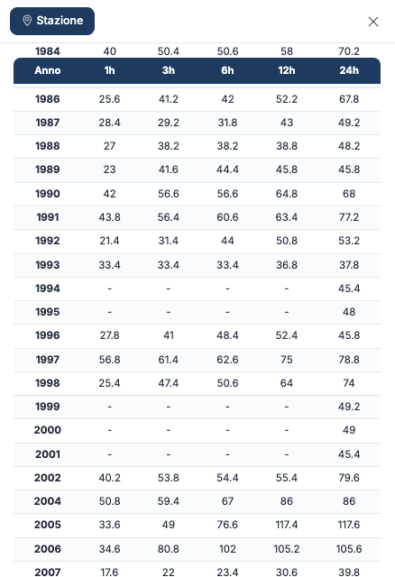
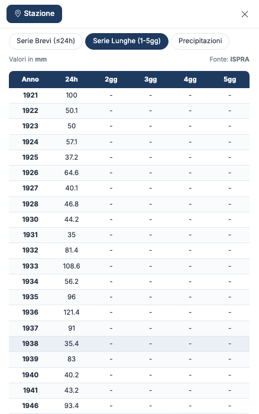
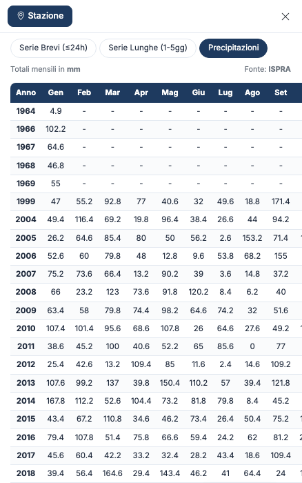

# Tabelle dei dati

Dopo lo sblocco, la scheda della stazione mostra tre tabelle. Passi dall'una all'altra con i
pulsanti sopra la tabella. Tutti i valori sono in **millimetri** e la fonte è indicata in
alto a destra.

## Serie Brevi (≤24h)

Per ogni anno, l'**altezza di pioggia massima** caduta in **1, 3, 6, 12 e 24 ore**
consecutive. È la serie da cui si ricava la curva di possibilità pluviometrica.

## Serie Lunghe (1-5gg)

Per ogni anno, la pioggia massima caduta in **1, 2, 3, 4 e 5 giorni** consecutivi (colonne
24h, 2gg, 3gg, 4gg, 5gg).

## Precipitazioni

I **totali mensili** di pioggia, da gennaio a dicembre, e il totale annuo nella colonna
**Tot**, ricavati dalle misure giornaliere.

## Come leggere le tabelle

- **Un trattino (–)** indica un valore che la fonte non ha pubblicato. Negli anni più vecchi
  è normale avere solo il massimo di 24 ore: le durate brevi richiedono un pluviografo.
- **Un anno che manca** dalla tabella non ha dati per quella serie.
- **Un valore 0** è un dato, non un dato mancante.
- I valori sono **come pubblicati dalla fonte**: Hydrogeo NX non corregge, non completa e non
  stima i dati mancanti.
- Una stazione con solo piogge giornaliere non ha serie brevi né lunghe: compare solo la
  tabella **Precipitazioni**, oppure il messaggio «Nessun dato disponibile per questa serie».

!!! tip "Serie per la statistica"
    Per Gumbel, GEV o TCEV ti servono le **Serie Brevi**, con almeno 20 anni di dati.
    Runoff Lab NX le importa direttamente: vedi [Collegamenti con le altre app NX](integrazioni.md).

## Crediti

La prima tabella che si apre subito dopo lo sblocco è inclusa. Le altre tabelle, e la stessa
tabella riaperta più tardi, usano crediti. Vedi [Accesso e crediti](crediti.md).

---

*Hai trovato un errore in questa pagina? [Segnalacelo](mailto:info@geostru.ai?subject=Help%20Hydrogeo%20NX) o apri una [Pull Request](https://github.com/EngSoft-Geostru/geostru-help-nx/edit/main/hydrogeo/docs/it/dati.md).*
