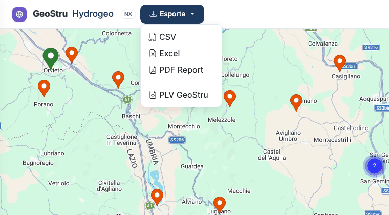

# Esportazioni e formati

Il menu **Esporta**, in alto, esporta l'**ultima stazione selezionata**. Se non hai
selezionato nessuna stazione, l'app te lo chiede.



## I formati

| Formato | Contenuto | Per che cosa |
|---|---|---|
| **CSV** | I massimi annui, una riga per anno e durata | Fogli di calcolo, script, altri software |
| **Excel** | Tre fogli: **Stazione** (anagrafica), **Intensita** (massimi annui), **Misure** (precipitazioni) | Controllo e elaborazioni in Excel |
| **PDF Report** | La relazione della stazione | Allegato alla relazione tecnica |
| **PLV GeoStru** | Anagrafica e massimi annui nel formato di interscambio GeoStru | Software desktop GeoStru |

### CSV

Testo UTF-8, separatore **punto e virgola**, punto come separatore decimale. Prima riga di
intestazione:

```text
station_name;region;year;month;day;duration_hours;precipitation_mm;data_type
```

`duration_hours` è la durata in ore (1, 3, 6, 12, 24, 48…), `precipitation_mm` l'altezza di
pioggia massima dell'anno per quella durata.

### Excel

Un file `.xlsx` con i fogli **Stazione**, **Intensita** e **Misure**, pronto da filtrare e
da usare nei grafici.

### PDF Report

Una relazione impaginata, **in italiano**, con:

- l'anagrafica della stazione;
- la tabella delle **Serie brevi (1h – 24h)**;
- la tabella delle **Serie lunghe (1 – 5 gg)**;
- in chiusura il blocco **«Software utilizzato»**: nome e versione del programma,
  licenziatario, un **codice** e l'indirizzo dove chiunque può verificarlo online, e
  l'impronta dei dati usati.

### PLV GeoStru

Un file di testo a sezioni:

```text
[STATION]
Name=Terni
Region=Umbria
Province=Terni
Latitude=42.559722
Longitude=12.650278
Altitude=130.00
Basin=Nera

[INTENSITY_DATA]
Duration(h);Year;Precipitation(mm)
1;1937;16.6
…
```

È il formato di interscambio dei dati di pioggia dei software desktop GeoStru.

!!! note "Runoff Lab NX"
    Per portare una stazione in Runoff Lab NX **non serve un file**: Runoff Lab la importa
    direttamente da Hydrogeo NX. Vedi [Collegamenti con le altre app NX](integrazioni.md).

### XML HydrOnline

Su richiesta, l'[assistente](assistente.md) esporta la stazione anche in formato XML
HydrOnline.

## Licenza e crediti

Ogni file riporta il **nome del licenziatario**. Ogni esportazione usa crediti; se la ripeti
identica a breve distanza non paghi di nuovo. Vedi [Accesso e crediti](crediti.md).

---

*Hai trovato un errore in questa pagina? [Segnalacelo](mailto:info@geostru.ai?subject=Help%20Hydrogeo%20NX) o apri una [Pull Request](https://github.com/EngSoft-Geostru/geostru-help-nx/edit/main/hydrogeo/docs/it/formati.md).*
