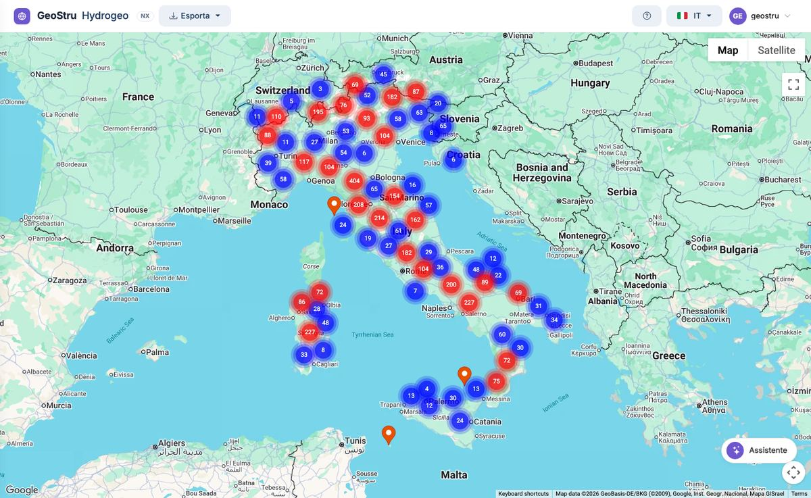

# Hydrogeo NX — Dati pluviometrici

**Hydrogeo NX** raccoglie su una mappa i dati di pioggia italiani pubblicati da **ISPRA**
negli Annali Idrologici e dai **servizi idrologici regionali**. Trovi le stazioni attorno
al tuo sito, leggi i **massimi annui di pioggia** da 1 a 24 ore e da 1 a 5 giorni e le
**precipitazioni mensili**, e porti le serie nel tuo studio o in
[Runoff Lab NX](https://help.nx.geostru.ai/runofflab/it/) per l'analisi statistica.

[**Apri l'app**](https://nx.geostru.ai/hydrogeo/){ .md-button .md-button--primary }
[Guida rapida](quickstart.md){ .md-button }

## Il database

- **Oltre 6.000 stazioni pluviometriche** in tutte e venti le regioni.
- **Oltre 4.000 stazioni con le serie dei massimi annui** per durata.
- **Dati dal 1916** all'ultimo anno pubblicato da ciascuna fonte.
- **Solo fonti ufficiali**: ISPRA e dodici servizi regionali. L'elenco è in
  [Fonti e limiti dei dati](fonti.md).

I numeri esatti del momento sono nel riquadro del pulsante **?** dell'app.

## Che cosa fa e che cosa non fa

Hydrogeo NX è il **passaggio dei dati**: trova le stazioni, mostra i valori come li ha
pubblicati la fonte e li esporta.

**Non esegue elaborazioni statistiche.** Le distribuzioni di probabilità (Gumbel, GEV,
Pearson III, TCEV), le curve di possibilità pluviometrica h = a·tⁿ, gli ietogrammi e gli
idrogrammi sono in **Runoff Lab NX**, che importa le serie direttamente da Hydrogeo NX.
Vedi [Collegamenti con le altre app NX](integrazioni.md).

## A chi serve

A ingegneri idraulici, geologi, idrologi e consulenti ambientali che hanno bisogno di dati di
pioggia affidabili per fognature e drenaggio urbano, studi di compatibilità idraulica,
invarianza idraulica, studi di piena, tombini e vasche di laminazione.

## Come si lavora

1. **Cerchi le stazioni** chiedendolo all'[assistente](assistente.md): la mappa si apre
   vuota e si popola con i risultati della ricerca.
2. **Apri la scheda** di una stazione con un clic sul segnaposto: fonte, posizione, anni di
   dati, giudizio di rilevanza. Vedi [Mappa e scheda della stazione](mappa.md).
3. **Sblocchi i dati** e leggi le [tabelle](dati.md): serie brevi, serie lunghe,
   precipitazioni mensili.
4. **Esporti** la stazione in CSV, Excel, PDF o PLV. Vedi [Esportazioni e formati](formati.md).
5. **Porti la serie in Runoff Lab NX** per la statistica.

## Capitoli

- [Guida rapida (5 minuti)](quickstart.md) — dalla ricerca alla prima tabella.
- [Il lavoro completo](workflow.md) — dal sito del progetto alla curva di possibilità pluviometrica.
- [Mappa e scheda della stazione](mappa.md)
- [Tabelle dei dati](dati.md)
- [Assistente AI](assistente.md)
- [Esportazioni e formati](formati.md)
- [Collegamenti con le altre app NX](integrazioni.md) — Atlante, Runoff Lab, HID, GeoDropbox.
- [Accesso e crediti](crediti.md)
- [Fonti e limiti dei dati](fonti.md)
- [Glossario](glossario.md)
- [Domande frequenti](faq.md)

---

*Hai trovato un errore in questa pagina? [Segnalacelo](mailto:info@geostru.ai?subject=Help%20Hydrogeo%20NX) o apri una [Pull Request](https://github.com/EngSoft-Geostru/geostru-help-nx/edit/main/hydrogeo/docs/it/index.md).*
