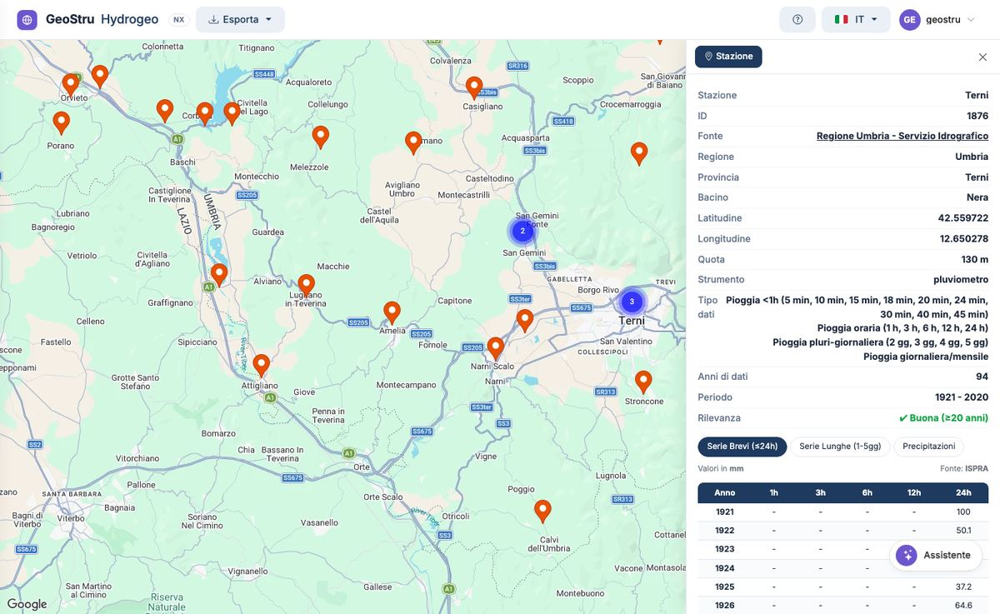
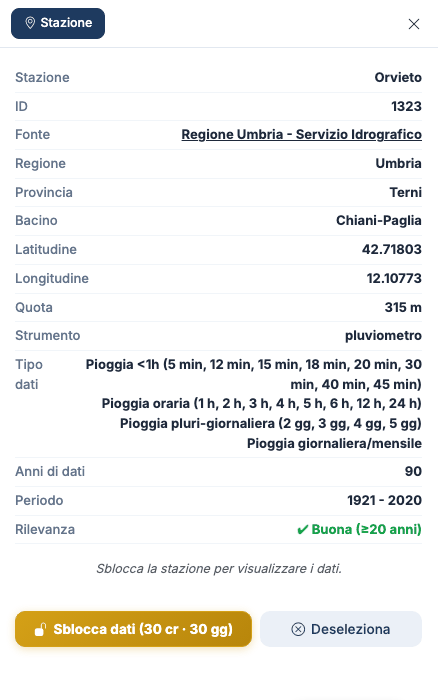

# Mappa e scheda della stazione

## La mappa

La mappa si apre **vuota**. Le stazioni compaiono quando le cerchi con
l'[assistente](assistente.md), o quando arrivi da Atlante NX con il sito del progetto.

- I **segnaposto arancioni** sono le stazioni trovate; quelli **verdi** le stazioni
  selezionate.
- Quando allarghi la vista, le stazioni vicine si **raggruppano** in un cerchio con il
  numero di stazioni: avvicinati o fai clic sul cerchio per separarle.
- Le stazioni nello **stesso punto** (per esempio vecchia e nuova stazione dello stesso
  comune) si aprono a ventaglio al clic.
- In alto a destra scegli **Map** o **Satellite**; l'app ricorda la scelta.
- Le stazioni trovate e quelle selezionate restano sulla mappa finché non chiudi la scheda
  del browser.

Il segnaposto rosso **Sito (Atlante NX)** indica il sito del progetto quando apri Hydrogeo NX
da Atlante NX. Vedi [Collegamenti con le altre app NX](integrazioni.md).

!!! note "Stazioni senza coordinate"
    Alcune stazioni storiche degli Annali non hanno coordinate nel database. L'assistente le
    trova e ne mostra i dati, ma non possono comparire sulla mappa.

## La scheda della stazione

Un clic su un segnaposto seleziona la stazione e apre la **scheda** a destra.

| Campo | Che cosa indica |
|---|---|
| **Stazione** | Nome della stazione, come lo riporta la fonte |
| **ID** | Identificativo della stazione in Hydrogeo NX: serve per chiederla all'assistente |
| **Fonte** | Ente che pubblica i dati, con il collegamento quando esiste |
| **Regione**, **Provincia**, **Bacino** | Posizione amministrativa e bacino idrografico |
| **Latitudine**, **Longitudine** | Coordinate in gradi decimali (WGS84) |
| **Quota** | Quota della stazione in m s.l.m. |
| **Strumento** | Tipo di strumento: pluviometro, pluviografo, termo-pluviometro… |
| **Tipo dati** | Che cosa misura la stazione: pioggia sotto l'ora, oraria, pluri-giornaliera, giornaliera/mensile |
| **Anni di dati** | Numero di anni con dati |
| **Periodo** | Primo e ultimo anno con dati |
| **Rilevanza** | Giudizio sulla lunghezza della serie |

### La rilevanza

| Giudizio | Anni di dati | Uso |
|---|---|---|
| ✔ **Buona** | 20 o più | Adatta a un'analisi statistica dei massimi |
| ⚠ **Media** | da 10 a 20 | Da usare con cautela, meglio confrontarla con stazioni vicine |
| ✘ **Bassa** | meno di 10 | Insufficiente da sola per la statistica |

La rilevanza guarda solo il **numero di anni**, non la continuità della serie: una stazione
con 30 anni sparsi su un secolo resta «Buona». Controlla sempre il periodo e la tabella.

### «Tipo dati» e tabelle

La voce **Tipo dati** elenca anche durate inferiori all'ora (5, 10, 15 minuti…) quando la
fonte le pubblica. Le tabelle dell'app mostrano le durate di 1, 3, 6, 12 e 24 ore e da 1 a 5
giorni: vedi [Tabelle dei dati](dati.md).

## Selezionare e deselezionare

- Puoi selezionare **più stazioni**: ognuna diventa verde.
- L'**esportazione** riguarda l'ultima stazione selezionata.
- **Deseleziona**, in fondo alla scheda, toglie la stazione dalla selezione; la **×** in alto
  chiude la scheda.

## La stazione da sbloccare

Finché non la sblocchi, la scheda mostra i dati anagrafici e il pulsante **Sblocca dati** al
posto delle tabelle.

Che cosa costa lo sblocco e quanto dura è spiegato in [Accesso e crediti](crediti.md).

---

*Hai trovato un errore in questa pagina? [Segnalacelo](mailto:info@geostru.ai?subject=Help%20Hydrogeo%20NX) o apri una [Pull Request](https://github.com/EngSoft-Geostru/geostru-help-nx/edit/main/hydrogeo/docs/it/mappa.md).*
